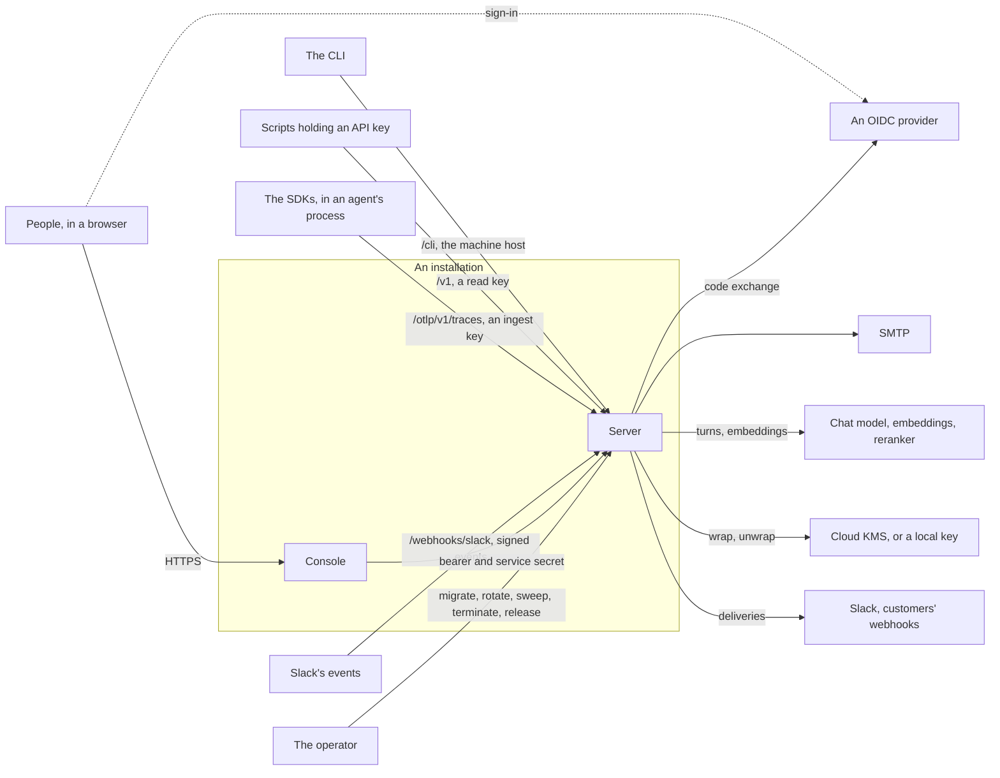
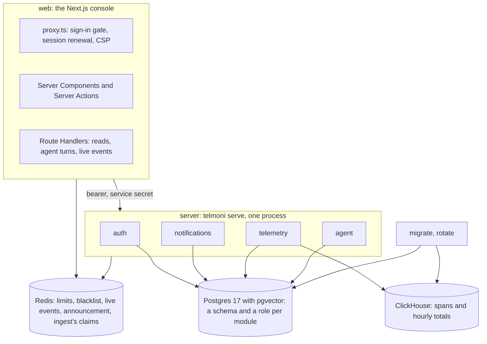
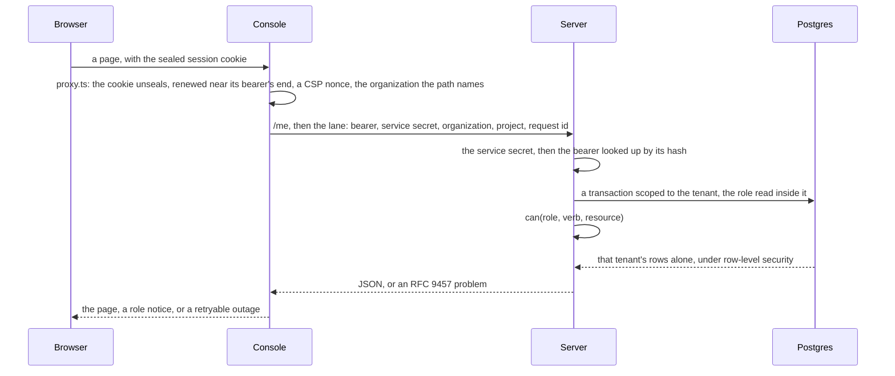
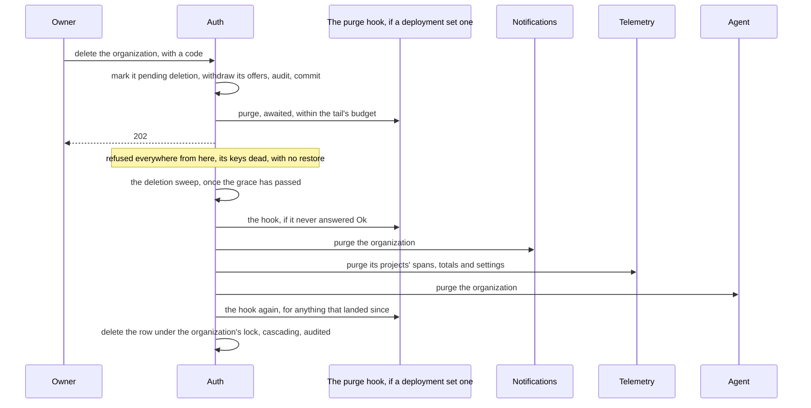
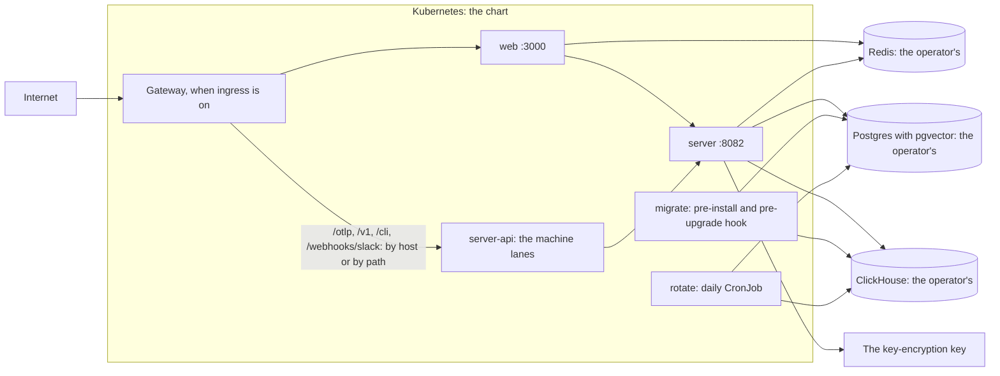

# Architecture

Telmoni's core on one page: what it is for, what it is made of, how a request moves through it, how tenants are kept apart, how data lives and is erased, how it runs, how it fails, and why it is built this way. It is the repository's one document on how the core is built: the detail behind each line is in the code it names, the code's comments and its tests.

**Where it stands:** Telmoni has not launched. What runs is the foundation: organizations and projects, members and roles, API keys, notifications, a hash-chained audit log and a read-only console agent. The telemetry the product is for has its module and its two stores, its ingest lane, the four SDKs under `sdk/` that send a run to it, and the console's first reads of one: traces, sessions and users; the monitor an agent is held to, with the lanes that make one; and the ping lane a crontab reports its runs through, with the project's ping keys and their rotation. The ticker that watches a monitor, and alerts, are next ([Where it goes next](#where-it-goes-next)).

## Contents

- [Purpose and scope](#purpose-and-scope)
- [Goals and constraints](#goals-and-constraints)
- [Context](#context)
- [Building blocks](#building-blocks)
- [How a request moves](#how-a-request-moves)
- [Identity and access](#identity-and-access)
- [Data](#data)
- [Notifications](#notifications)
- [The console agent](#the-console-agent)
- [The SDKs](#the-sdks)
- [Background work](#background-work)
- [Deployment](#deployment)
- [Extending the core](#extending-the-core)
- [Conventions everywhere](#conventions-everywhere)
- [When something fails](#when-something-fails)
- [Scale](#scale)
- [Where it goes next](#where-it-goes-next)
- [Decisions](#decisions)
- [Known gaps](#known-gaps)

## Purpose and scope

Telmoni is a privacy-first telemetry and monitoring platform for AI agents, open source under Apache-2.0. This repository is its core: everything an installation runs. Today that is the multi-tenant foundation the telemetry will stand on:
- organizations and projects, members and roles;
- API keys, and a read API, `/v1`;
- notifications, to an in-app feed, Slack and webhooks;
- a hash-chained audit log, exportable by range;
- a read-only console agent that answers from the docs and a project's own data;
- telemetry: ingest over OpenTelemetry's own protocol, behind a project API key, with every content field dropped at the door; each project's settings in Postgres, its content mode set by the organization's owner and the key its user ids are hashed under; and the spans and their hourly totals in ClickHouse.

It is **one Rust binary**, `telmoni`, and **a Next.js console** beside it, deployed together with a Helm chart or Docker Compose. A deployment that needs more builds its own binary and console on these crates rather than forking them ([Extending the core](#extending-the-core)).

| For | Read |
|---|---|
| What the product does for a customer | The book, [`telmoni/docs`](https://github.com/telmoni/docs), which the console builds in from `web/content/docs` and serves at `/docs` |
| Running it yourself | The book's self-host pages, `content/self-host` in `telmoni/docs` |
| Developing it | `README.md` and `AGENTS.md` |

## Goals and constraints

**What the design must hold:**

| Goal | How |
|---|---|
| **One tenant never sees another's data** | A database role per module; the tenant bound into every transaction's type; forced row-level security; one permission matrix; work across tenants only through a module's own maintenance lane |
| **Every change is accounted for** | Its audit row commits in the same transaction, on a chain per organization that is verified daily |
| **What a customer deletes is gone** | Deletion is a saga across every module, finished by a sweep, with no restore once its grace has passed |
| **Secrets and personal data never leak** | `Redacted` in memory, ids alone in logs, problems that carry no internals, and connector grants sealed row by row under a key-encryption key |
| **Nothing is lost when a process stops** | Every loop is leader-locked, leased or chunked, and work begun by a request is either awaited or backed by a sweep |
| **It is simple to run** | One binary, one console, one Postgres, one ClickHouse, one Redis; configuration only from the environment; the chart on a cluster, or Compose on one machine |

**What it is not, on purpose:**
- **Microservices.** The modules are libraries in one process, and never call each other over the network.
- **A console with logic.** The console renders and relays; every rule is in Rust.
- **Signed tokens.** Every token is opaque and stored as its hash, so nothing needs a signing key.

**What it must live with:**
- **Nothing has shipped.** Schemas, wire contracts, Redis keys and APIs change in place: one migration per module and store, edited, and no migration path (`AGENTS.md`).
- **It is built in the open**, under Apache-2.0, and names no deployment built on it.
- **Self-hosting is a first path**, not an afterthought: Compose on one machine, or the chart on any cluster.

## Context

Who and what an installation talks to.



| Party | What it is to the core | What crosses |
|---|---|---|
| **People** | An organization's owner, admins and members, in a browser | Pages, Server Actions and the console's reads under `/api`, under a sealed session cookie |
| **The CLI** | `telmoni/telmoni-cli`, signed in by a device grant | The `/cli` lanes: start, poll, refresh, `/me`, sign-out |
| **Scripts** | Whoever holds a project's API key | `/v1`, read-only today |
| **The SDKs** | `sdk/`: Python, TypeScript, Go and Rust, linked into an agent's own process (*The SDKs*) | `/otlp/v1/traces` on the server: a run's spans as OTLP JSON, content taken off, under a project API key with the `ingest` scope |
| **Slack's events** | Slack telling the core an app was removed or its tokens revoked | Signed events, verified by the server |
| **An OIDC provider** | Optional: who a person is, beside or instead of the password form | Discovery, the code exchange, an RS256 id token, logout |
| **SMTP** | Mail: verification, reset, invitations, codes | Each message |
| **Models** | The agent's chat model (Anthropic, or anything OpenAI-compatible), embeddings and an optional reranker: the operator's, and never egress-guarded | A turn's text and the passages it reads; every passage the agent indexes |
| **The key-encryption key** | A Cloud KMS key on a cluster, a local key on a laptop | Each connector row's data key, to wrap or unwrap |
| **Slack, customers' webhooks** | Where notices are delivered | Each notice; a webhook's signed |
| **The operator** | Whoever runs the installation | Subcommands, feature flags, the log level |

## Building blocks



| Block | What it is | What it keeps |
|---|---|---|
| `telmoni` | The binary: `App`, `Parts`, `Module` and `run`; `serve` and the subcommands; the sweeps' timers | — |
| `auth` | Identity, sessions and the one issuer; organizations, projects, rosters, invitations and transfers; API keys; flags; export, audit exports and deletion; `/me` and `/v1` | The `auth` schema |
| `notifications` | The feeds, the connectors, the delivery queue and its loop, Slack's events, the uninstalls a delete, or an install refused after Slack's exchange, files (`uninstall.rs`); the retention sweep, which also finishes a deleted project's purge its delete could not | The `notifications` schema |
| `agent` | Model adapters, embeddings, the index and hybrid search, five read-only tools, the turn loop | The `agent` schema, with pgvector |
| `telemetry` | Ingest at `/otlp/v1/traces`: the contract (`contract.rs`, with the field inventory as a table the docs page and the console are held to), the span read by it with its content dropped (`ingest/`), the claim on each export and the rate limit in Redis, auth asked again once an export's rows are in whether its project outlived the write, a project deleted as they landed having its spans marked deleted once more — the write and its settling a task of their own, which an exporter that stops waiting does not cut short, and a body not arrived within a minute refused, so no export outlasts an organization's deletion grace (`handler/ingest.rs`), the nudge that tells the console's open pages of each export kept (`live.rs`), and each project's hashing key, made by its first export with the project's settings row, filed under the organization that holds the project then, read with the project held in place (`hashing.rs`); each project's settings, and the switch its organization's owner sets its content mode with; the console's reads — the trace list, a page at a time with its total, each filter's values counted, the runs over the window as a histogram on the reader's clock, a download of it, and a trace's spans (`traces.rs`, `handler/traces.rs`), the users and the sessions, a run's spans summed by user and by session (`users.rs`, `sessions.rs`, their handlers), the field inventory (`handler/field_inventory.rs`) — each through the one query module for ClickHouse, which names the reader's projects on every read; each project's saved views of its trace list and saved layouts of a session's page and a trace's, two kinds of one row, in Postgres (`handler/views.rs`), and the layout its sessions and traces open in, one of those layouts or the console's own default, which a deleted layout hands back to (`handler/session_layout.rs`); the session lane's pinned spans, the spans a layout names under each trace, read with the session (`traces::pinned`); each project's monitors — an agent's contract: when its runs are expected, read as a crontab reads a line and timed in the monitor's own zone (`schedule.rs`), how long past its due time one may start, how long one may go quiet, how many steps it may take and what it may spend — made, changed, paused, resumed and deleted through the console's lanes, each made under the organization's chain lock and held to the plan's ceiling — read before the lock and within a second, so a deployment slow to answer it holds nobody else on the chain — and each change recorded on the chain, a delete taking the monitor and, by the cascade, its open runs once the pings holding it are done — every writer of a monitor and its runs takes the monitor first: a ping holds it from its read, a purge, once it holds the project, deletes its monitors before any other row, their runs going with them, and a move holds them before it rewrites anything — every timing searched as it is sent, so one that never comes is refused, and a saved one that a later release cannot read logged and its monitor due at no time until a read succeeds again — at its next run's end once a release can read it, or at a save — never a ping or a resume refused for it (`handler/monitors.rs`); the ping lane, `/ping/{ping_key}/{slug}` and its `/start`, `/checkpoint` and `/fail`, which a crontab's `curl` reaches with the project's ping key in the URL and nothing else — the key resolved outside any tenant as an API key is, and refused as one unknown once auth says its organization's deletion is marked, the project held in place against a transfer or a purge while the ping writes, a run opened, heard and ended on its open row, keyed by the project and the run's id, so a `rid` names a run within its project alone, a ping that finds its run opened beside it by another of the run's pings hearing it rather than opening a second, a checkpoint's steps and spend kept only where they are more than the run holds, the monitor settled from its row as it stands once held as the write holds it, so a pause or a save the console commits while the ping is under way stands, and one the console commits after a settling writes over the monitor as the ping left it — a save keeping its timing keeps the due time the run's end moved it to, a pause records the state it paused, held as its write holds it, and neither puts the monitor's clocks back past the ping's — and a ping that waited out its monitor's delete making the monitor anew, as a first ping does — a run that never said it ended, ended as `error` by the next ping that finds it, and every run given a ceiling for the ticker to end it by — a slug no monitor has making one as `new`, with an hour's stall timeout until its owner sets one, and the owner told once (`notify.rs`), the organization's open consoles told of each ping heard, so a page reading the project's monitors draws itself again (`live.rs`), a body dropped and the answer saying so, and no answer one a cache on the way may keep, the door's refusals before it included, since a `GET` there records a run (`handler/pings.rs`); the project's ping keys, two live at once for a rotation, shown once and kept hashed, each minting and retiring recorded (`handler/ping_keys.rs`), the older retired a week after its last ping by a loop of the module's own (`rotation.rs`) — each key on its own, its staleness and the newer key asked again by the statement that retires it, so a ping since the tick's read keeps it, under the organization the key is filed under when it is retired, and one that cannot be retired then, its project moving or being purged, or its organization's chain lock busy, left for the next tick while the tick goes on, unless the database has stopped answering — and the project told through the outbox in the same transaction (`notify.rs`); the outbox, where a finished run waits to be a row of `spans` and a notice to reach the project's feed, drained by a loop every replica runs, which reads which of a batch's runs `spans` holds before it inserts, so a run is written once, and hands a row back with its try when ClickHouse is the fault, so an outage strands nothing and only a row it refused reaches the cap, past which `telmoni release outbox` tries it again, and files a notice where auth holds its project when it asks, or nowhere once its organization's deletion is marked or the project is gone, a project found gone before the write or after it purged from notifications once more, and lands a run by the same rule, a project found gone before the insert or after it marked deleted in ClickHouse once more (`outbox.rs`); the dogfood observer, which records the console agent's own questions as runs of a project of the operator's (`dogfood.rs`); the purge that marks a deleted project's rows in both tables and then deletes its rows here, each project held alone meanwhile as a move holds it, so no ping writes beside it, as auth's deletions ask through the seam (`seam.rs`, `store.rs`), and a project's purge cut short tried again by a loop of the module's own every ten minutes on every replica, which finds it by the settings row it left once auth no longer has the project (`sweep.rs`); the ClickHouse file and its nightly purge | The `telemetry` schema, and ClickHouse's `telemetry` database |
| `shared` | Errors and problems, RBAC, `Acting`, scoped transactions, the seams, the audit writer and verifier, envelope encryption, the egress guard, logging, configuration, `Redacted`, slugs | — |
| `migrator` | The migration runner, `rotate`, the `audit` schema, role hardening and grants; ClickHouse's file, its purge and the rewrite of the rows deleted projects left, run as its user there | The `audit` schema |
| `web/` | The console: pages, the session, the edge's rate limits, the Route Handlers — the reads a page makes after it loads, and the relays of agent turns and live events — and the book, which lives in its own repository, `telmoni/docs`, and is laid into `content/docs` before the console builds (`scripts/book.sh`); no database access and no business logic | Nothing but what Redis holds |
| `sdk/` | The four SDKs, in an agent's own process: a tracer provider of each one's own, a batch processor, and an exporter that takes content off and sends OTLP JSON to ingest (*The SDKs*); `fixtures/`, the golden export and the answers every suite replays | A bounded queue, in memory, until it is sent |
| Postgres | One database: a schema per module, each written by its own role alone | Everything durable but the spans and their totals |
| ClickHouse | One node: telemetry's spans and their hourly totals, metadata alone, read under a row policy | The spans, until the retention line, and their hourly totals for 13 months |
| Redis | The console's rate-limit windows, session blacklist, live events and announcement, and the server's claims on each export, the machine lanes' limits and the nudges that tell the console's pages of each export kept — all of it losable | Nothing that must survive |

## How a request moves



A write takes the same path through a Server Action, its audit row committed with the change, and answers with the page drawn again, or with the next one when the write moves it (a rename, a deletion). A read a page makes after it loads — the search palette's index, the agent's history, a connector's deliveries, a trace opened over the trace list — takes it through a Route Handler under `/api`, as a `GET`: an action is for writes, and a browser sends them one at a time.

Every way in:

| Way in | Path | Gate |
|---|---|---|
| A page, a Server Action or a read under `/api` | Browser → console → the server's `/internal` lanes | The sealed cookie, then the service secret and the bearer, then the matrix, then RLS |
| `/v1` | A script → the machine host → the server's door → auth's lanes | The door's limits by address and key; the API key's `read` scope; the organization's switch |
| `/cli` | The CLI → the machine host → the server's door → auth's lanes | The door's limits by address and bearer; the device code, or the bearer; never a browser |
| `/ping` | A crontab line → the machine host → the server's door → the ping lane | The door's limits by address and key, the key taken as minted; the key in the path, or a 404, as for one whose organization's deletion is marked; the organization not paused |
| Ingest | An SDK, or any OTLP exporter → the machine host → the server's door → `/otlp/v1/traces` | The door's limit by address, keyed or not; the API key's `ingest` scope; the project's own limit; then the contract: a span outside a run refused, content dropped |
| Slack's events | Slack → the machine host → `POST /webhooks/slack` | Slack's signature |
| An agent turn | The agent's window → `POST /api/agent/turns` → the server, streamed back | The session, then a turn as the asker, re-resolved as it runs |
| Live events | `EventSource` → `/api/events` → Redis's channels, which the console's own actions publish on, and telemetry for each export it keeps and each ping it hears (`live.rs`: a nudge on the organization's channel, never the data) | Same origin, the session, the blacklist |

**The console is the one public surface for people, and the machine host the one for machines.** A person's every request enters through the console, which calls the server with the service secret; that secret proves only that a call came from inside, and who is asking is auth's answer on every request. A machine reaches the server straight, on the lanes the binary's door puts in front of (`crates/telmoni/src/door.rs`): ingest at `/otlp/v1/traces` and the read API under `/v1`, each opened by a project API key; the CLI's session lanes under `/cli`, opened by the device code or the bearer they carry; the ping lane under `/ping`, opened by the key in its path; and Slack's signed events at `/webhooks/slack`. The door reads the caller's address past the proxies in front (`TRUSTED_PROXY_HOPS`) and meters `/v1`, `/cli` and `/ping` by source and by credential in Redis, and every refusal it makes is a problem document, as is the server's answer for a path no lane serves — a lane's root with a trailing slash among them, which a router nested at the lane's name never sees; ingest keeps a limit of its own, per project, and Slack's events their signature. A request is named by the server alone: an `x-request-id` it arrives with is taken off, whoever sent it, and an id minted in its place, the one its span prints on every log line and its audit rows record (`crates/shared/src/middleware/http.rs`), since on a machine lane the header is the caller's free text, and nothing there compares the service secret, which would make a public lane an oracle for it.

## Identity and access

**Who is asking** is auth's answer, `Acting`, on every request: the person, the organization, both roles, the session.
- **One issuer.** The password form, an OIDC provider and the CLI's device grant all end in the same opaque session — a short-lived bearer and a refresh token rotated on every use — stored as hashes. An external provider only answers "who is this".
- **Ending a session holds on the next request**, since every request looks its bearer up.
- **The console's side** is a sealed cookie holding the session's tokens, renewed near expiry only where the cookie can be written: by an open tab's heartbeat through its own Route Handler, and otherwise by the proxy before anything renders (`web/lib/proxy/session.ts`), on every path but the sign-in's callback and the sign-out, which write the cookie themselves; the proxy writes the renewed cookie both into the request the page renders with and onto the answer the browser keeps. Never by a page, which cannot write it: auth takes a refresh token presented again past its thirty seconds' grace as a copy somebody kept, and ends the session. The requests a page sends together share one renewal in each process, auth's grace covering the few a second replica sends; a refusal clears the cookie; and an auth that does not answer leaves the session to be asked about again within that grace, since auth may have spent the token before its answer was lost.
- **API keys** are minted on a project, hashed, shown once, with an expiry and a rotation grace.
- **Abuse limits** are where the cost is: lockouts and a decoy hash in auth, capped codes and links, and per-person and per-address windows at the console's edge.

**What they may do** is one matrix, `can(role, verb, resource)`, for every module, with every cell pinned by a test. An organization has one owner, admins and members; a project's seats are admins and members, and a seat never lowers what the organization's role gives.

**Which rows they may touch** is bound into the transaction's type, `Scoped<Binding>`, and enforced by forced row-level security, where an empty binding matches nothing.
- **Work across tenants** — the bearer lookup, invitations, sweeps, the indexer, the delivery loop — runs in the module's own maintenance lane, never as a wildcard.
- **Beneath it all, no request value is spliced into SQL**, and a test reads every query to keep it so.
- ⚠ **Compose's quickstart connects as the superuser**, and to ClickHouse as the one user that made its tables, so RLS, the row policy, the grants and the roles' timeouts do not apply there; what separates tenants then is each query's own `WHERE` (in ClickHouse, the one query module's), the membership checks and the constraints.

## Data

```text
audit           events, partitioned by month: one hash chain per organization
auth            people, credentials, sessions, organizations, projects, rosters, invitations,
                transfers, API keys, flags, audit exports
notifications   feed, connections, deliveries, delivery_attempts, oauth_states,
                uninstalls (a vendor app to uninstall where a delete, or a refused install, left no connection)
agent           chunks (a vector and a text index), conversations, messages, cursors, erasures
telemetry       project_settings (the content mode; the project's hashing key, sealed under TELEMETRY_KEK;
                the saved layout its sessions and traces open in, if one),
                trace_views (a project's saved views of its trace list, and its saved layouts of a
                session's page and a trace's: one table, two kinds),
                monitors (an agent's contract: its schedule and zone, grace, expected duration and
                bounds, its state and when its next run is due),
                ping_keys (a project's ping keys, kept as their hashes, two live at once),
                open_runs (a row per run still going, keyed by the project and the run's id: when
                it started and was last heard, its steps and spend so far, and the bounds it is
                held to),
                outbox (a finished run on its way to spans, a notice on its way to the feed)

ClickHouse, telemetry's database:
spans           a row per finished span, partitioned by the day it arrived, its run ids under a bloom filter for a trace's read
spans_hourly    their totals by hour, partitioned by month, fed by a view
migrations      the digest of the statements the store was made from
```

- **One migration per module and store**, edited in place before launch. The migrator runs `audit`, then `auth`, then the rest by name, then the grants, then ClickHouse's one file.
- **The audit log** is append-only by its grants, one chain per organization written under an advisory lock, in a frozen hash format pinned by golden vectors. A writer of several chains, or of several organizations' locks, takes them by id compared by byte, not by the database's collation, which orders mixed-case ids otherwise. It is verified daily and never repaired; `rotate` makes its partitions ahead, and none is dropped. An owner or admin exports a range as a file that verifies on its own.
- **A project's move** to another organization — a transfer's accept, an owner's move, the settling of either — holds the project's move lock alone to its commit, taken once its checks have passed and before both organizations' chain locks; a ping, and the rotation retiring a ping key, try the lock shared as their transaction's first lock and read the organization their rows are filed under only once they hold it. A ping a move keeps out lets go of its connection and tries again, less often the longer it waits, for two seconds, then answers 409; a key is left for the rotation's next tick. So a move waits for the pings in flight — as long as its role's `lock_timeout` lets it, then a 409 to try again — keeping new ones out meanwhile, and takes their rows with the rest; a ping let in after a move files its rows where the project went; and the pings kept out hold no connection while they wait (`telmoni_shared::db::project_move`). Telemetry's purges take the same lock alone, for every project whose rows they delete, so a ping in flight is waited for — two seconds at most, the purge's `lock_timeout`, and for a project's purge less what the store's mark took, since auth gives it two seconds whole; past them the purge fails, a project's then tried again by telemetry's own sweep within ten minutes, as one ClickHouse does not take is, and an organization's by auth's deletion sweep — and its rows go with the rest, and one kept out, let in once the purge commits, finds its key gone, a 404. A project's purge deletes its ping keys before anything else, on their own, so its lane is closed whatever fails after. A move takes both organizations' membership locks before it writes anything; the seat lanes (a seat's role, its removal, its holder leaving), the hand-over's (an offer, its withdrawal, its decline), the project's delete, its key lanes (a key minted, rotated, revoked) and an invitation sent or withdrawn take the organization's first and read under it the caller's role, then where the project is, so one queued behind a move is refused — a 409 to anybody still holding a role on it there, the stranger's refusal to anybody else — rather than acting for the organization that gave the project up and filed on its chain; an invitation accepted or declined reads where the project is again under the lock it takes after the person's, so somebody answering as the project moves is told to try again rather than seated on it and enrolled where it was. Every one of those waits is bounded by the role's `lock_timeout` and answered 409 when it runs out, the audit chain's, which every audited lane takes last, among them.
- **Retention** is each module's sweep deleting what has passed its window, in chunks where the work can be large; each window is a named constant. ClickHouse's spans go a whole day at a time, dropped by `rotate` at the longest retention sold; a deleted project's go with it, marked at once and rewritten off the disk by the same `rotate`.
- **Export** is the organization's own data, read in one consistent transaction.

**Deletion** runs across every module, and only auth starts it:



- **A project** goes at once, its notices and connectors, its spans and totals — marked deleted, gone from every read within moments as the store applies the mark, and off the disk by the night's `rotate` — and its telemetry settings, monitors and ping keys purged after the commit, the keys first — notifications' purge its connectors first, in a transaction of their own, then its notices in chunks, so one cut short keeps what it did (before a move, one transaction instead, so a move refused leaves the project as it was), a purge cut short tried again by the module's own sweep until it lands, notifications' every hour and telemetry's every ten minutes, and an export in flight as the project goes marked deleted once its rows are in — and the agent's index catching up within the hour.
- **A person** is erased across every module, the identity provider first, and the erasure stops if that fails.
- **The audit log outlives what it describes**: its rows name ids, with no foreign key to cascade.

## Notifications

- **Two feeds:** each project's, and the organization's own, for its owner and admins.
- **Raising a notice** writes it and one delivery per active connection in one transaction. The first attempt is made right after the commit; the rest are the delivery loop's: leased rows, backoff, at least once, deduplicated by the receiver on the delivery's id. A batch's outcomes are one transaction, its connections written before its deliveries, the order a purge's cascade takes them, and written again where Postgres ends it to break a deadlock. A resend's outcome, by hand, writes them in the same order.
- **Connectors**: Slack through OAuth, and webhooks signed with `telmoni-signature`.
- **An app leaves a workspace with its last connection there.** Slack's `apps.uninstall` ends every connection in the workspace, so a delete files the uninstall in its own transaction, with a token Slack has not revoked — as does an install refused after Slack's exchange, whose token nobody would otherwise hold — and it is decided after the commit: the workspace's live connections counted under a lock an install takes too, and the app uninstalled, outside any transaction, where none is left. A crash or a caller that stops waiting loses nothing: the retention sweep asks again every hour, and gives one up after a day. Holding the lock across the vendor's call, so a purge's rows outlived its teardown, was turned down: every wait behind it could outlast the role's two seconds and lose its decision. An install refused as a reconnect of an existing row seals its token again under an id of its own, so no two filings share a row and each settles for itself.
- **A lane takes its organization's chain lock before it changes a row**, after only the workspace's lock an install holds, and gives up with a 409 after two seconds: a transfer holds that lock while it awaits the purge of its project, which would otherwise wait on a lane waiting on the transfer, in a circle Postgres cannot see. Slack's revocation takes the lock of every organization its workspace serves, by id, and revokes only theirs. A connect then asks auth again, within a second, and refuses a project moved since the request came, or a role lost: a transfer holds the lock to its commit, so that answer stands to the connect's own. Purging before the transfer's chain locks was turned down: telemetry's lanes, which ask auth under that lock, would write beside its move.
- **Every grant is sealed at rest.** A data key per row, AES-256-GCM per field with the row's id as associated data, the data key wrapped by the key-encryption key: a library, never a lane.
- **The egress guard** checks a customer's URL when it is registered, when it is dialled and when it connects, and follows no redirect, because a network policy cannot tell a customer's address from the database's.

## The console agent

- **Absent, off or on.** Without its database it is absent; with a database and no model it keeps its tables and its retention; with both it answers.
- **Read-only.** Five tools, each a read that checks the matrix again as the asker, who is resolved again throughout the turn; nothing it does writes.
- **Search inside Postgres.** A lexical half and a semantic half fused by rank, compared exactly for a small tenant, and reranked when a reranker is set.
- **The index** holds the docs, the audit log, the feed, deliveries and remembered conversations, each document's audience decided by the module that owns it.
- **Prompt injection is contained, not prevented:** nothing retrieved enters the system prompt, tool results are fenced, the answer is rendered as nodes, never HTML, and the agent cannot act.
- **A vendor's outage never stops the server booting**; an embedding model of the wrong width does.
- **Its own questions** are reported with the Rust SDK, as any agent's runs are, as ids, timings and token counts, never content: where `TELMONI_API_KEY` holds an ingest key of a project of the operator's own, the turn's recorder (`observe.rs`) sends each question with `record_run` (`report.rs`) to `TELMONI_ENDPOINT`, the server's own loopback address unless set — a run of that project under the agent `console-agent`, each model call and tool call a span under it, the asking organization its user, which ingest hashes as it hashes every user id, and the agent's conversation the run's session — and so meets every check a customer's export does: the key, the rate limit, the claim on its digest and the organization's grants. Queued on the turn's task and flushed on a blocking task, so an answer never waits on it; a refusal is logged by the SDK once per kind and the question lost to the record. Unset, nothing records them.
- **In the console, a window over every page**, moved, sized or filling the screen, that leaves the page its keys; a turn's stream names its conversation first, so an answer stopped or cut off never splits a thread.

## The SDKs

Four SDKs, one contract, under `sdk/`: an agent's runs, steps, model calls and tool calls as OpenTelemetry spans, sent to ingest (`POST /otlp/v1/traces`) and nowhere else. Each runs a tracer provider of its own beside whatever OpenTelemetry the application has, sends nothing outside a run, and takes content off every span before it leaves the process unless asked and the project allows. Python (`sdk/python`) was built first and is the reference; the three others were ported from it, and `sdk/fixtures/` holds the golden export and the server's answers every suite replays, so no language ships a behaviour the others lack. `crates/telemetry/src/contract.rs` names what ingest reads; each SDK's `contract` module copies those names, and a name changes on both sides in the same change.

| SDK | Package | On | Entry points |
|---|---|---|---|
| Python | `telmoni` (3.10+) | `opentelemetry-api`, `opentelemetry-sdk`; `urllib` sends | `Telmoni(config, transport=, sleep=)`, `Telmoni.from_env()`; `run`, `step`, `model_call`, `tool_call` as context managers, `async with` and decorators; `flush()`, `shutdown()` |
| TypeScript | `telmoni` (Node 18.19+ / 20.6+) | `@opentelemetry/api`, `@opentelemetry/sdk-trace-base`, `@opentelemetry/resources`; `fetch` sends | `new Telmoni(config, hooks)`, `Telmoni.fromEnv()`; `run(agent, options, fn)`, `wrap(agent, options, fn)`; `step`, `modelCall`, `toolCall` on a `Run` or a `Step`, each with a callback; `flush()`, `shutdown()` |
| Go | `github.com/telmoni/telmoni/sdk/go` (1.26+) | `go.opentelemetry.io/otel`, `otel/sdk`, `otel/trace`; `net/http` sends | `New(cfg, opts…)` and `NewFromEnv()`, both `(*Client, error)`; `client.Run(ctx, agent, RunOptions)`, `run.Step`, `ModelCall`, `ToolCall(ctx, …)`, each `(context.Context, *T)` ended by `End()`; `RunFromContext`; `Flush(ctx)`, `Shutdown(ctx)` |
| Rust | `telmoni-sdk` (`publish = false`), a member of this workspace | `opentelemetry`, `opentelemetry_sdk` (`trace`), `uuid`; reqwest's blocking client sends, built on the processor's thread | `Telmoni::new(config)`, `from_env()`, `with_hooks(config, Hooks)`; `run(agent, RunOptions) -> Result<Run, Error>`; `step`, `model_call`, `tool_call` as guards, `*_with` and `try_*_with` closures; `flush()`, `shutdown()` |

**The parity table.** Every row is answered the same in all four unless a cell says otherwise; a new behaviour adds a row and, where the wire or an answer changes, a fixture.

| Behaviour | Python | TypeScript | Go | Rust |
|---|---|---|---|---|
| The default endpoint `https://api.telmoni.com`; trailing slashes stripped; a blank endpoint, explicit or from the environment, falls back; a blank organization or key is unset | yes | yes | yes | yes |
| `TELMONI_ENDPOINT`, `TELMONI_API_KEY`, `TELMONI_ORG`, `TELMONI_ENVIRONMENT` and `TELMONI_RELEASE` read in one place and no other variable; no `OTEL_*` variable reaches the SDK, proved with six set | `Config.from_env` | `Telmoni.fromEnv` | `ConfigFromEnv` | `Config::from_env` |
| The deployment on the resource of everything sent: `deployment.environment.name` from the `environment` option or `TELMONI_ENVIRONMENT`, `service.version` from `release` or `TELMONI_RELEASE`, a blank one unset and nothing sent where neither is set; never `OTEL_RESOURCE_ATTRIBUTES`, which the application's exporters read (`sdk/fixtures/run.json` names both) | yes | yes | yes | yes |
| The key never printed or serialized | a `Secret`: `repr`, `str` and `dataclasses.asdict` show it redacted; `pickle` refused | a non-enumerable `apiKey`; `#private` internals | `json:"-"`, `String`, `GoString` | a hand-written `Debug`; `skip_serializing` |
| Plain HTTP only to this machine (`localhost`, `*.localhost`, a loopback address); no redirect followed | `ValueError` at `Config`, and again when the client is built; an opener without `urllib`'s redirect handler | `TypeError` at construction; `fetch` with `redirect: 'manual'` | `New` returns an error; `CheckRedirect` returns the 3xx | one warning and nothing sent, since `new` cannot fail; reqwest's `Policy::none()` |
| `sample_rate` above 0 and up to 1, else refused | `ValueError` | `RangeError` | `New` returns an error, except 0, the zero value, which means 1 on the client and the client's rate on a run; a run's bad rate falls back to the client's with one warning | `Error::SampleRate` |
| A tracer provider of the SDK's own: resource, sampler, limits, id generator and processor given explicitly | `TracerProvider(...)`, its `OTEL_SDK_DISABLED` switch overridden | `BasicTracerProvider` with every option (the 2.12 shim merges `OTEL_*` under them) | `NewTracerProvider` with `WithSampler`, `WithRawSpanLimits`, `NewSchemaless` | `SdkTracerProvider::builder()` with every part |
| The sampler records every span and decides nothing: a parent's flag, else the root sampler's decision, never a drop | reads the application's global provider's sampler when none is configured | the `sampler` option, else always on: the api cannot read the application's | the `Sampler` field, else `AlwaysSample` | the `sampler` field, else `AlwaysOn` |
| The SDK's own batch processor: a queue of 2048, batches of 512, 5 s; `telmoni.run.start` exported at once; drops counted and warned once; flush and drain | a thread | an unref'd timer | a goroutine | a thread |
| The run: `invoke_agent <agent>`, INTERNAL, in the current trace; `telmoni.run_id` a UUID v4; tags, bounds and the sample rate; its start span at the same instant | yes | yes | yes | yes |
| A blank agent name | `ValueError` | `TypeError` | a run that does nothing, with one warning: the SDK never panics | `Error::EmptyAgent` |
| Every span inside a run carries `telmoni.run_id`, `telmoni.agent`, and `user.id` and `gen_ai.conversation.id` when set | yes | yes | yes | yes |
| Steps INTERNAL; model calls `<operation> <model>` CLIENT with `answered(...)`; tool calls `execute_tool <name>` with `returned(...)`; content set as JSON strings | yes | yes | yes; a `Usage` sends all four counts, a zero among them | yes; `Content` from a string, a `Value` or any `Serialize` |
| Errors: `fail(type)` sets `error.type` and status ERROR with no message; `cancel()` sets `telmoni.cancelled`; the idiom's own error | the exception's class; `KeyboardInterrupt` and `CancelledError` cancel | `constructor.name`, then `name`; an `AbortError` cancels | `Fail(err)`: `%T` without its `*`; `context.Canceled` cancels, and a deadline that ran out fails with its type | `try_*_with`: the error type's last path segment; a panic unwinding through a guard marks `panic` |
| Nothing sent outside a run | a client-level call outside a run is a no-op with one warning | impossible: steps and calls open on handles | `RunFromContext(ctx)` outside a run is nil, whose handles, and its own `End`, `Fail`, `FailWith` and `Cancel`, do nothing | impossible: guards open on guards |
| A step or call opened where its run is not current — another thread or goroutine — goes under the run, in its trace, and carries the run to the calls inside it | falls back to the run's span when the context does not carry the run | on the handle | a `ctx` with no span goes under the run | on the guard |
| A model call's blank operation, empty or whitespace, is `chat` | yes | yes | yes | yes |
| ⚠ Open, the owner's to settle: a call made inside a tool call, an agent used as a tool, nests under it, though the contract gives a call's parent as its step or the run; the trace's view nests each span under the parent it names either way | yes, by the context | no: a `ToolCall` opens nothing, and a call goes under its step or the run | yes, by the `ctx` | yes: a `ToolCall` is a `Parent` |
| The exporter: OTLP/JSON, `Authorization: Bearer` when keyed, `User-Agent: telmoni-<language>/<version>`, the resource's five attributes from its own list and the deployment's two where set, content off unless `capture_content` is on and the mode learned is `on` | `telmoni-python` | `telmoni-typescript` | `telmoni-go` | `telmoni-rust` |
| Answers: the content mode learned from the header; each drop and refusal warned once — content with the project's content mode and the link to `api/ingest#what-is-dropped-at-the-door`, unlisted text with the tag that would keep it; 429 and 503 retried after `Retry-After`, else 2^attempt seconds, at most 60, three attempts in all; others never; a transport error retried the same way | `logging`, logger `telmoni` | `console.warn`, or the `warn` hook | `log/slog` | `tracing::warn!`, target `telmoni` |
| Warnings once per client, the set bounded at 1,024 keys | yes | yes | yes | yes |
| A panicking or throwing hook — the transport, the sleep, the warning's sink — stops no worker: that export's batch is dropped with a warning, a failing warning costs no batch, and the next batch goes | `Exception` caught around each export; `logging` contains a failing handler | a throwing `warn` swallowed; a rejected export warned | `recover` around each export, warned through the logger, and each warning, silent | `catch_unwind` around each export and each warning, each reported through `tracing::warn!` |
| A flush waits at most 30 s, holding the process while it waits; a shutdown drains for at most 30 s, then starts nothing more and holds nothing that keeps the process alive | `flush(timeout_s=30)`; the daemon thread joined for 30 s | `flush(30)`, its timer held until it settles, since a script's last `await` is often the flush and the worker's own timer is unref'd; at the shutdown's deadline the retry wait ends, no batch or attempt follows, and a later flush returns at once | the `ctx`, or 30 s for a `ctx` without a deadline, for both | 30 s for both |
| A proxy in the environment (`HTTPS_PROXY`, `NO_PROXY`) | honoured, as `urllib` does | not read: Node's `fetch` ignores it unless Node runs with `NODE_USE_ENV_PROXY=1` (22.21 and 24.5 and later) | honoured, as `net/http`'s default transport does | honoured, as reqwest does |
| The roots an export's TLS is checked against, so a self-hoster's private CA is trusted where the host trusts it | the system's store, as `urllib`'s default context loads it; `SSL_CERT_FILE` and `SSL_CERT_DIR` honoured | Node's bundled roots, a private CA added through `NODE_EXTRA_CA_CERTS` | the system's store, as `crypto/x509` loads it; `SSL_CERT_FILE` and `SSL_CERT_DIR` honoured on Linux | the system's store through `rustls-native-certs` (`SSL_CERT_FILE` and `SSL_CERT_DIR` honoured), and webpki's bundled roots beside it, so a container with no store still reaches the hosted service |
| Beside the application's own OpenTelemetry: a run joins the current trace, the application's spans opened inside nest under it, its sampling rate holds inside runs, and a run in a trace it does not sample is still sent | through the context | through the application's context manager, or `handle.context` | through the returned `ctx` | through `context()` or `attach()`; the run's parent from `Context::current()` |
| A run recorded after it ended, for a job that keeps its own log or a hook that runs once its turn is over (`sdk/fixtures/recorded.json`): handed over as data — its id, a UUID the caller gives; its agent, user, session and tags; its times and outcome; its steps and calls, each with its own — and sent as the live calls would have sent it, through the same processor, content rules and sample rate, in a trace of its own named by the run's id, whatever is current. Each span's id is the first eight bytes of the version 5 UUID of its place, in decimal, under the run's id (`0` the run, `1` its start, then each step and call, a step before its calls), never zero since the version's bits fall in them; the run's start goes first, each span as it ended, the run's own last, in one export while the record fits a batch; so the same record sent again is the same bytes, which ingest's claim answers once. The contract gains nothing | `record_run(RunRecord)` | `recordRun(record)` | `RecordRun(ctx, RunRecord) error` | `record_run(RunRecord) -> Result<(), Error>` |
| The record's spans queued together, none taken by the worker between them | under the processor's hold | in one synchronous pass, before the worker's timer can run | under the processor's hold | under the processor's hold, a guard |
| A record the queue has no room for is refused whole, before anything is queued — the run and its start two spans, each step and each call one, against the queue's free room — since its tail, the run's own span first, would otherwise be dropped; a sampled-out record is never refused, and a live span ending under the hold still takes a slot | `QueueFullError`, a `RuntimeError` | `QueueFullError` | `ErrQueueFull` | `Error::QueueFull { spans }` |
| A record refused, sending nothing: a blank agent; a run id that is no UUID, or the nil UUID, whose trace id of zeros is invalid; a span that ends before it starts | `ValueError`; also a time without its timezone | `TypeError`, and `RangeError` for a span ending first; also a time that is neither a `Date` nor a finite number, and an item of no known `type` | an `error`; also a zero `time.Time` and a nil item | `Error::EmptyAgent`, `Error::RunId`, `Error::EndBeforeStart`; also `Error::SampleRate` for a configured rate out of range |
| A record's times, its run id's forms and its tags' order | an aware `datetime`, sent in whole microseconds; what `uuid.UUID` reads; tags as given | a `Date` or milliseconds since the epoch, made `[seconds, nanoseconds]` by the SDK, since a span reads a number no larger than `performance.now()` as a performance reading; the hyphenated form or 32 hex digits; tags as given | `time.Time`, to the nanosecond; the hyphenated form; tags sorted by key, a map having no order | `SystemTime`, to the nanosecond; what `Uuid::parse_str` reads; tags sorted by key (`BTreeMap`) |
| A run across services (`sdk/fixtures/headers.json`): `inject` writes into an outgoing request's headers the W3C `traceparent` of the span current inside a run and the W3C `baggage` members `telmoni.run_id` and `telmoni.agent`, the agent percent-encoded as the baggage grammar asks and `%` with it, beside the carrier's own members, ours replaced where they were; nothing outside a run, or for a run the sample rate kept out. `extract` reads them back as a run continued here — its steps and calls take the caller's span, remote and non-recording, as their parent and carry the caller's run, so nothing of the run itself is sent or ended from this side — and nothing for headers that name no run: no `traceparent`, one that is malformed, of version `ff`, upper-case, of zero ids or with more after the flags under version `00`; no run id, one that is no UUID, or a blank agent. The SDK's own helpers, never a propagator set globally | `telmoni.inject(headers)` from the current context, `telmoni.extract(headers) -> Run | None`, any mapping of header names, matched whatever their case, to values | `telmoni.inject(headers, from?)`, the handle given or the active context, `telmoni.extract(headers)`; a record, as Node's headers are, or anything with `get` and `set`, as the Fetch `Headers` is | `client.Inject(ctx, header)`, the span in `ctx` inside the run `ctx` carries, `client.Extract(ctx, header) context.Context`, the run found by `RunFromContext`; `http.Header` | `client.inject(&mut headers)` from `Context::current()`, `inject_from(&cx, …)` from a handle's `context()`, `client.extract(&headers) -> Option<Run>`; any `Carrier`, an OpenTelemetry `Injector` and `Extractor` both, as `HashMap<String, String>` is, names matched as the carrier matches them (the `HashMap` impl lowercases both sides) |

What each suite proves (`sdk/<language>/tests`): the configuration rows; the golden run of `sdk/fixtures/run.json`, its start travelling first and its deployment on the resource; the recorded run of `sdk/fixtures/recorded.json`, compared whole, ids and times included, and the same record sent again as the same bytes; each answer under `sdk/fixtures/answers/`; the headers of `sdk/fixtures/headers.json` written and read, a run continued from another client's headers and handed on again; `run`, `step`, `model_call` and `tool_call` in the idiom; the application's provider beside ours, with an in-memory exporter, an every-other sampler, an always-off one and six `OTEL_*` variables set; and the processor's bound, its hold, its unflushed full batch and its drain. TypeScript's also runs a short-lived process of its own, whose flush must send before it exits. Python has 76 tests, TypeScript 90, Go 76 with three examples, Rust 83 with its harness's own. None replays the fixtures against ingest's handler yet (*Known gaps*).

**Growing the SDKs:** built in Python first and then in the three others in the same change, each behaviour a row above and, where the wire or an answer changes, a fixture every suite replays; a lane only once the server serves it; a disagreement between an SDK and ingest is fixed on the side that is wrong, with its fixture, never worked around on the other.

They are checked by `make sdk-check` and CI's `sdks` job, the Rust SDK as a workspace member under the cargo jobs besides. None is published yet: the four go up together, at a tag of their own (`PACKAGES.md` in `telmoni/telmoni-cloud`), all at `0.1.0`, which TypeScript and Python test against their manifests and Rust reads from its own, and Go under a tag of its own, `sdk/go/v…`, matching its `Version` constant.

**On the TypeScript SDK, outside this repository:** the coding-agent plugins — Claude Code's, Cursor's, OpenCode's and Codex's, a repository each (`telmoni/<agent>-observability-plugin`) — record a person's turns with `recordRun`, since a hook runs once the turn it reports is over, and bundle the SDK into the one file their npm package ships. They send what the SDKs send and no more: metadata, under a key with the `ingest` scope. Until the SDKs are published they build against `sdk/typescript` by path, so a change to `recordRun`, the processor or the exporter is checked against their suites too.

## Background work

Most of it runs inside `serve`, in every replica, and all of it is safe for replicas to run at once and safe to stop at any point:

| Work | Runs | How replicas share it |
|---|---|---|
| Deletion sweep, audit verification | `serve`, on timers | A leader lock with a heartbeat and a budget |
| Auth's retention | `serve`, daily | One idempotent transaction |
| Audit exports | `serve`, on a timer, and built after a request | Row leases, each write fenced on its attempt |
| Delivery loop | `serve`, every replica | Row leases, `SKIP LOCKED` |
| Telemetry's outbox | `serve`, every replica | Row leases, `SKIP LOCKED` |
| Ping keys' rotation | `serve`, every replica, a minute | A key retired once, recorded once and told once, under its organization's chain lock |
| Telemetry's purge sweep: a deleted project's purge its delete could not finish, found by the settings row it left once auth no longer has the project | `serve`, every replica, ten minutes | Each purge holds its project alone; one finished leaves no row to find |
| Notifications' retention, a deleted project's purge its delete could not finish, found by the rows it left once auth no longer has the project, and the uninstalls deletes filed that did not go through | `serve`, every replica, hourly, the first a minute after boot | Advisory locks, chunk by chunk; each purge and each uninstall safe to repeat |
| The agent's retention | `serve`, hourly | Advisory locks, chunk by chunk |
| Agent indexer | `serve`, when the agent is on | Cursor leases |
| Migrations | `telmoni migrate`, a Helm hook Job | One Job |
| Partition rotation, and ClickHouse's purge | `telmoni rotate`, a daily CronJob | `Forbid` |

- **Work a request starts** is awaited where losing it would matter — the deletion tail, the agent's erase — or left for a lease or a sweep to finish. Two are bare tasks a rollout can lose: the password-reset mail, so that its timing reveals nothing, and the retries that settle telemetry's settings after a transfer that could not settle them itself (*Known gaps*).
- **No loop is told to stop.** Leases lapse, locks die with their connections, and committed chunks stay committed, so a loop cut short loses nothing.
- **The delivery loop, telemetry's outbox, the ping keys' rotation and telemetry's purge sweep are raced against the HTTP server**: if one ends, the process exits, and the restart is the recovery.

## Deployment



- **Two images**, `server` (a static musl binary on distroless) and `web` (Node on distroless, with the book as `telmoni/docs`'s `main` held it at the build), published to GHCR once CI passes on `main`.
- **The chart** runs the console, the server, the migrate hook and the rotate CronJob, reads one ConfigMap and three Secrets the operator makes, denies all traffic by default, runs every pod non-root with every capability dropped, and offers high availability and a Gateway as switches. Postgres, ClickHouse, Redis and the key are the operator's, outside it.
- **Two doors.** The console's, for people; and the machine lanes' — ingest at `/otlp/v1/traces`, the read API under `/v1`, the CLI's session lanes under `/cli`, the ping lane under `/ping` and Slack's events at `/webhooks/slack` — on a Service of their own, `server-api`, routed on a host of their own (`ingress.apiHost`) or by path on the console's host, whose slugs are reserved for them, and only the lanes' paths either way: every other lane of the server is the console's to call, behind the service secret, and each machine lane has a gate of its own, a project API key, the CLI's device code or bearer, a ping key in the path, or Slack's signature. The server reads `TRUSTED_PROXY_HOPS` from the same ConfigMap value the console does (`web.trustedProxyHops`), since both sit behind the same Gateway.
- **Order:** the ConfigMap and the migrator's account as hooks, then the migration, then the rollout; a failed migration fails the upgrade before anything rolls.
- **Compose** runs the whole of it on one machine, every module as one superuser, ClickHouse as one user, and `rotate` by hand; it publishes the console, and the server's port on loopback alone, for the reverse proxy on the host to forward the machine lanes to.
- **CI** checks, and tests against Postgres and ClickHouse; the jobs that build the console or read its pages check `telmoni/docs` out beside this repository first, and so does `publish.yml` for the `web` image, which it pushes, with `server`, once CI passes on `main`; nothing deploys.

## Extending the core

A deployment that needs more builds on the core rather than forking it, and the core names none:

| Seam | What a deployment does |
|---|---|
| **The binary** | Calls `App::assemble(Parts)` with its own `AuthProvider`, `MailSender`, `PurgeHook`, `OwnershipHook`, `Entitlements` and agent parts, mounts its own `Module`s, and hands `run` its builder |
| **The seams** | A mounted module reaches the core only through `seam::Auth` and the notifier; `organization_standing`, `organization_slugs`, the three reads of who owns what (`organizations_owned_by`, `owner_of`, `owners_of_several`) and the `organization_alert` notice exist for such a module |
| **The database** | Builds on the server image, adding `/app/migrations/<schema>` and `/app/grants/*.sql`; a grants file names its grantees and is skipped where they do not exist |
| **The console** | Lays its files over the core's nine slots, and imports the core only through `@/lib/extension/ui` and `@/lib/extension/server`; the book's `meta.json` files take its pages in |
| **The chart** | Wraps this one, setting `global.imageRegistry` and `extraEnv` |
| **Paths** | Takes only words the core reserves for it, so no organization or project can land on its pages |

**What a deployment cannot replace:** the issuer, the core's routes and request layers, the loops' cadences, and the subcommands.

**A deployment that sells plans** has three hooks into what the core does, each `None` in the core's own binary, which then caps nothing and asks nobody:
- **`PurgeHook`** drops what it holds of an organization before the organization goes ([Data](#data)).
- **`OwnershipHook`** is asked whether someone may come to own an organization — before an owner's offer and before the admin's accept, ahead of any lock, since it reads auth back on auth's own pool — and its refusal is the person's answer; it is told once an organization is founded, on request or by `/me`, and once one changes hands, within three seconds and logged when it fails, its own catching up covering what it missed. It is asked too whether a person may found another organization at their asking (`may_found`), before `POST /organizations` and never before `/me` provisions their first: a deployment that has a second organization paid for before it exists refuses it there, and founds it itself once it is, through `Auth::found_organization`, under an id the deployment minted, so a founding tried again after a failure founds the same organization once; `Auth::check_founding` lets it refuse a name or a URL before it takes anything of the founder.
- **`Entitlements`** answers what an organization may take in, as `Grants`, read at each door before anything new is taken — ingest before the body, the agent before a question, both invitation lanes and both seats an accepted invitation takes — through `seam::admit_new`; a paused organization is answered `402` `/errors/plan/limit-reached` with the deployment's own words and the `entitlement` that lifts it, reads and deletion never asked, and an answer it cannot get lets the request in. It answers, apart from that and only where a roster changes, how many people an organization may hold (`seam::member_ceiling`, a `MemberCeiling`): auth counts the roster and everyone invited in its maintenance lane — the one binding that sees every project's invitations — before an invitation is sent, and the roster alone under the organization's lock before a seat is taken, so an invitation sent while there was room seats nobody once there is none, and a member joining a second project takes no seat; both roster listings carry the ceiling and what stands against it to whoever could invite, and to nobody else, since the count spans every project of the organization, so the Members pages hide an invitation they know would be refused. `NoLimits` stands in where no deployment sells.

**The owner of two organizations moves a project between them** with `POST /internal/projects/{project_id}/move`, the transfer's own steps with nobody to ask: the keys follow, the telemetry settings move, the connectors are purged, the seat holders join the destination's roster, a live offer of the project ends, and both chains record it (`project_moved`). A deployment's console merges one organization into another with it, project by project, then deletes the emptied one.

## Conventions everywhere

- **Errors** are `TelmoniError`, answered as RFC 9457 problems that carry no internals, every `type` documented in the book's `errors.mdx` and held there by a test.
- **Panics** are kept out by lints — no `unwrap`, `expect` or indexing outside tests — and none reaches a caller.
- **Logs** are JSON with the keys Cloud Logging reads, carry ids and never a secret, an address or free text, and a raised level always expires.
- **Configuration** comes only from the environment, read once at boot, and is refused when unsafe in a pod.
- **Shutdown** drains HTTP on `SIGTERM` or `SIGINT`.
- **Contracts** are generated: the wire contract and the OpenAPI document come from the code, the router is built from the same table as the document, and the console's copies are held to them by tests.

## When something fails

| Fails | What a person sees | What recovers it |
|---|---|---|
| **Postgres** | At boot, the process exits. Running, the pods go unready, and pages say the service is unavailable. | Postgres |
| **A module's grant** | The server starts, and never goes ready | The grant |
| **ClickHouse** | Ingest answers `503`, which an exporter retries; the trace, user and session pages say the store is unavailable; readiness reads Postgres alone, so the server stays ready; `migrate` and `rotate` fail | ClickHouse |
| **Redis** | Rate limits per instance, the server's as the console's; the blacklist in memory (auth still refuses a revoked bearer); live updates paused; the announcement from the environment; and an export sent again may be written twice, with no claim to answer it | Redis |
| **The OIDC provider** | No new sign-in through it; sessions already issued go on, since auth issued them | The provider |
| **SMTP** | Whatever needs mail answers that it failed | SMTP |
| **The key-encryption key** | Deliveries held, their attempts handed back; a new connector refused | The key |
| **A destination** | Retries with backoff, then a failed delivery; a webhook's breaker marks its connection errored; an uninstalled Slack app retires its own | The destination, and a resend |
| **The model** | Retried while busy, then the turn ends with an error and nothing is saved | The vendor |
| **Embeddings** | The server still boots; indexing backs off; the agent's search tool reports a failure | The vendor |
| **A pod, mid-loop** | Nothing: leases lapse, locks die with their connections, chunks stay committed | The next tick |

## Scale

- **Both processes are stateless**, so both scale by replicas, and the chart's high-availability switch gives each an autoscaler and a disruption budget.
- **Every replica runs every loop**, and the work is shared by leader locks, leases and chunks, so a replica added is a replica safe to add.
- **Connections multiply with replicas:** each process opens one pool per module, of `SERVICE_POOL_MAX_CONNECTIONS` each, kept small on purpose (`crates/shared/src/db.rs`).
- **What runs one at a time:** audit writes within one organization, each leader sweep, each indexer source, each retention chunk, `rotate` and `migrate`.
- **What each process caps:** first delivery attempts, concurrent sends and export builds, each a named constant.
- **What a trace's read may take:** 5,000 spans or 8,192 of their units, a KiB of text each, its order and its cut found on the light columns before any span is read whole (`traces.rs`).

## Where it goes next

Telmoni is for telemetry from AI agents, and that is built on this foundation in the open. What is built: **the `telemetry` module**, a module like the others, with its own schema and role, its seam, and its two stores — Postgres for what must be transactional or private, ClickHouse for the spans and their hourly totals, metadata alone, read under a row policy and purged a day at a time, their totals a month at a time. Self-hosting runs both. And the switch a project's content mode is set with: the organization's owner's alone, audited, and offering `off` alone until content has somewhere to be kept. And **ingest**, over OpenTelemetry's own protocol at `/otlp/v1/traces`, JSON or protobuf, behind a project API key holding the `ingest` scope: each span read by the contract (`crates/telemetry/src/contract.rs`, the one list of what is read and kept) into a row, every content field dropped at the door and named in OTLP's partial success, each `user.id` hashed under a key of the project's own, sealed under `TELEMETRY_KEK`, and the export's digest claimed in Redis so a retry with the same bytes is answered rather than written twice. A span is kept only inside a run our SDKs mark (`telmoni.run_id`, `telmoni.agent`); any other exporter's is refused one by one until a run is read out of any trace. And **the four SDKs** (*The SDKs*), which open those runs and send them, each on its language's OpenTelemetry SDK with an exporter of ours, or send a run recorded after it ended; on that, outside this repository, **the coding-agent plugins** for Claude Code, Cursor, OpenCode and Codex, each turn a run and each of the agent's sessions a session, metadata alone. And **the console's first reads of a run**: the trace list, laid out as Langfuse's tracing page, a row per run in a window of days — its agent, user, session, status, steps, calls, errors, tokens and duration, the columns a person shows kept in their browser — filtered by several values of any of them and by model and tool, sorted by any column, a page at a time with its total, all of it in the URL; beside it each filter's values with the runs that carry each under the other filters, the window's runs as bars on the reader's own clock, a download of the list as CSV or JSON, and saved views, the project's own, which every member applies and its owners and admins save — and a trace, opened over the list without leaving it, in the console's side panel (`web/components/side-panel.tsx`, which New project and New organization open too; the run is the URL's `?peek=`, moved with the browser's own history, so the list is not read again) or on its own page: its spans as the tree they ran in, a timeline of them a toggle away, beside the span chosen in full, each read through the one query module as the project `x-project-id` names; **the users and sessions pages** on the same reads: a row per user and per session the window's runs named — traces, errors, steps, tokens, first and last seen, sorted by any column from the URL — read from the spans, since the rollups name no user, a user opening their traces and a session beside the list, in the console's side panel as a trace opens over its list, or its own page, its runs in the order they started, a replay in metadata and never a message, in a layout a trace's page shares — each trace's line alone, as a chatbot's reviewer reads a conversation, until Customize opens its steps and calls as nested work, one set of options any of which is changed from the console's own default (`web/lib/layout.ts`), a trace opened reading its spans then through the trace list's own Route Handler, the spans a layout pins read with the session, a customization kept under a name for the project as the list's views are, and the project's default an owner's or admin's to set, so no layout is ever replaced under anybody; **the field inventory**, every attribute ingest reads and what becomes of it, one table in `contract.rs` that the docs page is held to by a test and the console's Privacy page reads over a lane, beside the project's content mode; **the console agent as the first agent recorded**, its questions runs of a project of the operator's own (*The console agent*); and **one door for machines** (`crates/telmoni/src/door.rs`): the read API, the CLI's session lanes, the ping lane, ingest and Slack's events served by the server itself on the machine host, through the chart's `server-api` Service or a self-hoster's proxy, the console's relays for them gone, and the read API's and the CLI's limits — by source address and by credential, in Redis — moved into the server, ingest metered per project inside its own handler, and the ping lane held by source address and by key the same way, the key taken as it came and spelled as minted, any other spelling in its place refused at the door before anything is counted, since the lane reads its path percent-decoded and a key encoded would be a bucket of its own. What is settled, and not built:
- **The CLI sending**: a command wrapped as a run.
- **The monitors' ticker, alert rules and incidents** on top of the monitors and the ping lane, delivered through the connectors, with mail and PagerDuty joining them.

The ping lane's word, `ping`, is reserved, as `otlp`, `v1`, `cli` and `webhooks` are, so no organization holds one.

## Decisions

| Decision | Why | What it gives up |
|---|---|---|
| **One binary, its modules libraries in one process** | No hop to secure, version or cache, and one deploy | The modules scale and fail together |
| **Modules meet only through seams** | One module's bug cannot reach another's tables, and tests can stand doubles in | A seam method for every question between modules |
| **A database role per module, with a maintenance lane of its own** | Grants and RLS hold inside one process as between services; a shared lane once held every schema | A pool per module in every process |
| **Forced RLS, with the tenant in the transaction's type** | A forgotten filter returns no rows, never another tenant's | Every query runs inside a scope |
| **Opaque tokens, stored as hashes, from one issuer** | Nothing to sign, rotate or leak, and an ended session holds on the next request | A lookup on every request |
| **The service secret proves origin, not identity** | No identity claim crosses a hop, and roles are read fresh | Every request asks auth |
| **The console is a thin proxy** | Every rule lives in one language, under one suite of tests | The console cannot answer without the server |
| **The audit row in the change's transaction, chained per organization** | No change without its record, and a record nobody can edit unseen | Audited writes within an organization go one at a time |
| **Audit partitions made ahead, none dropped** | Running out would stop every audited write; history stays until an archive exists | Storage only grows |
| **Deletion as a saga finished by a sweep, with no restore** | A spawned tail would die with its pod, and the grace covers requests in flight | A deleted organization cannot come back |
| **Envelope encryption as a library, a data key per row** | A dump yields ciphertext, and no endpoint opens everything | A call to the key on every open |
| **The egress guard in code** | A network policy cannot tell a customer's address from the database's | Every customer URL must pass through it |
| **A leased delivery queue, at least once** | Durable, with no leader | Receivers deduplicate on the delivery's id |
| **Every loop safe to repeat and to stop** | A rollout loses nothing | Each loop carries a lock, a lease or a chunk |
| **Liveness without I/O; readiness reading each module's own table** | A database stall must not restart every replica, and a missing grant must not pass a probe | — |
| **Configuration from the environment, refused when unsafe in a pod** | Nobody has to remember a flag | A laptop and a pod differ by `KUBERNETES_SERVICE_HOST` alone |
| **Problems with no internals, held to a catalog** | Nothing internal reaches a caller, and every `type` is documented | The detail lives only in logs |
| **A read-only agent whose tools run as the asker** | The worst a poisoned passage can do is mislead | The agent cannot act |
| **Search inside Postgres** | One store, and an exact path where an approximate index's filter misses a small tenant | Postgres carries the vectors |
| **Spans in ClickHouse, metadata alone; settings and content in Postgres** | The spans are counted, never edited, and a store that holds no content is one the privacy pages describe in a line | A second store to run, on every installation |
| **ClickHouse's tenancy as a row policy naming each read's projects** | A read that forgets its scope fails rather than answer every project's rows, as RLS does in Postgres | Every read goes through one query module |
| **Generated contracts, the router built from the document's table** | A lane the document does not describe is a lane the server does not serve | `make contract` after each change |
| **Ids name rows, slugs spell links, and a moved slug does not redirect** | Links read as names, never an id in the address bar | A link outlived by a URL change answers "not found" |
| **Redis for what is losable alone: the console's state, the server's claims and limits** | Nothing durable in a cache | Per-instance limits while it is down, and an export's retry written twice |
| **The SDKs in this repository, on OpenTelemetry's SDK, with an exporter of their own, growing together** | OpenTelemetry gives spans, context and batching in every language and lets a framework's instrumentation join later; an exporter of ours sees each answer's headers and takes content off before it leaves; a language that lags is a customer who cannot start; and beside ingest, both sides of the contract change in one commit, under the licence a library an agent links needs | Each SDK carries its language's OpenTelemetry SDK, every behaviour is written four times, held together by the fixtures, and this repository's CI carries three more toolchains |
| **A sampler and a batch processor of the SDK's own** | OpenTelemetry's processors skip a span whose trace is not sampled and its samplers drop, so a run inside an unsampled trace would vanish and a run of ours would change the application's sampling; ours records everything, follows the parent's flag, and drops whole runs by rate in the exporter | A processor and a sampler in each language rather than OpenTelemetry's |
| **Plain HTTP only to this machine, and no redirect, in the SDKs as in the CLI** | Every export carries the key | A self-hosted server reached across a network needs TLS in front of it |
| **The trace list as one aggregation per run, a literal per sort, every filter bound** | The query module takes a literal and server-side parameters alone, so the sort is chosen in code from a closed set and a filter is a list of values that binds as `[]` and admits every row when empty; ClickHouse sums each run's spans in one pass over the window, and the page, its total, the histogram and a download are each one more pass over the same sums, the facets one more beside them | Twenty-six literals from one macro, a filter that is a `HAVING` on the sums, and five passes over the window for a page that shows them all |
| **The field inventory as a table in the contract, served to the console and held to the docs page by a test** | What ingest reads, what the page says and what the console shows cannot drift apart: one list, in the code that reads it | A row of prose for every name, and a page edited beside the code |
| **The agent reports its own runs with the SDK, as a customer does** | No seam and no module of ours: the agent installs the SDK and configures it as any customer does, so the key, the rate limit, the claim, the grants and the SDK's own API are exercised by us before anyone; the record holds no content to keep or drop | One request to ourselves per question, on the SDK's own thread, and only what the record API carries: a model call's finish reason, its time to first token and its token ceiling stay out |

## Known gaps

The ones that shape the design, each kept here until it is closed:
- **Compose's superuser path is untested**.
- **The egress guard holds only while the cluster's pod and Service ranges are private**.
- **The password-reset mail can be lost** to a rollout, and nothing retries it.
- **Delivery is at least once, unordered, and unpaced per vendor**.
- **Audit partitions are never dropped**, and `ip_address`, `user_agent` and `shard_key` are filled by nothing.
- **Every project keeps the longest retention**, since no plan's limit is read yet.
- **A transfer whose settling of telemetry's settings fails every try**, or never runs, leaves them under an organization that no longer holds the project, until the project moves again, is deleted or has its content mode changed. Auth logs the project's id at `error`.
- **Leader locks prevent overlap, not repetition.** Each replica's timer starts at its own boot, so a daily sweep runs once a day for each replica (`crates/telmoni/src/sweeps.rs`).
- **No `preStop` hook, no grace period of the chart's own, and no startup probe**, so a pod leaving its Service can still meet a few requests while it drains.
- **The SDKs' real transports are untested:** `urllib`, `fetch`, `net/http` and reqwest, their timeouts and their redirect refusals, since every suite injects its transport; Go's example compiles and never runs, and TypeScript's tests import the sources rather than the built package. And no suite replays `sdk/fixtures/` against ingest's handler, though both now live here.
- **The root run's sampling decision is read from the application in Python alone**, whose provider exposes its sampler; the three others take a `sampler` option, and sample every root run without one.
- **Go's `Usage` sends all four counts**, a zero among them, where the others send the counts given.
- **The trace list pages by offset, with no cursor**: every page sums the whole window before it skips to its own, a page past the thousandth is refused, a download holds the first 10,000 traces and a facet names its 50 commonest values; and a run whose own span never arrives is listed as running for as long as its spans are kept, since no open run is tracked yet.
- **A question of the agent's own is lost to the record when the door refuses it or the SDK's attempts run out**, logged by the SDK once per kind and never retried past them; the agent's answer is unaffected either way.
- **An export whose project is deleted as it lands** keeps its spans, unreadable, until the retention line where auth cannot say within a second, once the rows are in, whether the project outlived the write, or where ClickHouse does not take the mark that follows, each logged with the project's id; and where the insert outlasts its wait and ClickHouse finishes it after the purge's mark, answered as a failure the exporter cannot retry once the key is gone. Nothing marks them after, since the purge's own mark came first and its sweep finds a purge cut short by the settings row the purge then deletes.
- **An organization's telemetry purge holds every one of its projects' move locks at once**, an entry each in Postgres's shared lock table, which holds `max_locks_per_transaction` entries for each connection the server allows: an organization of thousands of projects needs it raised before its purge can finish.
- **An unkeyed export costs one key lookup**, inside the door's 1,200 a minute an address, which stands in front of ingest as in front of `/v1`: a flood from one address spends that many of auth's transactions a minute and no more, and from many addresses that many each, the per-project limit metering only what a key opens.
- **A Slack install that lands as its workspace's last connection goes** is uninstalled with it where Slack finished its exchange before the uninstall and its row came after the count, since the workspace is known only from the exchange: its first send fails, or Slack's `app_uninstalled` revokes it, and its project is told.
