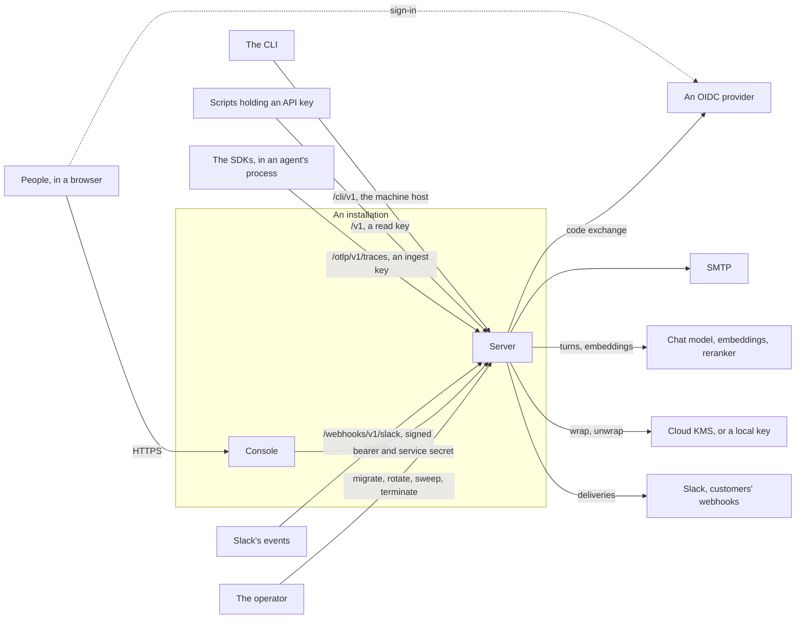
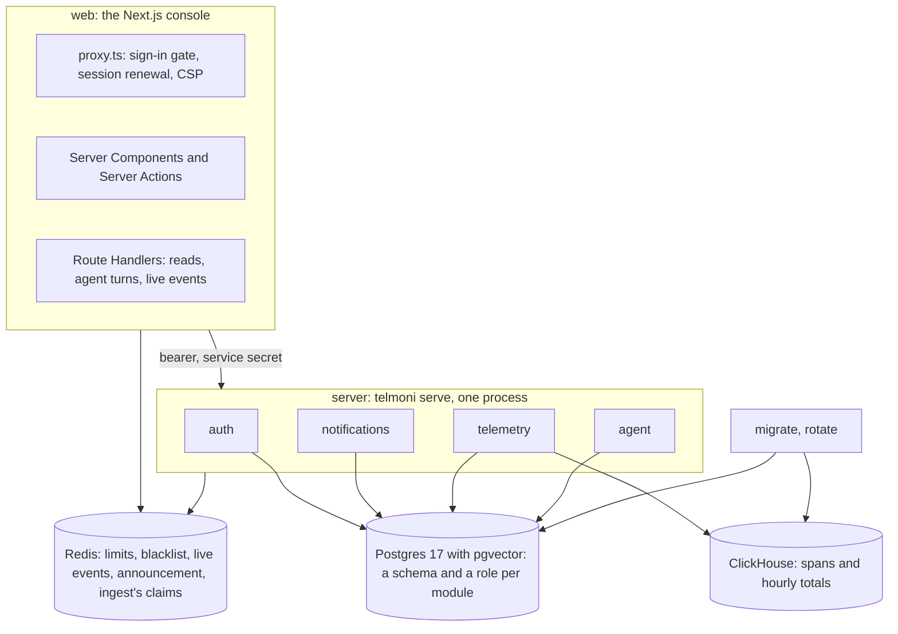
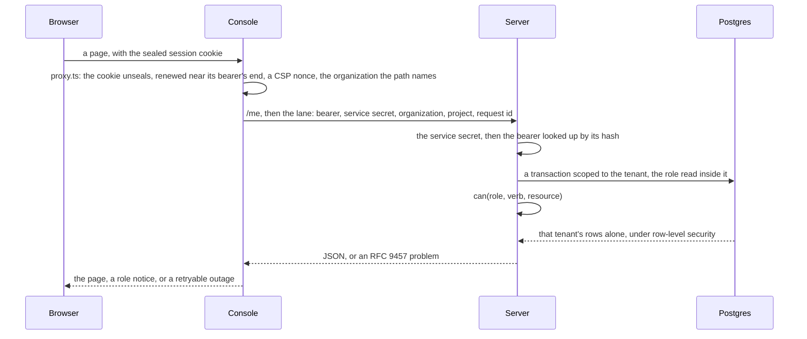
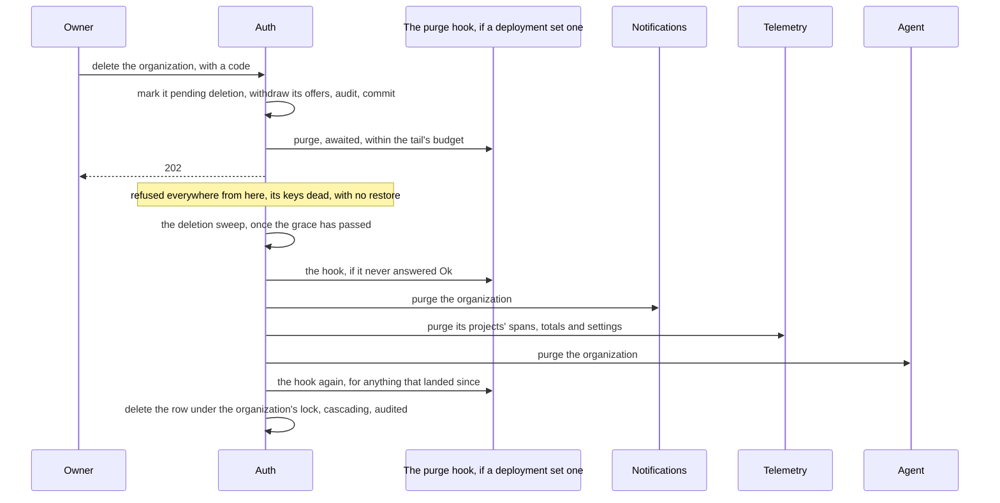
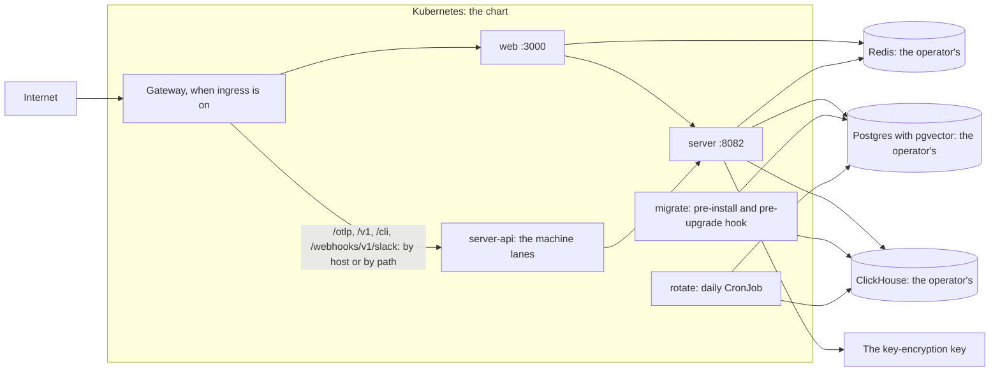

# Architecture

Telmoni's core on one page: what it is for, what it is made of, how a request moves through it, how tenants are kept apart, how data lives and is erased, how it runs, how it fails, and why it is built this way. It is the repository's one document on how the core is built: the detail behind each line is in the code it names, the code's comments and its tests.

**Where it stands:** Telmoni has not launched. What runs is the foundation — organizations and projects, members and roles, API keys, notifications, a hash-chained audit log and a read-only console agent — and the first of the telemetry on it: the `telemetry` module and its two stores, ingest at `/otlp/v1/traces`, the four SDKs under `sdk/`, and the console's traces, sessions and users. Alerts are next ([Where it goes next](#where-it-goes-next)).

## Contents

- [Purpose and scope](#purpose-and-scope)
- [Goals and constraints](#goals-and-constraints)
- [Context](#context)
- [Building blocks](#building-blocks)
- [How a request moves](#how-a-request-moves)
- [Identity and access](#identity-and-access)
- [Data](#data)
- [Notifications](#notifications)
- [The console agent](#the-console-agent)
- [The SDKs](#the-sdks)
- [Background work](#background-work)
- [Deployment](#deployment)
- [Extending the core](#extending-the-core)
- [Conventions everywhere](#conventions-everywhere)
- [When something fails](#when-something-fails)
- [Scale](#scale)
- [Where it goes next](#where-it-goes-next)
- [Decisions](#decisions)
- [Known gaps](#known-gaps)

## Purpose and scope

Telmoni is a privacy-first telemetry and monitoring platform for AI agents, open source under Apache-2.0. This repository is its core: everything an installation runs. Today that is:
- organizations and projects, members and roles;
- API keys, and a read API, `/v1`;
- notifications, to an in-app feed, Slack and webhooks;
- a hash-chained audit log, exportable by range;
- a read-only console agent that answers from the docs and a project's own data;
- telemetry: ingest over OpenTelemetry's own protocol, behind a project API key, with every content field dropped at the door; each project's settings, saved views and layouts in Postgres, its content mode set by the organization's owner and the key its user ids are hashed under; and the spans and their hourly totals in ClickHouse, read back as traces, sessions and users.

It is **one Rust binary**, `telmoni`, and **a Next.js console** beside it, deployed together with a Helm chart or Docker Compose. A deployment that needs more builds its own binary and console on these crates rather than forking them ([Extending the core](#extending-the-core)).

| For | Read |
|---|---|
| What the product does for a customer | The book, [`telmoni/docs`](https://github.com/telmoni/docs), which the console builds in from `web/content/docs` and serves at `/docs` |
| Running it yourself | The book's self-host pages, `content/self-host` in `telmoni/docs` |
| Developing it | `README.md` and `AGENTS.md` |

## Goals and constraints

**What the design must hold:**

| Goal | How |
|---|---|
| **One tenant never sees another's data** | A database role per module; the tenant bound into every transaction's type; forced row-level security; one permission matrix; work across tenants only through a module's own maintenance lane |
| **Every change is accounted for** | Its audit row commits in the same transaction, on a chain per organization that is verified daily |
| **What a customer deletes is gone** | Deletion is a saga across every module, finished by a sweep, with no restore once its grace has passed |
| **Secrets and personal data never leak** | `Redacted` in memory, ids alone in logs, problems that carry no internals, and connector grants and project hashing keys sealed row by row under a key-encryption key |
| **Nothing is lost when a process stops** | Every loop is leader-locked, leased or chunked, and work begun by a request is either awaited or backed by a sweep |
| **It is simple to run** | One binary, one console, one Postgres, one ClickHouse, one Redis; configuration only from the environment; the chart on a cluster, or Compose on one machine |

**What it is not, on purpose:**
- **Microservices.** The modules are libraries in one process, and never call each other over the network.
- **A console with logic.** The console renders and relays; every rule is in Rust.
- **Signed tokens.** Every token is opaque and stored as its hash, so nothing needs a signing key.

**What it must live with:**
- **Nothing has shipped.** Schemas, wire contracts, Redis keys and APIs change in place: one migration per module and store, edited, and no migration path (`AGENTS.md`).
- **It is built in the open**, under Apache-2.0, and names no deployment built on it.
- **Self-hosting is a first path**, not an afterthought: Compose on one machine, or the chart on any cluster.

## Context

Who and what an installation talks to.



| Party | What it is to the core | What crosses |
|---|---|---|
| **People** | An organization's owner, admins and members, in a browser | Pages, Server Actions and the console's reads under `/api/v1`, under a sealed session cookie |
| **The CLI** | `telmoni/telmoni-cli`, signed in by a device grant | The `/cli/v1` lanes: start, poll, refresh, `/me`, sign-out |
| **Scripts** | Whoever holds a project's API key | `/v1`, read-only today |
| **The SDKs** | `sdk/`: Python, TypeScript, Go and Rust, linked into an agent's own process (*The SDKs*) | `/otlp/v1/traces` on the server: a run's spans as OTLP JSON, content taken off, under a project API key with the `ingest` scope |
| **Slack's events** | Slack telling the core an app was removed or its tokens revoked | Signed events, verified by the server |
| **An OIDC provider** | Optional: who a person is, beside or instead of the password form, set as the `AUTH_CUSTOM_*` block | Discovery, the code exchange bound by PKCE, an id token of the one algorithm configured carrying the sign-in's nonce, userinfo where asked for, logout |
| **SMTP** | Mail: verification, reset, invitations, codes | Each message |
| **Models** | The agent's chat model (Anthropic, or anything OpenAI-compatible), embeddings and an optional reranker: the operator's, and never egress-guarded | A turn's text and the passages it reads; every passage the agent indexes |
| **The key-encryption key** | A Cloud KMS key on a cluster, a local key on a laptop | Each connector row's and each project's data key, to wrap or unwrap |
| **Slack, customers' webhooks** | Where notices are delivered | Each notice; a webhook's is signed |
| **The operator** | Whoever runs the installation | Subcommands, feature flags, the log level |

## Building blocks



| Block | What it is | What it keeps |
|---|---|---|
| `telmoni` | The binary (`telmoni-server`): `App`, `Parts`, `Module` and `run`; `serve`, the machine door (`door.rs`), the subcommands (`cli.rs`) and the sweeps' timers (`sweeps.rs`) | — |
| `auth` | Identity, sessions and the one issuer; organizations, projects, rosters, invitations and transfers; API keys; flags; export, audit exports and deletion; `/me`, `/cli/v1` and `/v1` | The `auth` schema |
| `notifications` | The feeds, the connectors, the delivery queue and its loop, Slack's events, the uninstalls a delete or a refused install files (`uninstall.rs`), and the retention sweep, which also finishes a deleted project's purge (`retention.rs`) | The `notifications` schema |
| `agent` | Model adapters, embeddings, the index and hybrid search, five read-only tools, the turn loop, and the recorder that sends its own questions through the Rust SDK (`observe.rs`, `report.rs`) | The `agent` schema, with pgvector |
| `telemetry` | Ingest at `/otlp/v1/traces` (`contract.rs`, `ingest/`, `handler/ingest.rs`); each project's hashing key (`hashing.rs`), content mode (`handler/content_mode.rs`) and saved views and layouts (`handler/views.rs`, `handler/session_layout.rs`); the console's reads of traces (`traces.rs`, `handler/traces.rs`), sessions (`sessions.rs`, `handler/sessions.rs`), users (`users.rs`, `handler/users.rs`) and the field inventory (`handler/field_inventory.rs`), every ClickHouse read and write going through `store.rs`; live nudges (`live.rs`), lane ceilings (`ceilings.rs`), project move and purge (`seam.rs`, `sweep.rs`), and ClickHouse's schema and retention (`schema.rs`, `retention.rs`) | The `telemetry` schema, and ClickHouse's `telemetry` database |
| `shared` | Errors and problems, RBAC, `Acting`, scoped transactions, the project move lock (`db/project_move.rs`), the seams (`seam.rs`), the audit writer and verifier, envelope encryption, the egress guard, logging, configuration, `Redacted`, slugs | — |
| `migrator` | The migration runner, `rotate`, the `audit` schema, role hardening and grants; ClickHouse's file, its purge and the rewrite of deleted projects' rows, run as its user there | The `audit` schema |
| `web/` | The console: pages, the session, the edge's rate limits, the Route Handlers — the reads a page makes after it loads, and the relays of agent turns and live events — and the book, laid into `content/docs` from `telmoni/docs` before the console builds (`scripts/book.sh`); no database access and no business logic. A 404 answered from a layout's `notFound()` renders Next's error shell from scratch so the status is a real 404 rather than a 200 with `noindex` inside Suspense, and `components/settings-boot.tsx` applies the saved settings there | Nothing but what Redis holds |
| `sdk/` | The four SDKs, in an agent's own process: a tracer provider of each one's own, a batch processor, and an exporter that takes content off and sends OTLP JSON to ingest (*The SDKs*); `fixtures/`, the golden exports, the answers, the headers and the endpoints every suite replays | A bounded queue, in memory, until it is sent |
| Postgres | One database: a schema per module, each written by its own role alone | Everything durable but the spans and their totals |
| ClickHouse | One node: telemetry's spans and their hourly totals, metadata alone, read under a row policy | The spans, until the retention line, and their hourly totals for 13 months |
| Redis | The console's rate-limit windows, session blacklist, live events and announcement, and the server's claims on each export, the machine lanes' limits and the nudges that tell the console's pages of each export kept — all of it losable | Nothing that must survive |

**Inside `telemetry`:**
- **Ingest (`ingest/`, `handler/ingest.rs`):** spans are read by `contract.rs` (whose field inventory table the docs page and the console's Privacy page are held to), with every content field dropped and drops past the first 256 counted rather than kept (`ingest/report.rs`). An export from a clock a zone or a date out is moved as one by `Telmoni-Sent-At` when no span ends more than 55 minutes past it; otherwise each trace ending more than 55 minutes past arrival is moved back to end at arrival (`ingest/batch.rs`). Each export's digest is claimed in Redis (`ingest/claims.rs`) and metered per project (`rate_limit.rs`). A project's first export mints its hashing key with its settings row under the organization holding the project then, while holding the project in place (`hashing.rs`). The write and its settling run on a task of their own so a disconnecting exporter does not cut them short, and once the rows land auth is asked again whether the project outlived the write, marking them deleted once more if not. Any body not arrived within a minute is refused so no export outlasts an organization's deletion grace. Every refusal before a body is kept — address limit, key check, project limit, paused organization, unreadable headers, stray path or method — reads the body out first (up to its cap and within that minute, kept nowhere) so hyper does not reset the connection while the exporter is still writing (`refuse_unread`), except when `Content-Length` exceeds the cap or the client sent `Expect: 100-continue`. Each kept export publishes a nudge on the organization's Redis channel (`live.rs`).
- **Reads and views (`store.rs`, `traces.rs`, `sessions.rs`, `users.rs`, `handler/`):** every ClickHouse read goes through `store.rs`, which binds the reader's projects on every query. The trace list returns a page of runs with its total, per-filter facet counts, a histogram on the reader's clock, a CSV or JSON download, or a single trace's spans (`traces.rs`, `handler/traces.rs`); users and sessions sum runs by `user.id` and `session_id` (`users.rs`, `sessions.rs`), with a session also reading the spans its layout pins under each trace (`traces::pinned`). In Postgres, `trace_views` holds each project's saved trace-list views (`list`) and saved trace/session layouts (`layout`) (`handler/views.rs`), and `project_settings` records which layout its sessions and traces open in (`handler/session_layout.rs`), falling back to the console's default (`web/lib/layout.ts`) when unset or deleted.

## How a request moves



A write takes the same path through a Server Action, its audit row committed with the change, and answers with the page drawn again, or with the next one when the write moves it (a rename, a deletion). A read a page makes after it loads — the search palette's index, the agent's history, a connector's deliveries, a trace or session opened over its list — takes it through a Route Handler under `/api/v1`, as a `GET`: an action is for writes, and a browser sends them one at a time.

Every way in:

| Way in | Path | Gate |
|---|---|---|
| A page, a Server Action or a read under `/api/v1` | Browser → console → the server's `/internal/v1` lanes | The sealed cookie, then the service secret and the bearer, then the matrix, then RLS |
| `/v1` | A script → the machine host → the server's door → auth's lanes | The door's limits by address and key; the API key's `read` scope; the organization's switch; on a deployment that sells plans, its data out for the UTC day (`ceilings.rs`), each answer counted with what its connection costs |
| `/cli/v1` | The CLI → the machine host → the server's door → auth's lanes | The door's limits by address and bearer; the device code, or the bearer; never a browser |
| Ingest | An SDK, or any OTLP exporter → the machine host → the server's door → `/otlp/v1/traces` | The door's limit by address, keyed or not, on that route alone, so the logs and metrics an SDK sends beside its traces cost them nothing; the API key's `ingest` scope; the project's own limit; then the contract: a span outside a run refused, content dropped |
| Slack's events | Slack → the machine host → `POST /webhooks/v1/slack` | Slack's signature |
| An agent turn | The agent's window → `POST /api/v1/agent/turns` → the server, streamed back | The session, then a turn as the asker, re-resolved as it runs |
| Live events | `EventSource` → `/api/v1/events` → Redis's channels, which the console's own actions publish on, and telemetry for each export it keeps (`live.rs`: a nudge on the organization's channel, never the data) | Same origin, the session, the blacklist; a project's nudges passed on to its readers alone, as `/me` named them when the stream opened, and the listener opens another when they change (`lib/events/readers.ts`) |

**The console is the one public surface for people, and the machine host the one for machines.** A person's every request enters through the console, which calls the server with the service secret; that secret proves only that a call came from inside, and who is asking is auth's answer on every request. A machine reaches the server straight, on the lanes the binary's door puts in front of (`crates/telmoni/src/door.rs`): ingest at `/otlp/v1/traces` and the read API under `/v1`, each opened by a project API key; the CLI's session lanes under `/cli/v1`, opened by the device code or the bearer they carry; and Slack's signed events at `/webhooks/v1/slack`. The door reads the caller's address past the proxies in front (`TRUSTED_PROXY_HOPS`) and meters `/v1` and `/cli/v1` by source and by credential in Redis, and every refusal it makes is a problem document, as is the server's answer for a path no lane serves — a lane's root with a trailing slash among them, which a router nested at the lane's name never sees; ingest keeps a limit of its own, per project, and Slack's events their signature. A request is named by the server alone: an `x-request-id` it arrives with is taken off, whoever sent it, and an id minted in its place, the one its span prints on every log line and its audit rows record (`crates/shared/src/middleware/http.rs`), since on a machine lane the header is the caller's free text, and nothing there compares the service secret, which would make a public lane an oracle for it.

**Every route names its version after its lane's name, `v1` today.** The read API is `/v1`, the machine host being its name; the CLI's lanes are `/cli/v1`, Slack's events `/webhooks/v1/slack`, the console's lanes on the server `/internal/v1`, and the Route Handlers the console's pages fetch `/api/v1`, one organization's under `/api/v1/organizations/{slug}`, which the proxy reads as it reads a page's path; ingest's `/otlp/v1/traces` is OTLP's own path, which an exporter appends to its base. The lane comes first so the Gateway's prefixes, the reserved slugs and what reaches the server from outside stay as they were — `/internal` is never routed — and so a lane moves on its own: its `v2` is served beside its `v1` until its clients have moved, then the `v1` goes. A path without its version is the server's 404. The probes (`/health`, `/livez`, the console's `/api/health`) are the platform's, not an API, and carry none, as do the handlers a browser is sent to rather than fetches: the sign-in's and a connector's redirects, the trace list's download, `llms.txt` and `llms-full.txt`. A client names its own build in `User-Agent` (`telmoni-<language>/<version>`, `telmoni-cli/<version>`).

## Identity and access

**Who is asking** is auth's answer, `Acting`, on every request: the person, the organization, both roles, the session.
- **One issuer.** The password form, an OIDC provider and the CLI's device grant all end in the same opaque session — a short-lived bearer and a refresh token rotated on every use — stored as hashes. An external provider only answers "who is this".
- **Every code is bound to its sign-in.** The console's doors seal a fresh PKCE verifier and nonce beside the state (`lib/auth/pkce.ts`); the provider is sent the S256 challenge and the nonce, the code is redeemed with the verifier, and an id token carrying another nonce is refused (RFC 9700 § 2.1.1). The password form's own codes keep the challenge with the code (`auth.authorization_codes`) and are spent only with its verifier, a wrong one burning the code, and the exchange's cache answers a retry only for the same verifier.
- **Nobody new comes in unasked.** Neither the form nor a provider creates an account unless `AUTH_DISABLE_SIGNUP=false`, except for an address a live invitation names (verified by the provider where it is one's). A provider's subject links to an existing account only under `AUTH_CUSTOM_ALLOW_ACCOUNT_LINKING`, and only for an address both the provider and the account verified, so an unverified account made under someone's address beforehand is never handed to them; a linked sign-in records an unverified address only where nobody else holds it. An address under `AUTH_DOMAINS_WITH_SSO_ENFORCEMENT` signs in through the provider alone, with the form's sign-in, sign-up and reset answering `403` `/errors/auth/sso-required` (`boot.rs`). A closed sign-up answers `403` `/errors/auth/sign-up-closed`, sending a sign-in a provider began and auth turned away to `/auth/refused` (`web/lib/auth/refusal.ts`) rather than `/auth/login`, which would loop back through the provider.
- **Somebody new can start in the deployment's organization.** When `TELMONI_DEFAULT_ORG_ID` (and optionally `TELMONI_DEFAULT_PROJECT_ID` in it) is set, the issuer checks them at boot (`default_organization.rs`), and every door that creates a person — the form, a provider, the seeded admin, the test door — joins them in the identity's transaction under the organization's chain lock, audited as `service:default-organization`; `/me` then finds them a member and provisions nothing. Enrollment happens once, at creation, so a removed person stays removed; an organization or project deleted since boot is logged and skipped. A binary that counts seats refuses the variables at boot.
- **One provider runs beside the stack.** Dex, the compose file's `oidc` profile (`crates/auth/dex/dev-config.yaml`), holds sign-ins to PKCE; the console's e2e suite signs in through it (`web/e2e/oidc.spec.ts`, `make e2e`), so the exchange, the key set and the nonce meet a provider of someone else's making, and a developer tries the same with `COMPOSE_PROFILES=oidc`.
- **Ending a session holds on the next request**, since every request looks its bearer up. Signing out is a form post; a `GET /auth/logout` with a live session is asked first, since a link is all it takes to get there, and a dead session's redirect is let out.
- **The console's side** is a sealed cookie holding the session's tokens, renewed near expiry only where the cookie can be written: by an open tab's heartbeat Route Handler, or by the proxy before anything renders (`web/lib/proxy/session.ts`) on every path except sign-in callback and sign-out. The proxy writes the renewed cookie into both the request and the response; pages never renew it, because auth treats a refresh token presented again past its 30-second grace as a stolen copy and ends the session. Concurrent requests in one process share a single renewal, auth's grace covering other replicas; a refusal clears the cookie, and a timeout leaves the session to retry within that grace.
- **API keys** are minted on a project, hashed, shown once, with an expiry and a rotation grace.
- **Abuse limits** are where the cost is: lockouts and a decoy hash in auth, capped codes and links, and per-person and per-address windows at the console's edge.

**What they may do** is one matrix, `can(role, verb, resource)`, for every module, with every cell pinned by a test. An organization has one owner, admins and members; a project's seats are admins and members, and a seat never lowers what the organization's role gives. A seat is taken by its holder — an invitation accepted, a handover — or given by the organization's owner or an admin to one of its members (`POST /internal/v1/projects/{project_id}/members`), with the project's feed and the person notified, and listed by `/me` (`givenSeats`) while they remain a Member of its organization until marked seen (`POST /internal/v1/me/seats/{project_id}/seen`, called by the bell or when opening the project) or until the project moves.

**Which rows they may touch** is bound into the transaction's type, `Scoped<Binding>`, and enforced by forced row-level security, where an empty binding matches nothing.
- **Work across tenants** — the bearer lookup, invitations, sweeps, the indexer, the delivery loop — runs in the module's own maintenance lane, never as a wildcard.
- **Beneath it all, no request value is spliced into SQL**, and a test reads every query to keep it so.
- ⚠ **Compose's quickstart connects as the superuser**, and to ClickHouse as the one user that made its tables, so RLS, the row policy, the grants and the roles' timeouts do not apply there; what separates tenants then is each query's own `WHERE` (in ClickHouse, the one query module's), the membership checks and the constraints.

## Data

```text
audit           events, partitioned by month: one hash chain per organization
auth            identities, accounts, credentials, external_identities, sessions,
                access_tokens, refresh_tokens, authorization_codes, device_codes,
                confirmation_codes, organizations, organization_members,
                organization_invites, projects, project_members, member_invites,
                api_tokens, feature_flags, organization_flags, audit_exports
notifications   feed, connections, deliveries, delivery_attempts, oauth_states,
                uninstalls (a vendor app to uninstall where a delete, or a refused install, left no connection)
agent           chunks (a vector and a text index), conversations, messages, cursors, erasures
telemetry       project_settings (the content mode; the project's hashing key, sealed under TELEMETRY_KEK;
                the saved layout its sessions and traces open in, if one),
                trace_views (a project's saved views of its trace list, and its saved layouts of a
                session's page and a trace's: one table, two kinds)

ClickHouse, telemetry's database:
spans           a row per finished span, partitioned by the day it arrived, its run ids under a bloom filter for a trace's read
spans_hourly    their totals by hour, partitioned by month, fed by a view
migrations      the digest of the statements the store was made from
```

- **One migration per module and store**, edited in place before launch. The migrator runs `audit`, then `auth`, then the rest by name, then the grants, then ClickHouse's one file.
- **The audit log** is append-only by its grants, one chain per organization written under an advisory lock, in a frozen hash format pinned by golden vectors. A writer of several chains, or of several organizations' locks, takes them by id compared by byte, not by the database's collation, which orders mixed-case ids otherwise. It is verified daily and never repaired; `rotate` makes its partitions ahead, and none is dropped. An owner or admin exports a range as a file that verifies on its own.
- **A project's move and lock order (`telmoni_shared::db::project_move`, `crates/auth/src/db/locks.rs`):**
  - Moving a project to another organization (a transfer's accept, an owner's move, or settling either) takes the project's move lock exclusively to commit, after its checks and before both organizations' chain locks. An export creating the project's settings row tries the same lock shared first (`try_hold_in_place`) and reads the project's organization only once held; if a move holds or waits for the lock, the export answers `503` at once for the exporter to retry without holding a connection. Telemetry's purges also take the move lock exclusively (waiting up to 2 s, the role's `lock_timeout`), retrying on telemetry's 10-minute sweep or auth's deletion sweep if it times out.
  - A move takes both organizations' membership locks before writing. Project lanes (seats, handovers, delete, keys, invitations sent or withdrawn) take the organization's membership lock first and re-read the caller's role and the project's current organization under it, refusing a project that moved behind them; invitation accept and decline re-read the project's organization under the lock taken after the person's lock. Every wait is bounded by the role's `lock_timeout` (answering `409` on timeout), with the audit chain lock always taken last.
- **Retention** is each module's sweep deleting what has passed its window, in chunks where the work can be large; each window is a named constant. ClickHouse's spans go a whole day at a time, dropped by `rotate` at the longest retention sold; a deleted project's are marked deleted, gone from every read within moments as the store applies the mark, and rewritten off the disk by the same `rotate`.
- **Export** is the organization's own data, read in one consistent transaction.

**Deletion** runs across every module, and only auth starts it:



- **A project** goes at once: its spans and hourly totals are marked deleted in ClickHouse (gone from reads within moments and rewritten off disk by `rotate`), its telemetry settings and views are removed, and notifications purges its connectors first in their own transaction and then its feed in chunks (or in a single transaction before a project move, so a refused move leaves the project untouched). A purge cut short is retried by notifications' hourly sweep and telemetry's 10-minute sweep, an export in flight as the project goes is marked deleted once its rows land, and the agent's index catches up within the hour.
- **A person** is erased across every module, the identity provider first, and the erasure stops if that fails.
- **The audit log outlives what it describes**: its rows name ids, with no foreign key to cascade.

## Notifications

- **Two feeds:** each project's, and the organization's own, for its owner and admins.
- **Raising a notice** writes it and one delivery per active connection in one transaction. The first attempt is made right after the commit; the rest are the delivery loop's: leased rows, backoff, at least once, deduplicated by the receiver on the delivery's id. A batch's outcomes are one transaction, its connections written before its deliveries, the order a purge's cascade takes them, and written again where Postgres ends it to break a deadlock. A resend's outcome, by hand, writes them in the same order.
- **Connectors**: Slack through OAuth, and webhooks signed with `telmoni-signature`.
- **An app leaves a workspace with its last connection there.** Slack's `apps.uninstall` ends every connection in the workspace, so a delete — or an install refused after Slack's exchange, sealing its token under a fresh id — files an `uninstalls` row in its own transaction. After commit, the workspace's live connections are counted under a workspace lock shared with installs, and the app is uninstalled outside any transaction when none remains; the hourly retention sweep retries unfinished uninstalls for up to a day.
- **A lane takes its organization's chain lock before changing a row** (after only the workspace lock an install holds) and gives up with `409` after 2 s, avoiding a deadlock with a project transfer that holds the chain lock while awaiting notifications' purge. Slack's revocation locks every organization its workspace serves, by id, and revokes only theirs. A connect re-checks auth within a second under that lock and refuses if the project moved or the caller's role was lost.
- **Every grant is sealed at rest.** A data key per row, AES-256-GCM per field with the row's id as associated data, the data key wrapped by the key-encryption key: a library, never a lane.
- **The egress guard** checks a customer's URL when it is registered, when it is dialled and when it connects, and follows no redirect, because a network policy cannot tell a customer's address from the database's.

## The console agent

- **Absent, off or on.** Without its database it is absent; with a database and no model it keeps its tables and its retention; with both it answers.
- **Read-only.** Five tools, each a read that checks the matrix again as the asker, who is resolved again throughout the turn; nothing it does writes.
- **Search inside Postgres.** A lexical half and a semantic half fused by rank, compared exactly for a small tenant, and reranked when a reranker is set.
- **The index** holds the docs, the audit log, the feed, deliveries and remembered conversations, each document's audience decided by the module that owns it.
- **Prompt injection is contained, not prevented:** nothing retrieved enters the system prompt; tool results are fenced in `<data>`, every angle bracket in tenant text swapped for a look-alike so nothing in it can close the fence or open a tag; the answer is rendered as nodes, never HTML, a link kept only when its path, resolved as the browser resolves it, is a page of this origin — never `//host`, a dot-segment path that collapses to one, or a door such as `/auth/logout` — and the agent cannot act.
- **A vendor's outage never stops the server booting**; an embedding model of the wrong width does.
- **Its own questions** are reported with the Rust SDK, as any agent's runs are, as ids, timings and token counts, never content: where `TELMONI_API_KEY` holds an ingest key of a project of the operator's own, the turn's recorder (`observe.rs`) sends each question with `record_run` (`report.rs`) to `TELMONI_ENDPOINT`, the server's own loopback address unless set — a run of that project under the agent `console-agent`, each model call and tool call a span under it, the asking organization its user, which ingest hashes as it hashes every user id, and the agent's conversation the run's session — and so meets every check a customer's export does: the key, the rate limit, the claim on its digest and the organization's grants. Queued on the turn's task and flushed on a blocking task, so an answer never waits on it; a refusal is logged by the SDK once per kind and the question lost to the record. Unset, nothing records them.
- **In the console, a window over every page**, moved, sized or filling the screen, that leaves the page its keys; a turn's stream names its conversation first, so an answer stopped or cut off never splits a thread.

## The SDKs

Four SDKs, one contract, under `sdk/`: an agent's runs, steps, model calls and tool calls as OpenTelemetry spans, sent to ingest (`POST /otlp/v1/traces`) and nowhere else. Each runs a tracer provider of its own beside whatever OpenTelemetry the application has, sends nothing outside a run, and takes content off every span before it leaves the process unless asked and the project allows. Python (`sdk/python`) was built first and is the reference; the three others were ported from it, and `sdk/fixtures/` holds the golden export and the server's answers every suite replays, so no language ships a behaviour the others lack. `crates/telemetry/src/contract.rs` names what ingest reads; each SDK's `contract` module copies those names, and a name changes on both sides in the same change.

| SDK | Package | On | Entry points |
|---|---|---|---|
| Python | `telmoni` (3.10+) | `opentelemetry-api`, `opentelemetry-sdk`; `urllib` sends | `Telmoni(config, transport=, sleep=)`, `Telmoni.from_env()`; `run`, `step`, `model_call`, `tool_call` as context managers, `async with` and decorators; `flush()`, `shutdown()` |
| TypeScript | `telmoni` (Node 18.19+ / 20.6+) | `@opentelemetry/api`, `@opentelemetry/sdk-trace-base`, `@opentelemetry/resources`; `fetch` sends, and Node's `http` to this machine | `new Telmoni(config, hooks)`, `Telmoni.fromEnv()`; `run(agent, options, fn)`, `wrap(agent, options, fn)`; `step`, `modelCall`, `toolCall` on a `Run` or a `Step`, each with a callback; `flush()`, `shutdown()` |
| Go | `github.com/telmoni/telmoni/sdk/go` (1.26.10+) | `go.opentelemetry.io/otel`, `otel/sdk`, `otel/trace`; `net/http` sends | `New(cfg, opts…)` and `NewFromEnv()`, both `(*Client, error)`; `client.Run(ctx, agent, RunOptions)`, `run.Step`, `ModelCall`, `ToolCall(ctx, …)`, each `(context.Context, *T)` ended by `End()`; `RunFromContext`; `Flush(ctx)`, `Shutdown(ctx)` |
| Rust | `telmoni`, a member of this workspace | `opentelemetry`, `opentelemetry_sdk` (`trace`), `uuid`; reqwest's blocking client sends, built on the processor's thread | `Telmoni::new(config)`, `from_env()`, `with_hooks(config, Hooks)`; `run(agent, RunOptions) -> Result<Run, Error>`; `step`, `model_call`, `tool_call` as guards, `*_with` and `try_*_with` closures; `flush()`, `shutdown()` |

**The parity table.** Every row is answered the same in all four unless a cell says otherwise; a new behaviour adds a row and, where the wire or an answer changes, a fixture.

| Behaviour | Python | TypeScript | Go | Rust |
|---|---|---|---|---|
| The default endpoint `https://api.telmoni.com`; trailing slashes stripped; a blank endpoint, explicit or from the environment, or one of slashes alone, falls back; one without a scheme gets `https://`, or `http://` for this machine, as the CLI reads it; a blank organization or key is unset | yes | yes | yes | yes |
| `TELMONI_ENDPOINT`, `TELMONI_API_KEY`, `TELMONI_ORG`, `TELMONI_ENVIRONMENT` and `TELMONI_RELEASE` read in one place and no other variable; no `OTEL_*` variable reaches the SDK, proved with six set | `Config.from_env` | `Telmoni.fromEnv` | `ConfigFromEnv` | `Config::from_env` |
| The deployment on the resource of everything sent: `deployment.environment.name` from the `environment` option or `TELMONI_ENVIRONMENT`, `service.version` from `release` or `TELMONI_RELEASE`, a blank one unset and nothing sent where neither is set; never `OTEL_RESOURCE_ATTRIBUTES`, which the application's exporters read (`sdk/fixtures/run.json` names both) | yes | yes | yes | yes |
| The key never printed or serialized | a `Secret`: `repr`, `str` and `dataclasses.asdict` show it redacted; `pickle` refused | a non-enumerable `apiKey`; `#private` internals | `json:"-"`, `String`, `GoString` | a hand-written `Debug`; `skip_serializing` |
| Plain HTTP only to this machine — `localhost`, a name under it, 127.0.0.0/8 or `::1`, an IPv4-mapped address read as its IPv4 — and an endpoint taken only where every SDK reads it alike (`sdk/fixtures/endpoints.json`): printable ASCII once Unicode's White_Space is trimmed from its ends, HTTP or HTTPS, a host that is a name of letters, digits, dots, hyphens and underscores, in labels of 1 to 63 characters with no hyphen at either end, the last no number, an IPv4 address in four decimal parts or an IPv6 one in brackets, a port from 1 to 65535 and a plain path; so nothing a URL parser fills in, decodes or rewrites, which reached another host or failed every export in some SDK — `https:///host`, `127.1`, credentials, a percent-escape, a backslash, a tab, a name in another script, a dot segment, a query; no redirect followed | `ValueError` at `Config`, and again when the client is built; an opener without `urllib`'s redirect handler | `TypeError` at construction; `fetch` with `redirect: 'manual'` | `New` returns an error; `CheckRedirect` returns the 3xx | one warning and nothing sent, since `new` cannot fail; reqwest's `Policy::none()` |
| `sample_rate` above 0 and up to 1, else refused | `ValueError` | `RangeError`, for a value that is no number too | `New` returns an error, except 0, the zero value, which means 1 on the client and the client's rate on a run; a run's bad rate falls back to the client's with one warning | `Error::SampleRate` |
| A token count sent as a whole number from 0, the one kind ingest takes; anything else — no number, `NaN`, an infinity, past 64 bits or below zero, over which ingest refuses the call or the batch is lost — left off its call with one warning, recorded calls too | yes, through `int()`, so a float is truncated rather than sent as a double, whose call ingest refuses; a `bool`, an `int` to Python, is no count; an `IntEnum`'s member goes as its number, never its name | yes, truncated by `Math.trunc`; a `null` usage counts nothing, and a boolean, which `Number` makes 1, is no count, nor text but a decimal numeral, where `Number` read `'0x10'` as 16 and `''` as 0, which Python leaves off; a bigint or a boxed number is read as its number | below zero; its counts are integers | below zero; its counts are integers |
| A run's tags, the first 32 alone, the most ingest keeps, the rest warned of once before anything opens, live and recorded: past a span's 128 attributes they had crowded out the run's own, its id or its `error.type`; and a tag ingest would drop before counting — a key not 1 to 64 characters, a value past 256 as ingest writes it, a number's every digit, 1e256's 257 — left off first with one warning, so it takes no place among them | in the mapping's order, an unset one left off; a `bool`, a 64-bit `int` or a finite `float` sent as it is, which ingest writes as its own text | in the object's order, an unset one left off; a boolean or a finite number sent as it is | by key | by key (`BTreeMap`) |
| A live call's text that is no string — a name, a model, a provider, a tag, the agent, the user, the session, the answer's model or an error type, an `Enum`'s member say — sent as its text with one warning, where a span named by it lost its whole batch, and a tuple or a number past 64 bits the run or the batch; but an error handed to `fail` as its type, or the error's class, sent as the class's name, never the error's text, which carries its message; a tag of a number or a bool as it is, the row above; an agent that is none, or whose text is blank, refused as a blank one; and an empty provider, user, session, answer's model or error type left off, which ingest refuses the span over | `str()`, or the class's name where that raises; an operation that is no string is `chat`; an exception or an exception's class by its name | `String()`, or its type where that throws, as a null-prototype object's does; any object by its constructor's name, then its `name`, and a class by its name | — its texts are strings | — its texts are strings |
| A live call's text past ingest's caps, counted in characters, which cost the call's span at ingest, or the run whole for the agent, user and session every span carries: a name, the agent, a model, a provider, the answer's model or an error type cut to its cap — a step's or a tool's name, and a model call's `<operation> <model>`, to 145, which the longest operation and a model at its cap fit, the rest to 128 — and a user past 128 or a session past 200 left off, since cut it would name another; a step named nothing sent as `step`, and a model call with no model named by its operation alone, its model left off; each with one warning; a continued run's agent cut as a run's | yes | yes | yes; each invalid byte one character, as JSON sends it | yes |
| Text with a lone surrogate, which ingest's JSON refuses with the whole request, sent with the replacement character in its place | the body written with its text as given, then each surrogate replaced; a header's baggage the same, where encoding it raised into the agent | `JSON.stringify`'s replacer; a header's baggage through `TextEncoder`, which replaces it | — `encoding/json` replaces invalid UTF-8 | — a `String` is UTF-8 |
| A number attribute ingest cannot read never costs its batch: `NaN` or an infinity, which JSON cannot carry, sent as `null`, which ingest reads as no value, an item of a list the same; a whole number past 64 bits, which ingest's parser refuses with the whole export, sent otherwise | `None` in its place, since `json.dumps` refuses one; an `int` past 64 bits as its text | `JSON.stringify` writes `null`; on the four keys sent as whole numbers, the token counts, a value that is no whole number within 64 bits goes as a double, which ingest refuses with that span alone | a `MarshalJSON` of its own writes `null`, where `encoding/json` refused one and lost the batch; an `int64` holds no more | `serde_json` writes `null`; an `i64` holds no more |
| A span's time outside 64 bits of nanoseconds from the epoch, a clock set wrong, sent as 0, so ingest refuses that span rather than the whole export | yes | yes | yes, written unsigned, since `UnixNano` overflows in 2262 | yes |
| A tracer provider of the SDK's own: resource, sampler, limits, id generator and processor given explicitly | `TracerProvider(...)`, its `OTEL_SDK_DISABLED` switch overridden | `BasicTracerProvider` with every option (the 2.12 shim merges `OTEL_*` under them) | `NewTracerProvider` with `WithSampler`, `WithRawSpanLimits`, `NewSchemaless` | `SdkTracerProvider::builder()` with every part |
| The sampler records every span and decides nothing: a parent's flag, else the root sampler's decision, never a drop | reads the application's global provider's sampler when none is configured | the `sampler` option, else always on: the api cannot read the application's | the `Sampler` field, else `AlwaysSample` | the `sampler` field, else `AlwaysOn` |
| The SDK's own batch processor: a queue of 2048, batches of 512, 5 s; drops counted and warned once; flush and drain | a thread | an unref'd timer | a goroutine | a thread |
| A run sampled out is dropped whole in the processor, every step and call inside it however late each ends: its draw marks every span of it from the span's start (`telmoni.sampled_out`, never sent), since a sampler's drop would clear the sampled flag the application's own spans inside the run inherit; a record sampled out builds no span, so the same record sent again draws again | yes; tags before the run's own attributes, since past the span's limit of 128 Python's SDK drops the oldest | yes | yes | yes |
| The run: `invoke_agent <agent>`, INTERNAL, in the current trace; `telmoni.run_id` a UUID v4; tags and the sample rate | yes | yes | yes | yes |
| A blank agent name | `ValueError` | `TypeError` | a run that does nothing, with one warning: the SDK never panics | `Error::EmptyAgent` |
| Every span inside a run carries `telmoni.run_id`, `telmoni.agent`, and `user.id` and `gen_ai.conversation.id` when set | yes | yes | yes | yes |
| Steps INTERNAL; model calls `<operation> <model>` CLIENT with `answered(...)`; tool calls `execute_tool <name>` with `returned(...)`; content set as JSON strings | yes | yes | yes; a `Usage` sends its four counts from 0, a zero among them, a negative one left off with one warning | yes; `Content` from a string, a `Value` or any `Serialize` |
| Errors: `fail(type)` sets `error.type` and status ERROR with no message, an empty type setting none, since ingest refuses a span over it, and the run with a run's; `cancel()` sets `telmoni.cancelled`; the idiom's own error | the exception's class; `KeyboardInterrupt` and `CancelledError` cancel | `constructor.name`, then `name`; an `AbortError` cancels | `Fail(err)`: `%T` without its `*`; `context.Canceled` cancels, and a deadline that ran out fails with its type | `try_*_with`: the error type's last path segment; a panic unwinding through a guard marks `panic` |
| Nothing sent outside a run | a client-level call outside a run is a no-op with one warning | impossible: steps and calls open on handles | `RunFromContext(ctx)` outside a run is nil, whose handles, and its own `End`, `Fail`, `FailWith` and `Cancel`, do nothing | impossible: guards open on guards |
| A step or call opened where its run is not current — another thread or goroutine — goes under the run, in its trace, and carries the run to the calls inside it | falls back to the run's span when the context does not carry the run | on the handle | a `ctx` with no span goes under the run | on the guard |
| A model call's blank operation, empty or whitespace, is `chat` | yes | yes | yes | yes |
| ⚠ Open, the owner's to settle: a call made inside a tool call, an agent used as a tool, nests under it, though the contract gives a call's parent as its step or the run; the trace's view nests each span under the parent it names either way | yes, by the context | no: a `ToolCall` opens nothing, and a call goes under its step or the run | yes, by the `ctx` | yes: a `ToolCall` is a `Parent` |
| The exporter: OTLP/JSON, `Authorization: Bearer` when keyed, `User-Agent: telmoni-<language>/<version>`, the resource's five attributes from its own list and the deployment's two where set, content off unless `capture_content` is on and the mode learned is `on` | `telmoni-python` | `telmoni-typescript` | `telmoni-go` | `telmoni-rust` |
| Answers: the content mode learned from the header; each drop and refusal warned once — content with the project's content mode and the link to `api/ingest#what-is-dropped-at-the-door`, unlisted text with the tag that would keep it; 429 and 503 retried after `Retry-After`, else 2^attempt seconds, at most 60, three attempts in all; others never; a transport error, no whole head having come, retried the same way, a head that breaks off or outlasts the request before its blank line counting as none; but an answer whose body breaks after its head, or outlasts the request, decided by its status, its body kept as far as it came | `logging`, logger `telmoni`; a head that ends at the close, which `http.client` would take, raised as `RemoteDisconnected` | `console.warn`, or the `warn` hook | `log/slog` | `tracing::warn!`, target `telmoni` |
| An answer's head of a kind ingest never sends and a proxy in front might: every `1xx` before the answer read past to it; an unasked `101` a refusal in Python, Go and Rust, its connection closed unread, and no answer in TypeScript; past that, each read as its client's parser reads it, a head it refuses counting as no answer; a duplicated `Retry-After` read each its own way, `fetch` falling back to the backoff; and a body gzipped unasked decoded by Go and `fetch` alone, which ask for gzip, so elsewhere a refusal's problem type and a kept export's drops go unread | `http.client`, which passes a `100` alone, read past the rest; refuses a line past 64 KiB, 100 headers or more, an `HTTP/2.0` status line and an empty line before the status | Node's parser, as Node 26 has it, refuses lines that end in a bare LF, a head past 16 KiB, and a `1xx` of HTTP/1.0 or with `Connection: close`; `fetch` fails on a `100` too; both take a `101` for no answer, Node's `http` closing the connection itself | refuses an empty line before the status; a `101`'s body, its connection, which no timeout covers, never read | hyper refuses more than 100 headers, a head past its buffer of about 408 KiB and an `HTTP/2.0` status line; nothing decoded, whatever reqwest features the application turns on |
| A request's ten seconds, its answer's headers and body held to them however slowly they come | a deadline from the request's start that shuts the connection, ending a read under way, since a socket's timeout is each read's alone; a connection being made keeps that timeout a step | `AbortSignal.timeout`, which aborts the body's stream with the request | `http.Client.Timeout`, which covers the body | reqwest's, and its body given up at the same deadline, since reqwest's own wait starts again at each read |
| An answer read up to its first MiB: a problem's JSON is small, and an export never pays for more | `urllib`'s response read a call at a time, so a read that fails loses nothing before it | the `fetch` body's stream, cancelled past it, a read that throws keeping the text before it | `io.LimitReader`, `io.ReadAll` keeping what came before an error | `Read::take`, given up at the request's ten seconds, since reqwest's own wait starts again at each read, `read_to_end` keeping what came before an error |
| An export at most ingest's 1,000 spans (`BATCH_SPANS_MAX`), which TypeScript's and Rust's batch size can be set past, and its body at most 1 MiB (`BATCH_MAX_BYTES`): a batch past either halved until each part fits, since ingest refuses it whole, and past 1 MiB its `413` can break an upload still going out, which reads as no answer and was sent three times; a span alone past 1 MiB sent without the attributes ingest drops for their length — a key past 128 characters, a value past 1,024 as ingest writes it, a list as its JSON — which at 128 attributes, a span's most, leaves it within, with one warning, and dropped only where its own name passes it, which ingest refuses; and a batch in parts given up whole at a part that fails as the rest would — the platform out of reach or busy past its retries, or a refusal of the key, the organization or the endpoint — but sent on past a part refused for what it holds, a `400` or a `413` | yes | yes | yes | yes |
| Each attempt sent with `Telmoni-Sent-At`, this clock as it leaves, in nanoseconds since the epoch: the clock the spans are timed by, so ingest moves a run from a clock a zone or a date out as one, whatever each export's delay | `time.time_ns()` | `Date.now()`, as a span's start is | `time.Now()` | `SystemTime::now()` |
| Warnings once per client, the set bounded at 1,024 keys | yes | yes | yes | yes |
| A panicking or throwing hook — the transport, the sleep, the warning's sink — stops no worker: that export's batch is dropped with a warning, a failing warning costs no batch, and the next batch goes; and a warning given on the agent's own call, a tag or a token count left off, never fails that call | `Exception` caught around each export; `logging` contains a failing handler, and a handler or filter that raises is suppressed in each warning | a throwing `warn` swallowed, in each warning; a rejected export warned | `recover` around each export, warned through the logger, and each warning, silent | `catch_unwind` around each export, reported through `tracing::warn!`, and around each warning's sink, the panic hook still told of it; under `panic = "abort"`, none is caught |
| A flush waits at most 30 s, holding the process while it waits; a shutdown drains for at most 30 s, then starts nothing more and holds nothing that keeps the process alive | `flush(timeout_s=30)`; the daemon thread joined for 30 s | `flush(30)`, its timer held until it settles, since a script's last `await` is often the flush and the worker's own timer is unref'd; at the shutdown's deadline the retry wait ends, no batch or attempt follows, and a later flush returns at once | the `ctx`, or 30 s for a `ctx` without a deadline, for both; a `ctx` already done stops the worker without waiting, ours stopped before the provider, which skips its processors then | 30 s for both |
| A proxy in the environment (`HTTPS_PROXY`, `NO_PROXY`), for every host but this machine, which each SDK reaches through none, as the CLI does: a proxy would take plain HTTP's key off it in the clear, and one elsewhere cannot reach its ports | honoured, as `urllib` does; this machine through an opener given an empty `ProxyHandler` | not read: Node's `fetch` ignores it unless Node runs with `NODE_USE_ENV_PROXY=1` (22.21 and 24.5 and later), and this machine is sent through Node's own request on agents of its own, past the environment's proxy and any an application puts on Node's global agent or forces through `http.request`, as proxy-agent and global-agent do | honoured, as `net/http`'s default transport does, which spares an exact `localhost` and a loopback IP alone; this machine through a clone of it with no `Proxy` and a dialer of its own, since an application may dial through one, SOCKS from `ALL_PROXY` say | honoured, as reqwest does, sparing no loopback host; this machine through a second client built `.no_proxy()` |
| The roots an export's TLS is checked against, so a self-hoster's private CA is trusted where the host trusts it | the system's store, as `urllib`'s default context loads it, through the `ssl` hook an application may set its trust by; `SSL_CERT_FILE` and `SSL_CERT_DIR` honoured | Node's bundled roots, a private CA added through `NODE_EXTRA_CA_CERTS` | the system's store, as `crypto/x509` loads it; `SSL_CERT_FILE` and `SSL_CERT_DIR` honoured on Linux | the system's store through `rustls-native-certs` (`SSL_CERT_FILE` and `SSL_CERT_DIR` honoured), and webpki's bundled roots beside it, so a container with no store still reaches the hosted service |
| Beside the application's own OpenTelemetry: a run joins the current trace, the application's spans opened inside nest under it, its sampling rate holds inside runs, and a run in a trace it does not sample is still sent | through the context | through the application's context manager, or `handle.context` | through the returned `ctx` | through `context()` or `attach()`; the run's parent from `Context::current()` |
| A run recorded after it ended, for a job that keeps its own log or a hook that runs once its turn is over (`sdk/fixtures/recorded.json`): handed over as data — its id, a UUID the caller gives; its agent, user, session and tags; its times and outcome; its steps and calls, each with its own — and sent as the live calls would have sent it, through the same processor, content rules and sample rate, in a trace of its own named by the run's id, whatever is current. Each span's id is the first eight bytes of the version 5 UUID of its place, in decimal, under the run's id (`0` the run, then each step and call from `1`, a step before its calls), never zero since the version's bits fall in them; each span goes as it ended, the run's own last, in exports of its own — one while the record fits a batch, 1,000 spans and 1 MiB, else batches counted from its first span, each halved past 1,000 spans or 1 MiB — so the same record sent again is the same bytes, whatever else the process sends, which ingest's claim answers once. The contract gains nothing | `record_run(RunRecord)` | `recordRun(record)` | `RecordRun(ctx, RunRecord) error` | `record_run(RunRecord) -> Result<(), Error>` |
| A record's exports are its own: its spans picked out by its trace as they end and staged, then queued in one step once it is built, a fence at each end that no batch crosses, so nothing queued before it, ending beside it on another thread or in a hook, or queued after it rides with it; one record at a time, its room in the queue kept meanwhile, and a build that fails queues nothing; nothing of the application's runs inside a build but the root sampler, as the record's own span starts, the reads of the caller's own record — a getter in TypeScript, a subclass's property in Python — which may throw part-way, a run's 32 tags keeping a span far inside the 128 attributes past which OpenTelemetry would warn | a lock; a count's warnings given before the build, since a logging handler may record a run, and a field of another type refused before it, which OpenTelemetry would warn of; the provider's meter a no-op, since `OTEL_PYTHON_SDK_INTERNAL_METRICS_ENABLED` would send OpenTelemetry's span metrics to the application's | a count's warnings given before the build, since a `warn` hook may record a run, and a field of another type refused before it, which OpenTelemetry would warn of through `diag` | a mutex; `OTEL_GO_X_OBSERVABILITY` sends OpenTelemetry's span metrics to the application's global meter, inside a build too, since Go's provider takes no meter of its own | a mutex, its guard queueing the record only once told it is built |
| A record the queue has no room for is refused whole, before anything is queued — a span for the run and for each step and each call, against the queue's free room — since its tail, the run's own span first, would otherwise be dropped; a sampled-out record is never refused, and while it is built its room is kept, a live span past it dropped and counted | `QueueFullError`, a `RuntimeError` | `QueueFullError` | `ErrQueueFull` | `Error::QueueFull { spans }` |
| A record refused before anything opens, sending nothing: a blank agent; a run id that is no UUID, or the nil UUID, whose trace id of zeros is invalid; a span that ends before it starts; and what ingest would refuse the export or the span for: a time not after the Unix epoch, or 2^64 nanoseconds or more after it, in July 2554; a step or a model named nothing, though not a tool, whose empty name ingest reads as none; and text past ingest's caps, counted in characters — a step's or a tool's name past 145, the agent, a model, a provider, a user or an error type past 128, a session past 200, a model call's operation and model past 144 together, its span's name | `ValueError`; also a time without its timezone; and `TypeError` for a record that is no `RunRecord` and a field of the wrong type — an agent, a run id, a name or a tag that is no `str`, a time that is no `datetime`, an item of another class, an `inside` or `calls` that is no sequence, since a set holds no order — save a token count, read as a whole number where it can be or left off with one warning, and an `operation` of `None`, a chat; its tags read before its items, and its items and calls once, so the tags and items checked are those built | `TypeError`, and `RangeError` for a span ending first, a time out of range or text past its cap; also a field of the wrong type — a time that is neither a `Date` nor a finite number, an item of no known `type`, an `inside` or `calls` that is no array, a name or a tag that is no string, tags or a usage that `Object.prototype.toString` names no `Object`, as an array, a `Map` or a boxed primitive — save a token count, as in Python; its tags read before its items, and its items and calls once, so the tags and items checked are those built | an `error`; also a zero `time.Time` and a nil item | `Error::EmptyAgent`, `Error::RunId`, `Error::EndBeforeStart`, `Error::RecordedTime`, `Error::EmptyName` and `Error::TooLong`; also `Error::SampleRate` for a configured rate out of range |
| A record's times, its run id's forms and its tags' order | an aware `datetime`, sent in whole microseconds; the hyphenated form or 32 hex digits, not all `uuid.UUID` reads, since a sign or an underscore would send another id; tags as given | a `Date` or milliseconds since the epoch, made `[seconds, nanoseconds]` by the SDK, since a span reads a number no larger than `performance.now()` as a performance reading; the hyphenated form or 32 hex digits; tags as given | `time.Time`, to the nanosecond; the hyphenated form; tags sorted by key, a map having no order | `SystemTime`, to the nanosecond; what `Uuid::parse_str` reads; tags sorted by key (`BTreeMap`) |
| A run across services (`sdk/fixtures/headers.json`): `inject` writes into an outgoing request's headers the W3C `traceparent` of the span current inside a run and the W3C `baggage` members `telmoni.run_id` and `telmoni.agent`, the agent percent-encoded as the baggage grammar asks and `%` with it, beside the carrier's own members, ours replaced where they were; nothing outside a run, or for a run the sample rate kept out. `extract` reads them back as a run continued here — its steps and calls take the caller's span, remote and non-recording, as their parent and carry the caller's run, so nothing of the run itself is sent or ended from this side — and nothing for headers that name no run: no `traceparent`, one that is malformed, of version `ff`, upper-case, of zero ids or with more after the flags under version `00`; no run id, one that is no hyphenated UUID (braced, bare or a URN), or a blank agent; an agent past 128 characters is cut to them, as a run's is, and the value read as one text in all four: a character sent unescaped taken as its UTF-8, a code point at a time; escapes that are no UTF-8 one U+FFFD for each maximal subpart, as Unicode's practice has it (Python's `errors="replace"`, `TextDecoder`, `from_utf8_lossy`, and Go's by hand, since `strings.ToValidUTF8` gives a whole run one); and a byte-order mark a character, which `TextDecoder` keeps only told to (`ignoreBOM`). The SDK's own helpers, never a propagator set globally | `telmoni.inject(headers)` from the current context, `telmoni.extract(headers) -> Run | None`, any mapping of header names, matched whatever their case, to values | `telmoni.inject(headers, from?)`, the handle given or the active context, `telmoni.extract(headers)`; a record, as Node's headers are, or anything with `get` and `set`, as the Fetch `Headers` is | `client.Inject(ctx, header)`, the span in `ctx` inside the run `ctx` carries, `client.Extract(ctx, header) context.Context`, the run found by `RunFromContext`; `http.Header` | `client.inject(&mut headers)` from `Context::current()`, `inject_from(&cx, …)` from a handle's `context()`, `client.extract(&headers) -> Option<Run>`; any `Carrier`, an OpenTelemetry `Injector` and `Extractor` both, as `HashMap<String, String>` is, names matched as the carrier matches them (the `HashMap` impl lowercases both sides) |

**What each suite proves (`sdk/<language>/tests`):**
- **Fixtures and golden runs:** every endpoint of `sdk/fixtures/endpoints.json` taken or refused as it says (Go's from the environment too); the golden run of `sdk/fixtures/run.json` with its deployment on the resource and `Telmoni-Sent-At` on each attempt; the recorded run of `sdk/fixtures/recorded.json` compared whole (ids and times included), identical bytes on replay, isolated in its own exports, cut from its first span when past a batch, with concurrent or hook-triggered spans kept apart and its queue room reserved; and the propagation headers of `sdk/fixtures/headers.json` written, read and continued across clients.
- **Validation, caps and sanitization:** every refusal in the record validation table opening nothing and never asking the sampler; live text past ingest's caps cut (or user/session ids left off), non-string text coerced (or error classes named without their message), token counts validated and truncated, tags capped at 32 after dropping invalid ones, `NaN`/infinity/out-of-range numbers and timestamps neutralized, and throwing or panicking warning/transport hooks contained.
- **Transports, batching and lifecycle:** each answer under `sdk/fixtures/answers/`, responses capped at 1 MiB, slow responses cut at the 10 s deadline, broken heads retried and broken bodies decided by status across default transports (including `1xx` and unasked `101` handling); loopback requests bypassing environment and application proxies; batches past 1 MiB or 1,000 spans halved and oversized single spans stripped of droppable attributes; coexistence beside an application's own OpenTelemetry provider, sampler, meter and `OTEL_*` variables; and processor bounds, flush and drain (including a short-lived process in TypeScript).
- **Counts:** Python has 177 tests, TypeScript 186, Go 119 with three examples, Rust 124 with its harness's own. None replays the fixtures against ingest's handler yet (*Known gaps*).

**Growing the SDKs:** built in Python first and then in the three others in the same change, each behaviour a row above and, where the wire or an answer changes, a fixture every suite replays; a lane only once the server serves it; a disagreement between an SDK and ingest is fixed on the side that is wrong, with its fixture, never worked around on the other.

They are checked by `make sdk-check` and CI's `sdks` job, the Rust SDK as a workspace member under the cargo jobs besides. The four go up together, at one version (`0.2.0` today) and a tag of their own, `sdk/v…`: `telmoni` on PyPI, npm and crates.io alike, which TypeScript and Python test against their manifests and Rust reads from its own, and Go under a tag of its own, `sdk/go/v…`, matching its `Version` constant. A release is that version bumped in one commit on `main`: once CI passes on it, `.github/workflows/sdk-release.yml` tags the commit and publishes the four, PyPI, npm and crates.io by trusted publishing, each registry minting a token for its job so that no secret is stored, from jobs that wait for the owner's approval in the `release` environment; npm's is staged, live once the owner approves it there too. Each package holds what runs, its manifest and its license, beside what its registry's tool adds of its own (cargo's original manifest and lock, setuptools' build metadata in the sdist), and never a README or a guide, the guide being the book's: npm's is packed from a copy of `package.json`, `LICENSE` and `dist/`, since npm adds any README beside its manifest; PyPI's sdist leaves out the README and the tests (`MANIFEST.in`), and its metadata carries no description; the crate lists `src/` and `LICENSE` with `readme = false`; and Go's module, its folder whole, holds no README, its tests the one thing besides the code, which Go ships in every module and never builds into a program. `0.1.0` went up by hand, before the workflow.

**On the TypeScript SDK, outside this repository:** the coding-agent plugins — Claude Code's, Cursor's, OpenCode's and Codex's, a repository each (`telmoni/<agent>-observability-plugin`) — record a person's turns with `recordRun`, since a hook runs once the turn it reports is over, and bundle the SDK into the one file their npm package ships. They send what the SDKs send and no more: metadata, under a key with the `ingest` scope. They build against the registry's `telmoni`, so a change to `recordRun`, the processor or the exporter meets their suites when they move to the release that carries it.

## Background work

Most of it runs inside `serve`, in every replica, and all of it is safe for replicas to run at once and safe to stop at any point:

| Work | Runs | How replicas share it |
|---|---|---|
| Deletion sweep, audit verification | `serve`, on timers | A leader lock with a heartbeat and a budget |
| Auth's retention | `serve`, daily | One idempotent transaction |
| Audit exports | `serve`, on a timer, and built after a request | Row leases, each write fenced on its attempt |
| Delivery loop | `serve`, every replica | Row leases, `SKIP LOCKED` |
| The ceilings' notices: a lane an organization was refused on today or yesterday, told to its owner and admins (`ceilings.rs`) | `serve`, every replica, five minutes | One notice a lane a day, by its dedup key; the counts in Redis, shared |
| Telemetry's purge sweep: a deleted project's purge its delete could not finish, found by the settings row it left once auth no longer has the project | `serve`, every replica, ten minutes | Each purge holds its project alone; one finished leaves no row to find |
| Notifications' retention, a deleted project's purge its delete could not finish, found by the rows it left once auth no longer has the project, and the uninstalls deletes filed that did not go through | `serve`, every replica, hourly, the first a minute after boot | Advisory locks, chunk by chunk; each purge and each uninstall safe to repeat |
| The agent's retention | `serve`, hourly | Advisory locks, chunk by chunk |
| Agent indexer | `serve`, when the agent is on | Cursor leases |
| Migrations | `telmoni migrate`, a Helm hook Job | One Job |
| Partition rotation, and ClickHouse's purge | `telmoni rotate`, a daily CronJob | `Forbid` |

- **Work a request starts** is awaited where losing it would matter — the deletion tail, the agent's erase — or left for a lease or a sweep to finish. Two are bare tasks a rollout can lose: the password-reset mail, so that its timing reveals nothing, and the retries that settle telemetry's settings after a transfer that could not settle them itself (*Known gaps*).
- **No loop is told to stop.** Leases lapse, locks die with their connections, and committed chunks stay committed, so a loop cut short loses nothing.
- **The delivery loop, the ceilings' notices and telemetry's purge sweep are raced against the HTTP server**: if one ends, the process exits, and the restart is the recovery.

## Deployment



- **Two images**, `server` (a static musl binary on distroless) and `web` (Node on distroless, with the book as `telmoni/docs`'s `main` held it at the build), published to GHCR once CI passes on `main`.
- **The chart** runs the console, the server, the migrate hook and the rotate CronJob, reads one ConfigMap and three Secrets the operator makes, denies all traffic by default, runs every pod non-root with every capability dropped, and offers high availability and a Gateway as switches. Postgres, ClickHouse, Redis and the key are the operator's, outside it.
- **Two doors.** The console's, for people; and the machine lanes' — ingest at `/otlp/v1/traces`, the read API under `/v1`, the CLI's session lanes under `/cli/v1` and Slack's events at `/webhooks/v1/slack` — on a Service of their own, `server-api`, routed on a host of their own (`ingress.apiHost`) or by path on the console's host, whose slugs are reserved for them, and only the lanes' paths either way: every other lane of the server is the console's to call, behind the service secret, and each machine lane has a gate of its own, a project API key, the CLI's device code or bearer, or Slack's signature. The server reads `TRUSTED_PROXY_HOPS` from the same ConfigMap value the console does (`web.trustedProxyHops`), since both sit behind the same Gateway.
- **Order:** the ConfigMap and the migrator's account as hooks, then the migration, then the rollout; a failed migration fails the upgrade before anything rolls.
- **Compose** runs the whole of it on one machine, every module as one superuser, ClickHouse as one user, and `rotate` by hand; it publishes the console, and the server's port on loopback alone, for the reverse proxy on the host to forward the machine lanes to.
- **CI** checks, and tests against Postgres and ClickHouse; the jobs that build the console or read its pages check `telmoni/docs` out beside this repository first, and so does `publish.yml` for the `web` image, which it pushes, with `server`, once CI passes on `main`; nothing deploys.

## Extending the core

A deployment that needs more builds on the core rather than forking it, and the core names none:

| Seam | What a deployment does |
|---|---|
| **The binary** | Calls `App::assemble(Parts)` with its own `AuthProvider`, `MailSender`, `PurgeHook`, `OwnershipHook`, `Entitlements` and agent parts, mounts its own `Module`s, and hands `run` its builder |
| **The seams** | A mounted module reaches the core only through `seam::Auth` and the notifier; `organization_standing`, `organization_slugs`, the three reads of who owns what (`organizations_owned_by`, `owner_of`, `owners_of_several`) and the `organization_alert` notice exist for such a module |
| **The database** | Builds on the server image, adding `/app/migrations/<schema>` and `/app/grants/*.sql`; a grants file names its grantees and is skipped where they do not exist |
| **The console** | Lays its files over the core's ten slots, and imports the core only through `@/lib/extension/ui` and `@/lib/extension/server`; the book's `meta.json` files take its pages in |
| **The chart** | Wraps this one, setting `global.imageRegistry` and `extraEnv` |
| **Paths** | Takes only words the core reserves for it, so no organization or project can land on its pages |

**What a deployment cannot replace:** the issuer, the core's routes and request layers, the loops' cadences, and the subcommands.

**A deployment that sells plans** has three hooks into what the core does, each `None` in the core's own binary, which then caps nothing and asks nobody:
- **`PurgeHook`** drops what it holds of an organization before the organization goes ([Data](#data)).
- **`OwnershipHook`** is asked whether someone may come to own an organization — before an owner's offer and before the admin's accept, ahead of any lock, since it reads auth back on auth's own pool — and its refusal is the person's answer; it is told once an organization is founded, on request or by `/me`, and once one changes hands, within three seconds and logged when it fails, its own catching up covering what it missed. It is asked too whether a person may found another organization at their asking (`may_found`), before `POST /internal/v1/organizations` and never before `/me` provisions their first: a deployment that has a second organization paid for before it exists refuses it there, and founds it itself once it is, through `Auth::found_organization`, under an id the deployment minted, so a founding tried again after a failure founds the same organization once; `Auth::check_founding` lets it refuse a name or a URL before it takes anything of the founder.
- **`Entitlements`** answers what an organization may take in, as `Grants`, read at each door before anything new is taken — ingest before the body, the agent before a question, both invitation lanes and both seats an accepted invitation takes — through `seam::admit_new`; a paused organization is answered `402` `/errors/plan/limit-reached` with the deployment's own words and the `entitlement` that lifts it, reads and deletion never asked, and an answer it cannot get lets the request in. It answers, apart from that and only where a roster changes, how many people an organization may hold (`seam::member_ceiling`, a `MemberCeiling`): auth counts the roster and everyone invited in its maintenance lane — the one binding that sees every project's invitations — before an invitation is sent, and the roster alone under the organization's lock before a seat is taken, so an invitation sent while there was room seats nobody once there is none, and a member joining a second project takes no seat; both roster listings carry the ceiling and what stands against it to whoever could invite, and to nobody else, since the count spans every project of the organization, so the Members pages hide an invitation they know would be refused. It answers too the machine lanes' ceiling its plan sets (`seam::lane_ceilings`, a `LaneCeilings`, which telemetry keeps a minute an organization in `ceilings.rs`): data out a UTC day, which the read API, the CLI's `/me`, the organization's export and an audit export's download count, the CLI's never refused. Past it, `429` `/errors/tenant/rate-limited` with `Retry-After`, and the owner and admins told in the feed once a day while it lasts (`organization_alert`). `NoLimits` stands in where no deployment sells.

**The owner of two organizations moves a project between them** with `POST /internal/v1/projects/{project_id}/move`, the transfer's own steps with nobody to ask: the keys follow, the telemetry settings move, the connectors are purged, the seat holders join the destination's roster, a live offer of the project ends, and both chains record it (`project_moved`). A deployment's console merges one organization into another with it, project by project, then deletes the emptied one.

## Conventions everywhere

- **Errors** are `TelmoniError`, answered as RFC 9457 problems that carry no internals, every `type` documented in the book's `errors.mdx` and held there by a test.
- **Panics** are kept out by lints — no `unwrap`, `expect` or indexing outside tests — and none reaches a caller.
- **Logs** are JSON with the keys Cloud Logging reads, carry ids and never a secret, an address or free text, and a raised level always expires.
- **Configuration** comes only from the environment, read once at boot, and is refused when unsafe in a pod.
- **Shutdown** drains HTTP on `SIGTERM` or `SIGINT`.
- **Connections** are HTTP/1 alone, each given 620 seconds from its accept or its last answer to send a request's head, then closed: past the 600 seconds Google's load balancer holds an idle connection to a backend, which a backend must outlast (`crates/telmoni/src/serve.rs`, hyper's own timer, which `axum::serve` never gave it).
- **Contracts** are generated: the wire contract and the OpenAPI document come from the code, the router is built from the same table as the document, and the console's copies are held to them by tests.

## When something fails

| Fails | What a person sees | What recovers it |
|---|---|---|
| **Postgres** | At boot, the process exits. Running, the pods go unready, and pages say the service is unavailable. | Postgres |
| **A module's grant** | The server starts, and never goes ready | The grant |
| **ClickHouse** | Ingest answers `503`, which an exporter retries; the trace, user and session pages say the store is unavailable; readiness reads Postgres alone, so the server stays ready; `migrate` and `rotate` fail | ClickHouse |
| **Redis** | Rate limits per instance, the server's as the console's; the blacklist in memory (auth still refuses a revoked bearer); live updates paused; the announcement from the environment; and an export sent again may be written twice, with no claim to answer it | Redis |
| **The OIDC provider** | No new sign-in through it; sessions already issued go on, since auth issued them | The provider |
| **SMTP** | Whatever needs mail answers that it failed | SMTP |
| **The key-encryption key** | Deliveries held, their attempts handed back; a new connector refused | The key |
| **A destination** | Retries with backoff, then a failed delivery; a webhook's breaker marks its connection errored; an uninstalled Slack app retires its own | The destination, and a resend |
| **The model** | Retried while busy, then the turn ends with an error and nothing is saved | The vendor |
| **Embeddings** | The server still boots; indexing backs off; the agent's search tool reports a failure | The vendor |
| **A pod, mid-loop** | Nothing: leases lapse, locks die with their connections, chunks stay committed | The next tick |

## Scale

- **Both processes are stateless**, so both scale by replicas, and the chart's high-availability switch gives each an autoscaler and a disruption budget.
- **Every replica runs every loop**, and the work is shared by leader locks, leases and chunks, so a replica added is a replica safe to add.
- **Connections multiply with replicas:** each process opens one pool per module, of `SERVICE_POOL_MAX_CONNECTIONS` each, kept small on purpose (`crates/shared/src/db.rs`).
- **What runs one at a time:** audit writes within one organization, each leader sweep, each indexer source, each retention chunk, `rotate` and `migrate`.
- **What each process caps:** first delivery attempts, concurrent sends and export builds, each a named constant.
- **What each read of ClickHouse may take:** eight seconds and 512 MiB of the one node (`store.rs`), so a read too large fails alone, answered as the store being unavailable, rather than taking the memory every project's reads and writes share; the trace list reaches it at about a hundred thousand runs in its window. A trace stops at 5,000 spans or at 8,192 of their units, a KiB of text each, its order and its cut found on the light columns before any span is read whole (`traces.rs`).
- **What an export's drops hold until its answer:** the first 256 by name, more than a 4 KiB message can name, and the rest counted (`ingest/report.rs`), so the drops of a 1 MiB export of empty attributes, some 170,000, take kilobytes where they took over ten megabytes, beside the decoded export's own seventeen.
- **What an export leaves in Redis:** its claim, for the hour: the answer's content mode alone, some 210 bytes on Redis 7.4 whatever the answer said, a retry's own bytes — the first copy's, by their digest — being read again for the rest (`ingest/claims.rs`). A project at ingest's ceiling, 600 exports a minute, holds about 8 MB of claims; answers held whole, up to 5 KB each, would be 190 MB.

## Where it goes next

Telmoni is for telemetry from AI agents, and that is built on this foundation in the open.

**What is built:**
- **The `telemetry` module and its stores:** Postgres for what must be transactional or private (each project's settings, content mode and saved views and layouts), and ClickHouse for the spans and their hourly totals, metadata alone, read under a row policy and purged a day or a month at a time.
- **Ingest at `/otlp/v1/traces`:** OpenTelemetry JSON or protobuf behind a project API key with the `ingest` scope. Spans inside a run (`telmoni.run_id`, `telmoni.agent`) are read by `contract.rs`, with every content field dropped at the door and named in OTLP's partial success, `user.id` hashed under the project's `TELEMETRY_KEK`-sealed key, and the export's digest claimed in Redis.
- **The four SDKs and coding-agent plugins:** Python, TypeScript, Go and Rust under `sdk/`, sending live or recorded runs (*The SDKs*); and outside this repository, the plugins for Claude Code, Cursor, OpenCode and Codex (`telmoni/<agent>-observability-plugin`), recording each turn with `recordRun`.
- **The console's traces, sessions, users and privacy pages:**
  - **Traces:** a row per run in a window of days, filtered, sorted, charted on the reader's clock, downloaded as CSV or JSON, or saved as a project view. A trace opens on its own page or over the list in the side panel (`web/components/side-panel.tsx`, `?peek=` in the URL, with history state and fragment entries managed by `web/components/fragment-entries.tsx`) as a span tree or timeline.
  - **Users and sessions:** runs summed by user and by session, with a session opening its runs in order in the side panel or on its own page, sharing its customizable layout and pinned spans (`web/lib/layout.ts`) with the trace page.
  - **Privacy and field inventory:** the project's content mode switch (owner-only, audited, offering `off` today) beside the field inventory table served from `contract.rs` and pinned against the docs page by a test.
- **The console agent's own runs:** reported through the Rust SDK to a project of the operator's own (*The console agent*).
- **One door for machines (`crates/telmoni/src/door.rs`):** `/v1`, `/cli/v1`, `/otlp/v1/traces` and `/webhooks/v1/slack` served directly by the server on the machine host (`server-api`), metered in Redis.

**What is settled, and not built:**
- **Alert rules** over the telemetry — failure rate, latency, tokens and cost per run, each over a window — and the incidents they open, delivered through the connectors, with PagerDuty joining them.
- **Model call cost and a cost cap**, and **content modes** beyond `off` once content has a store.

## Decisions

| Decision | Why | What it gives up |
|---|---|---|
| **One binary, its modules libraries in one process** | No hop to secure, version or cache, and one deploy | The modules scale and fail together |
| **Modules meet only through seams** | One module's bug cannot reach another's tables, and tests can stand doubles in | A seam method for every question between modules |
| **A database role per module, with a maintenance lane of its own** | Grants and RLS hold inside one process as between services; a shared lane once held every schema | A pool per module in every process |
| **Forced RLS, with the tenant in the transaction's type** | A forgotten filter returns no rows, never another tenant's | Every query runs inside a scope |
| **Opaque tokens, stored as hashes, from one issuer** | Nothing to sign, rotate or leak, and an ended session holds on the next request | A lookup on every request |
| **The service secret proves origin, not identity** | No identity claim crosses a hop, and roles are read fresh | Every request asks auth |
| **The console is a thin proxy** | Every rule lives in one language, under one suite of tests | The console cannot answer without the server |
| **The audit row in the change's transaction, chained per organization** | No change without its record, and a record nobody can edit unseen | Audited writes within an organization go one at a time |
| **Audit partitions made ahead, none dropped** | Running out would stop every audited write; history stays until an archive exists | Storage only grows |
| **Deletion as a saga finished by a sweep, with no restore** | A spawned tail would die with its pod, and the grace covers requests in flight | A deleted organization cannot come back |
| **Envelope encryption as a library, a data key per row** | A dump yields ciphertext, and no endpoint opens everything | A call to the key on every open |
| **The egress guard in code** | A network policy cannot tell a customer's address from the database's | Every customer URL must pass through it |
| **A leased delivery queue, at least once** | Durable, with no leader | Receivers deduplicate on the delivery's id |
| **Every loop safe to repeat and to stop** | A rollout loses nothing | Each loop carries a lock, a lease or a chunk |
| **Liveness without I/O; readiness reading each module's own table** | A database stall must not restart every replica, and a missing grant must not pass a probe | — |
| **Configuration from the environment, refused when unsafe in a pod** | Nobody has to remember a flag | A laptop and a pod differ by `KUBERNETES_SERVICE_HOST` alone |
| **Problems with no internals, held to a catalog** | Nothing internal reaches a caller, and every `type` is documented | The detail lives only in logs |
| **A read-only agent whose tools run as the asker** | The worst a poisoned passage can do is mislead | The agent cannot act |
| **Search inside Postgres** | One store, and an exact path where an approximate index's filter misses a small tenant | Postgres carries the vectors |
| **Spans in ClickHouse, metadata alone; settings and content in Postgres** | The spans are counted, never edited, and a store that holds no content is one the privacy pages describe in a line | A second store to run, on every installation |
| **ClickHouse's tenancy as a row policy naming each read's projects** | A read that forgets its scope fails rather than answer every project's rows, as RLS does in Postgres | Every read goes through one query module |
| **Generated contracts, the router built from the document's table** | A lane the document does not describe is a lane the server does not serve | `make contract` after each change |
| **Ids name rows, slugs spell links, and a moved slug does not redirect** | Links read as names, never an id in the address bar | A link outlived by a URL change answers "not found" |
| **Redis for what is losable alone: the console's state, the server's claims and limits** | Nothing durable in a cache | Per-instance limits while it is down, and an export's retry written twice |
| **The SDKs in this repository, on OpenTelemetry's SDK, with an exporter of their own, growing together** | OpenTelemetry gives spans, context and batching in every language and lets a framework's instrumentation join later; an exporter of ours sees each answer's headers and takes content off before it leaves; a language that lags is a customer who cannot start; and beside ingest, both sides of the contract change in one commit, under the licence a library an agent links needs | Each SDK carries its language's OpenTelemetry SDK, every behaviour is written four times, held together by the fixtures, and this repository's CI carries three more toolchains |
| **A sampler and a batch processor of the SDK's own** | OpenTelemetry's processors skip a span whose trace is not sampled and its samplers drop, so a run inside an unsampled trace would vanish and a run of ours would change the application's sampling; ours records everything, follows the parent's flag, and drops whole runs by rate in the processor, each span of a run sampled out marked from its start | A processor and a sampler in each language rather than OpenTelemetry's |
| **A run's headers written and read by the SDK's own code, not OpenTelemetry's propagators** | A run crossing services must read the same in every language, and OpenTelemetry's baggage propagators disagree: Python's writes a space as `+`, which TypeScript's reads back as a `+`, and Rust's leaves `%` unescaped, on which TypeScript's decoder throws; Go's alone follows the W3C grammar. An agent handed between two languages would arrive renamed, or its run not continue at all. Ours percent-encode as the grammar asks, `%` included, and `sdk/fixtures/headers.json` holds all four to the same bytes. Only `traceparent` reads alike in all four of OpenTelemetry's, some forty lines a language, not worth a dependency of TypeScript's own (`@opentelemetry/core`) | A header parser in each language to keep, held to the fixture |
| **Plain HTTP only to this machine, and no redirect, in the SDKs as in the CLI** | Every export carries the key | A self-hosted server reached across a network needs TLS in front of it |
| **An endpoint every SDK reads alike, or refused** | Four URL parsers read shorthand, escapes, credentials and a missing host four ways — WHATWG's, in TypeScript and Rust, fills `https:///host` and reads `127.1` as `127.0.0.1`, where `urlsplit` and `url.Parse` keep what was typed — so one endpoint reached another host, or this machine, or failed every export, by language | An IP address written in full, a name in another script in its `xn--` form, and no query; the CLI, on WHATWG's parser, still takes some the SDKs refuse, and counts no IPv4-mapped address as this machine |
| **The sender's clock in a header of every export, believed where no span ends far past it** | Moved by its own last span's end, each export of a run from a clock an hour out landed seconds from the next and a late one minutes from the rest; the clock as the export leaves moves every export of a run alike, and a span ending more than 55 minutes past it, which that clock cannot have timed — a typo, a header in milliseconds — leaves the export to the last end's rule, as before | A header of ours, which another exporter does not send: its traces are still moved by their last end; and a record's times, read as the sending clock's, move with its error though another machine timed them |
| **A live call's text cut to ingest's caps, and a span's name with room for a model call's** | Past its cap a name cost ingest its span, and the agent, user and session ride on every span, so one of them cost the run after the agent's call had returned; a cut name still says what it was, where a cut id would name another, so an id past its cap is left off. A name's cap is the longest operation ingest reads as a model call's, a space and a model's 128, so a model ingest takes never costs its call: lowering the model's cap instead would refuse a provider's longest names. The agent keeps 128 | Two texts alike up to their cap read as one, and a run whose user or session is past its cap reads as having none; a record, which can refuse its caller, is still refused |
| **The trace list as one aggregation per run, a literal per sort, every filter bound** | The query module takes a literal and server-side parameters alone, so the sort is chosen in code from a closed set and a filter is a list of values that binds as `[]` and admits every row when empty; ClickHouse sums each run's spans in one pass over the window, and the page, its total, the histogram and a download are each one more pass over the same sums, the facets one more beside them | Twenty-six literals from one macro, a filter that is a `HAVING` on the sums, and five passes over the window for a page that shows them all |
| **The field inventory as a table in the contract, served to the console and held to the docs page by a test** | What ingest reads, what the page says and what the console shows cannot drift apart: one list, in the code that reads it | A row of prose for every name, and a page edited beside the code |
| **The agent reports its own runs with the SDK, as a customer does** | No seam and no module of ours: the agent installs the SDK and configures it as any customer does, so the key, the rate limit, the claim, the grants and the SDK's own API are exercised by us before anyone; the record holds no content to keep or drop | One request to ourselves per question, on the SDK's own thread, and only what the record API carries: a model call's finish reason, its time to first token and its token ceiling stay out |

## Known gaps

The ones that shape the design, each kept here until it is closed:
- **Compose's superuser path is untested**.
- **The egress guard holds only while the cluster's pod and Service ranges are private**.
- **The password-reset mail can be lost** to a rollout, and nothing retries it.
- **Delivery is at least once, unordered, and unpaced per vendor**.
- **Audit partitions are never dropped**, and `ip_address`, `user_agent` and `shard_key` are filled by nothing.
- **Every project keeps the longest retention**, since no plan's limit is read yet.
- **A transfer whose settling of telemetry's settings fails every try**, or never runs, leaves them under an organization that no longer holds the project, until the project moves again, is deleted or has its content mode changed. Auth logs the project's id at `error`.
- **Leader locks prevent overlap, not repetition.** Each replica's timer starts at its own boot, so a daily sweep runs once a day for each replica (`crates/telmoni/src/sweeps.rs`).
- **No `preStop` hook, no grace period of the chart's own, and no startup probe**, so a pod leaving its Service can still meet a few requests while it drains.
- **An endpoint every SDK takes that one transport cannot reach:** TypeScript's `fetch` never sends to the Fetch standard's bad ports (6000, 10080 and the rest), so every export to one on another machine fails there alone, the three others sending — this machine's go through Node's `http`, which keeps no such list; refusing them in all four would refuse ports 1 and 9, which tests name as endpoints they never send to. Rust's reqwest cannot reach a name whose `xn--` label is no punycode, nor an IPv6 address over HTTPS through a proxy.
- **The SDKs' real transports are tested in part:** each answers a loopback server for a body that breaks after its status, all but Go's for its first MiB too, and Python's and Rust's a trickled answer at their deadline; but `fetch`'s and `net/http`'s deadlines, Go's cap, and every redirect refusal are untested against a server, those suites injecting their transport elsewhere; Go's examples compile and never run, and TypeScript's tests import the sources rather than the built package. And no suite replays `sdk/fixtures/` against ingest's handler, though both now live here.
- **From an exporter other than ours, or where a span ends more than 55 minutes past the clock an export names, a trace from a clock 55 minutes or more ahead is moved export by export** (`ingest/batch.rs`), by as far as its last span in each ends past the export's arrival, the clock's lead less that export's delay: a run's parts land seconds apart, an export that arrives minutes late lands minutes from the rest, or is not moved at all where that leaves its lead under 55 minutes, one span's wrong end moves its trace's others with it, and a clock behind is never moved. Such an exporter sends no `Telmoni-Sent-At`, by which the SDKs' exports move as one.
- **The root run's sampling decision is read from the application in Python alone**, whose provider exposes its sampler; the three others take a `sampler` option, and sample every root run without one.
- **Go's `Usage` sends each of its four counts from 0**, a zero among them, where the others send the counts given.
- **The trace list pages by offset, with no cursor**: every page sums the whole window before it skips to its own, a page past the thousandth is refused, a download holds the first 10,000 traces and a facet names its 50 commonest values; and a run whose own span never arrives is listed as running for as long as its spans are kept.
- **A question of the agent's own is lost to the record when the door refuses it or the SDK's attempts run out**, logged by the SDK once per kind and never retried past them; the agent's answer is unaffected either way.
- **An export whose project is deleted as it lands** keeps its spans, unreadable, until the retention line where auth cannot say within a second, once the rows are in, whether the project outlived the write, or where ClickHouse does not take the mark that follows, each logged with the project's id; and where the insert outlasts its wait and ClickHouse finishes it after the purge's mark, answered as a failure the exporter cannot retry once the key is gone. Nothing marks them after, since the purge's own mark came first and its sweep finds a purge cut short by the settings row the purge then deletes.
- **An organization's telemetry purge holds every one of its projects' move locks at once**, an entry each in Postgres's shared lock table, which holds `max_locks_per_transaction` entries for each connection the server allows: an organization of thousands of projects needs it raised before its purge can finish.
- **An unkeyed export costs one key lookup**, inside the door's 1,200 a minute an address, which stands in front of ingest as in front of `/v1`: a flood from one address spends that many of auth's transactions a minute and no more, and from many addresses that many each, the per-project limit metering only what a key opens. Each refusal also reads out what the export sends, to 1 MiB and within a minute, keeping none of it, so a flood holds its connections that long.
- **A Slack install that lands as its workspace's last connection goes** is uninstalled with it where Slack finished its exchange before the uninstall and its row came after the count, since the workspace is known only from the exchange: its first send fails, or Slack's `app_uninstalled` revokes it, and its project is told.
