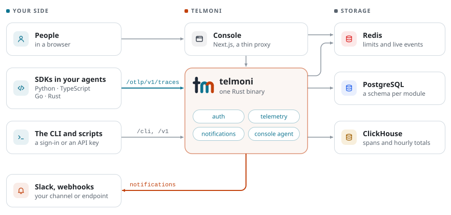

<div align="center">
  <a href="https://telmoni.com">
    <picture>
      <source media="(prefers-color-scheme: dark)" srcset=".github/assets/lockup-color-on-dark.svg">
      
    </picture>
  </a>
  <h3>Privacy-first telemetry and monitoring for AI agents</h3>
  <p>
    <a href="https://telmoni.com/docs"><strong>Docs</strong></a> ·
    <a href="https://telmoni.com/docs/self-host/overview"><strong>Self-host</strong></a> ·
    <a href="#-quickstart"><strong>Quickstart</strong></a> ·
    <a href="ARCHITECTURE.md"><strong>Architecture</strong></a>
  </p>
  <p>
    <a href="https://github.com/telmoni/telmoni/issues/new?template=bug-report.yml">Report a bug</a> ·
    <a href="https://github.com/telmoni/telmoni/issues/new?template=feature-request.yml">Request a feature</a> ·
    <a href="https://telmoni.com/docs/contributing/introduction">Contribute</a> ·
    <a href="https://github.com/telmoni/telmoni/security/policy">Report a vulnerability</a>
  </p>
  <p>
    <a href="https://github.com/telmoni/telmoni/actions/workflows/ci.yml"></a>
    <a href="LICENSE"></a>
    <a href="ARCHITECTURE.md#where-it-goes-next"></a>
    <br>
    <a href="https://telmoni.com/docs/api/ingest"></a>
    <a href="sdk"></a>
    <a href="https://telmoni.com/docs/self-host/overview"></a>
  </p>
</div>

> Know when your agents stall, loop or overspend, without sending us a single prompt.

Telmoni is an **open-source telemetry platform for AI agents**. Its SDKs record every **run** of an agent, and the **steps**, **model calls** and **tool calls** inside it, with their **tokens, timings and errors**, as OpenTelemetry spans. The console reads them back as **traces, sessions and users**. Everything is kept as **metadata**: prompts and completions come off a span before it leaves your process, and ingest drops any that arrive anyway. Telmoni is **one Rust binary** and **a Next.js console** on PostgreSQL, ClickHouse and Redis, and you can **self-host it** with Docker Compose or Kubernetes.

> [!NOTE]
> **Telmoni hasn't launched yet, and it's built in the open.** What runs today is the foundation (organizations and roles, API keys, the audit log, notifications and the console agent) and the first of the telemetry on it: the SDKs, ingest, and the console's traces, sessions and users. Monitors come next: the server already keeps each agent's schedule and bounds and marks a monitor late, failed or stalled when one is broken; the alerts that follow, cost tracking, and the console's monitor pages are being built. [Where it goes next](ARCHITECTURE.md#where-it-goes-next) lists what's settled but not built yet.

## ✨ Core features

- **[Agent telemetry](https://telmoni.com/docs/api/sdks)**: Open a run around your agent, and each step, model call and tool call inside it becomes an OpenTelemetry span with its timings, status, model, token counts and errors, tied to its run, session and end user. The SDKs send them to ingest at `/otlp/v1/traces`.
- **[Private by default](https://telmoni.com/docs/api/field-inventory)**: Telmoni keeps timings, statuses, counts and names, never content. The SDKs take prompts, completions and tool payloads off every span before it leaves your process, and ingest drops any content that arrives anyway. End-user IDs are hashed with a key unique to each project, and only an organization owner can change a project's content mode.
- **[Traces, sessions and users](https://telmoni.com/docs/workspace/traces)**: Filter and sort runs on any column, chart them over time, download them as CSV or JSON, and save views the whole project can use. A trace opens beside the list as the tree its spans ran in, a timeline of them a toggle away, a session on its runs in order, and the trace list tells you the moment new runs arrive.
- **[Organizations and audit](https://telmoni.com/docs/workspace/audit-log)**: Organizations and projects with owner, admin and member roles, invitations, transfers and scoped API keys, and sign-in by password or through any OIDC provider. Every change lands in an audit log that's hash-chained per organization and can be exported.
- **[Notifications](https://telmoni.com/docs/integrations/notifications)**: An in-app feed, Slack, and webhooks signed with HMAC-SHA256, sent through a delivery queue that retries.
- **[Console agent](https://telmoni.com/docs/self-host/agent)**: Ask questions in plain language. A read-only agent searches the docs, the audit log and the notification feed and cites its sources, running on Anthropic or any OpenAI-compatible model server, such as Ollama, vLLM or OpenRouter.
- **Monitors and alerts** *(in progress)*: A contract for each agent: a crontab schedule in its own time zone, a grace period, a stall timeout, a step cap and a cost cap, with a ping lane for cron jobs, and a check every few seconds that marks a monitor late, failed or stalled when its agent breaks the contract, opening an incident the project's channels hear of once, and closing it when the agent recovers. Rules and routing are the next milestone.

## 🚀 Quickstart

### 1️⃣ Run Telmoni

[Self-host it](#-self-hosting) with Docker Compose or Helm, or run it from source with `make up` ([Developing](#-developing)), which serves the console on http://localhost:3000 and the server on http://localhost:8082.

### 2️⃣ Create a project and an API key

Sign in to the console and create a project. On the project's **API keys** page, create a key with the **ingest** scope.

### 3️⃣ Record a run

Each SDK is `telmoni` on its registry: `pip install telmoni`, `npm install telmoni` or `cargo add telmoni`, and for Go, `go get github.com/telmoni/telmoni/sdk/go`.

```console
pip install telmoni openai
export TELMONI_ENDPOINT=http://localhost:8082   # your server; plain HTTP is refused unless it's this machine
export TELMONI_API_KEY=...                      # the ingest key from step 2
```

```python
from openai import OpenAI
from telmoni import Telmoni, Usage

telmoni = Telmoni.from_env()
openai = OpenAI()


@telmoni.run("support-bot")
def answer(question: str) -> str:
    with telmoni.model_call("gpt-4o-mini", provider="openai") as call:
        reply = openai.chat.completions.create(
            model="gpt-4o-mini",
            messages=[{"role": "user", "content": question}],
        )
        # The model and its tokens are recorded; the prompt and the reply stay here.
        call.answered(
            response_model=reply.model,
            usage=Usage(
                input_tokens=reply.usage.prompt_tokens,
                output_tokens=reply.usage.completion_tokens,
            ),
        )
    return reply.choices[0].message.content


print(answer("Where is my order?"))
telmoni.flush()
```

TypeScript, Go and Rust work the same way; the [SDK docs](https://telmoni.com/docs/api/sdks) show each.

### 4️⃣ See it in the console

Open the project's **Traces** page to find the run with its model call, tokens and timings. **Sessions** and **Users** group runs by the `session_id` and `user_id` a run is given.

## 📦 Self-hosting

Both ways to self-host pull the images [`publish.yml`](.github/workflows/publish.yml) publishes to the GitHub Container Registry, `ghcr.io/telmoni/server` and `ghcr.io/telmoni/web` (linux/amd64):

- **[Docker Compose](https://telmoni.com/docs/self-host/docker-compose)**: `deploy/compose/docker-compose.yml` runs the server, the console, PostgreSQL, ClickHouse and Redis on one machine. Write its `.env` once, then run `docker compose -f deploy/compose/docker-compose.yml up -d`.
- **[Kubernetes (Helm)](https://telmoni.com/docs/self-host/kubernetes)**: the chart in `deploy/charts/telmoni` deploys the server, the console and the migration job.

Configuration comes only from the environment ([every setting](https://telmoni.com/docs/self-host/configuration)), and [Production](https://telmoni.com/docs/self-host/production) covers OIDC, database role hardening, the reverse proxy and backups. Self-hosted Telmoni phones nothing home: the server calls only the services you configure.

## 🔌 Integrations

| Integration | Supports | Description |
|---|---|---|
| [SDKs](https://telmoni.com/docs/api/sdks) | Python, TypeScript, Go, Rust | Open a run around an agent and record its steps, model calls and tool calls as OpenTelemetry spans. |
| [Coding-agent plugins](https://telmoni.com/docs/api/coding-agents) | Claude Code, Codex, OpenCode, Cursor | Record each turn of a coding agent you already use as a run, with no code to write and never a prompt or a file. Each is an npm package under `@telmoni`. |
| [CLI](https://github.com/telmoni/telmoni-cli) | macOS, Linux | `telmoni`: device-code sign-in and your organizations from a terminal, or an API key in CI. |
| [Agent skills](https://github.com/telmoni/skills) | Claude Code, Codex, Cursor | Teach coding agents to work with the SDKs, the coding-agent plugins, the CLI, the API, webhooks and self-hosting. |
| [Slack](https://telmoni.com/docs/integrations/slack) | Notifications | A project's notifications, posted to a channel. |
| [Webhooks](https://telmoni.com/docs/integrations/webhooks) | Notifications | A project's notifications, delivered to your endpoint and signed with HMAC-SHA256. |
| [OIDC](https://telmoni.com/docs/self-host/configuration) | Any OIDC provider | Single sign-on beside the password form, or instead of it. |
| [Read API](https://telmoni.com/docs/api/reference) | HTTP, JSON | `/v1`: the organization and its members, read with an API key. |

## 🧭 How it works

<picture>
  <source media="(prefers-color-scheme: dark)" srcset=".github/assets/how-it-works-dark.svg">
  
</picture>

The `telmoni` binary runs every module (auth, notifications, telemetry and the console agent) in one process. Each module keeps its own Postgres schema under its own role, behind forced row-level security, and the spans and their hourly totals live in ClickHouse. The console is a thin proxy, so every rule lives in Rust. [ARCHITECTURE.md](ARCHITECTURE.md) explains how it's built, and why.

## 🧩 Extending Telmoni

A deployment that needs more builds on these crates instead of forking them: `telmoni_server::App::assemble` takes its own identity provider, mail transport and purge hook; a `telmoni_server::Module` mounts beside the built-in ones; a console built on this one replaces the slot files under `web/lib/extension/` and `web/components/extension/`, and imports the core only through `lib/extension/ui.ts` and `lib/extension/server.ts`. [ARCHITECTURE.md](ARCHITECTURE.md#extending-the-core) describes the seams.

## 🔧 Developing

You need Rust (the version `rust-toolchain.toml` pins, which `rustup` installs for you), Node with npm (`web/.nvmrc`), Docker and `rsync`, and the docs checked out beside this repository, since the console builds them in.

```console
git clone https://github.com/telmoni/docs.git ../docs   # once: the docs, which `make book` lays into the console
make first-run   # once: env files, dependencies, Postgres and ClickHouse, migrations
make up          # Postgres, ClickHouse, Redis, Mailpit, the server on :8082, the console on :3000
```

Sign in with the password form; mail lands in Mailpit at http://localhost:8025. [Developing](https://telmoni.com/docs/contributing/developing#the-platform) has the rest.

<details>
<summary><strong>Repository layout</strong></summary>

```text
crates/
  telmoni/        the binary: `serve`, and the admin commands (`migrate`, `rotate`, `sweep`, …)
  auth/           sign-in, organizations and projects, members, invitations, API keys
  notifications/  the feed, the Slack and webhook connectors, delivery
  agent/          the console agent: models, embeddings, the index and its hybrid search, read-only tools
  telemetry/      ingest at /otlp/v1/traces and the ping lane at /ping/v1, each project's settings,
                  monitors and the ticker that watches them, their incidents, ping keys and open runs, the outbox,
                  the spans and their hourly totals in ClickHouse, its ClickHouse file and nightly
                  purge, ClickHouse's configuration and local users
  migrator/       the migration runner, grants, role hardening, the audit schema;
                  runs telemetry's ClickHouse file and purge
  shared/         errors, RBAC, tenancy, the seams between modules
web/              the console, a thin proxy in front of the server, and the docs it serves, laid in from ../docs (`web/content/docs`)
sdk/              the SDKs: python/, typescript/, go/, rust/, and the fixtures every suite replays
contract/         the generated wire contract and OpenAPI document
deploy/           the Helm chart and the self-host compose file
scripts/          `up.sh` behind `make up`, `book.sh` behind `make book`, and the webhook tunnel and receiver for testing a connector
.github/          CI, the image publishing workflow, and the logo and diagram this README shows
ARCHITECTURE.md   how it is built, and why, on one page
```

</details>

## 💭 Support

- **Docs**: [telmoni.com/docs](https://telmoni.com/docs) covers self-hosting, the console, the SDKs, the CLI and the API, and what every [error](https://telmoni.com/docs/errors) means.
- **Bugs and feature requests**: [open an issue](https://github.com/telmoni/telmoni/issues/new/choose) from one of the templates.
- **Anything else**: [SUPPORT.md](https://github.com/telmoni/.github/blob/main/SUPPORT.md) says which channel handles what.

## 🤝 Contributing

Contributions are welcome. Start with the [introduction](https://telmoni.com/docs/contributing/introduction), and read the [AI policy](https://telmoni.com/docs/contributing/ai-policy) and the [Code of Conduct](https://telmoni.com/docs/contributing/code-of-conduct) before you open a pull request.

## 🔒 Security

Please don't report a vulnerability in a public issue. Report it privately from this repository's [Security tab](https://github.com/telmoni/telmoni/security) or to hello@telmoni.com, as the [security policy](https://telmoni.com/docs/legal/security#reporting-a-vulnerability) explains.

## 📄 License

Apache-2.0 ([LICENSE](LICENSE), [NOTICE](NOTICE)). Unless you say otherwise, a contribution you submit is licensed the same way.
