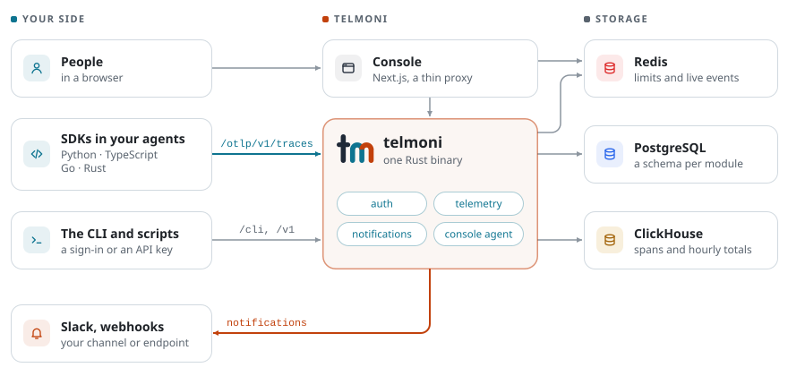

<div align="center">
  <a href="https://telmoni.com">
    <picture>
      <source media="(prefers-color-scheme: dark)" srcset=".github/assets/lockup-color-on-dark.svg">
      
    </picture>
  </a>
  <h3>Privacy-first, open-source monitoring for AI agents</h3>
  <p>
    <a href="https://telmoni.com/docs"><strong>Docs</strong></a> ·
    <a href="#quickstart"><strong>Quickstart</strong></a> ·
    <a href="https://telmoni.com/docs/self-host/overview"><strong>Self-host</strong></a> ·
    <a href="ARCHITECTURE.md"><strong>Architecture</strong></a> ·
    <a href="https://telmoni.com/docs/contributing/introduction"><strong>Contribute</strong></a>
  </p>
  <p>
    <a href="https://github.com/telmoni/telmoni/actions/workflows/ci.yml"></a>
    <a href="LICENSE"></a>
    <a href="ARCHITECTURE.md#where-it-goes-next"></a>
  </p>
</div>

> Know when your agents fail, stall, loop or overspend, and stop them at the cap you set. Prompts stay in your process unless you turn content on.

Telmoni is privacy-first, open-source monitoring for the AI agents you run: a Python service, a nightly batch, a LangGraph graph, a Claude Code session. Its SDKs and its Claude Code, Codex and Antigravity plugins record each **trace** of an agent, and the **steps**, **model calls**, **tool calls** and **retrievals** inside it, as OpenTelemetry spans; Telmoni alerts when a trace fails, stalls, loops, overspends or stops arriving, stops a trace at the caps you set, and shows you the trace that did it. Only metadata is kept unless you choose otherwise: prompts and completions come off a span before it leaves your process, and ingest drops any that arrive anyway, until a project's owner turns its content on and your code asks for it, when it is kept sealed under the project's own key. It is one Rust binary and a Next.js console on PostgreSQL, ClickHouse and Redis, self-hosted with Docker Compose or Helm.

> [!NOTE]
> Telmoni hasn't launched yet and isn't at 1.0, and it's built in the open: until it is, expect it to change every month, sometimes incompatibly. Running today: organizations and roles, API keys, the audit log, notifications, the console agent, and the telemetry on them: the SDKs and the Claude Code, Codex and Antigravity plugins, ingest, the console's traces, grouped by session or user, with each agent's changes of release, model and prompt version marked, dashboards, alerts, a cost alert among them, and objectives, each project's open incidents on its Agents page, the cost a call reports, scores, content an owner chooses to keep, and the SDKs' guard, which stops a trace at the caps on its steps and spend you set. [Where it goes next](ARCHITECTURE.md#where-it-goes-next) lists what is built, and [Known gaps](ARCHITECTURE.md#known-gaps) what isn't right yet.

## Features

- **[Alerts](https://telmoni.com/docs/monitoring/alerts)**: a trace that fails, runs long, loops on one tool, takes too many steps, is left open or costs past its cap, and traces that stop arriving, over an hour, a day or a week, against an alert threshold and an optional warning one; each incident told once to the feed and to the Slack channels and webhooks an alert links, acknowledged or muted from Slack, with maintenance windows; and those still open on each project's Agents page.
- **[Guard](https://telmoni.com/docs/api/sdks#the-guard)**: opt-in caps on a trace's steps and spend, counted in the agent's own process with no call to us, which stop an agent before it overspends.
- **[Objectives](https://telmoni.com/docs/monitoring/objectives) and [spend](https://telmoni.com/docs/monitoring/dashboards)**: objectives that promise a share of an agent's traces succeed or end in time, paging when the error budget burns too fast; budgets with the day they'll be reached; and spend, tokens, traces, failures and latency, split by agent, model, provider or tag.
- **[Agent telemetry](https://telmoni.com/docs/api/sdks)**: open a trace around your agent, or install a [coding-agent plugin](https://telmoni.com/docs/api/coding-agents), and each step, model call, tool call and retrieval inside it becomes a span with its timings, status, model, tokens, cost and errors. Any framework that speaks OpenTelemetry works too.
- **[Private by default](https://telmoni.com/docs/api/field-inventory)**: timings, statuses, counts and names, never content. End-user and session IDs are hashed with a key unique to each project, and the field inventory lists every attribute ingest reads, and what becomes of it.
- **[Content, when you choose it](https://telmoni.com/docs/monitoring/content)**: prompts, completions, the model's thinking, tool inputs and outputs, images and files, and failures with their stack traces, kept in full only where a project's owner turns its content mode on and the developer's capture switch is on too, sealed under the project's own key, and every read of it in the audit log.
- **[Traces](https://telmoni.com/docs/monitoring/traces)**: the trace behind every alert, as the tree its spans ran in or as a timeline; filter, sort, chart and download traces, by session and end user too, see new traces the moment they arrive, and see where an agent first ran on a new release, model or prompt version, marked on the charts.
- **[Scores](https://telmoni.com/docs/monitoring/scores)**: scores on a trace, a span or a session from your code or a member, alerted on when they drop.
- **[Organizations and audit](https://telmoni.com/docs/workspace/audit-log)**: owner, admin and member roles, invitations, transfers and scoped API keys; sign-in by password or any OIDC provider; and an audit log hash-chained per organization, exportable.
- **[Notifications](https://telmoni.com/docs/integrations/notifications)**: an in-app feed, Slack, and webhooks signed with HMAC-SHA256, through a delivery queue that retries.
- **[Console agent](https://telmoni.com/docs/self-host/agent)**: questions in plain language, answered from the docs, the audit log and the feed with sources cited, on Anthropic or any OpenAI-compatible server such as Ollama, vLLM or OpenRouter.

## Quickstart

### 1. Run Telmoni

[Self-host it](#self-hosting) with Docker Compose or Helm, or run it from source with `make up` ([Developing](#developing)): the console on http://localhost:3000, the server on http://localhost:8082.

### 2. Create a project and an API key

Sign in, create a project, and on its **API keys** page create a key with the **ingest** scope.

### 3. Record a trace

Each SDK is `telmoni` on its registry: `pip install telmoni`, `npm install telmoni`, `cargo add telmoni`, or `go get github.com/telmoni/telmoni/sdk/go`.

```console
pip install telmoni openai
export TELMONI_ENDPOINT=http://localhost:8082   # your server; plain HTTP is refused unless it's this machine
export TELMONI_API_KEY=...                      # the ingest key from step 2
```

```python
from openai import OpenAI
from telmoni import Telmoni, Usage

telmoni = Telmoni.from_env()
openai = OpenAI()


@telmoni.trace("support-bot")
def answer(question: str) -> str:
    with telmoni.model_call("gpt-4o-mini", provider="openai") as call:
        reply = openai.chat.completions.create(
            model="gpt-4o-mini",
            messages=[{"role": "user", "content": question}],
        )
        # The model and its tokens are recorded; the prompt and the reply stay here.
        call.answered(
            response_model=reply.model,
            usage=Usage(
                input_tokens=reply.usage.prompt_tokens,
                output_tokens=reply.usage.completion_tokens,
            ),
        )
    return reply.choices[0].message.content


print(answer("Where is my order?"))
telmoni.flush()
```

TypeScript, Go and Rust work the same way; the [SDK docs](https://telmoni.com/docs/api/sdks) show each.

### 4. See it in the console

The project's **Traces** page shows the trace with its model call, tokens and timings. **Group by** lays its traces out by the `session_id` or the `user_id` a trace is given.

## Self-hosting

No images are published: both paths build `server` and `web` from a checkout of this repository, for linux/amd64:

- **[Docker Compose](https://telmoni.com/docs/self-host/docker-compose)**: `deploy/compose/docker-compose.yml` runs the server, the console, PostgreSQL, ClickHouse and Redis on one machine. Copy `deploy/compose/.env.example` to `deploy/compose/.env`, fill its six secrets, then `docker compose -f deploy/compose/docker-compose.yml up -d --build --wait --wait-timeout 180`, which builds both images first.
- **[Kubernetes](https://telmoni.com/docs/self-host/kubernetes)**: the chart in `deploy/charts/telmoni` deploys the server, the console and the migration job, from the images you build and push to your own registry.

Configuration comes only from the environment ([every setting](https://telmoni.com/docs/self-host/configuration)); [Production](https://telmoni.com/docs/self-host/production) covers OIDC, database role hardening, the reverse proxy and backups. A self-hosted Telmoni phones nothing home: the server calls only the services you configure.

## Integrations

| Integration | For | What it does |
|---|---|---|
| [SDKs](https://telmoni.com/docs/api/sdks) | Python, TypeScript, Go, Rust | Record an agent's traces, steps, model calls, tool calls and retrievals as spans. |
| [Coding-agent plugins](https://telmoni.com/docs/api/coding-agents) | Claude Code, Codex, Antigravity | Record each turn of a coding agent you already use as a trace, with no code to write: metadata alone, unless you turn its content on. |
| [CLI](https://github.com/telmoni/telmoni-cli) | macOS, Linux | `telmoni`: sign in from a terminal (device code) or CI (an API key), see who you are, and switch organizations. |
| [Slack](https://telmoni.com/docs/integrations/slack) | Notifications | A project's notifications, posted to a channel. |
| [Webhooks](https://telmoni.com/docs/integrations/webhooks) | Notifications | A project's notifications, delivered to your endpoint and signed with HMAC-SHA256. |
| [OIDC](https://telmoni.com/docs/self-host/configuration) | Any OIDC provider | Single sign-on beside the password form, or instead of it. |
| [Read API](https://telmoni.com/docs/api/reference) | HTTP, JSON | `/v1`: the organization, traces, metrics, incidents and agents' changes, read with an API key; scores written. |

## How it works

<picture>
  <source media="(prefers-color-scheme: dark)" srcset=".github/assets/how-it-works-dark.svg">
  
</picture>

One Rust binary, `telmoni-server`, runs every module, auth, notifications, telemetry and the console agent, in one process. Each module keeps its own Postgres schema under its own role, behind forced row-level security, and the spans and their hourly totals live in ClickHouse. The console is a thin proxy, so every rule lives in Rust. [ARCHITECTURE.md](ARCHITECTURE.md) explains how it's built, and why.

## Extending Telmoni

A deployment that needs more builds on these crates instead of forking them: `telmoni_server::App::assemble` takes its own identity provider, mail transport and purge hook, a `telmoni_server::Module` mounts beside the built-in ones, and a console built on this one replaces the slot files under `web/lib/extension/` and `web/components/extension/`. [ARCHITECTURE.md](ARCHITECTURE.md#extending-the-core) describes the seams.

## Developing

You need Rust (the version `rust-toolchain.toml` pins, which `rustup` installs for you), Node with npm (`web/.nvmrc`) and Docker.

```console
make first-run   # once: env files, dependencies, Postgres and ClickHouse, migrations
make up          # Postgres, ClickHouse, Redis, Mailpit, the server on :8082, the console on :3000
```

Sign in with the password form; mail lands in Mailpit at http://localhost:8025. [Developing](https://telmoni.com/docs/contributing/developing#the-platform) has the rest, and [`AGENTS.md`](AGENTS.md) holds the rules the code is held to.

<details>
<summary><strong>Repository layout</strong></summary>

```text
crates/
  telmoni/        the binary: `serve`, and the admin commands (`migrate`, `rotate`, `sweep`, …)
  auth/           sign-in, organizations and projects, members, invitations, API keys
  notifications/  the feed, the Slack and webhook connectors, delivery
  agent/          the console agent: models, embeddings, the index and its hybrid search, read-only tools
  telemetry/      ingest at /otlp/v1/traces, each project's settings, the spans and their hourly
                  totals in ClickHouse, the content an `on` project keeps, sealed in Postgres,
                  scores, alerts and objectives, its ClickHouse file and nightly
                  purge, and the model prices, converted from LiteLLM's by `make prices`
  migrator/       the migration runner, grants, role hardening, the audit schema
  shared/         errors, RBAC, tenancy, the seams between modules
web/              the console, a thin proxy in front of the server, and the docs it serves (content/docs)
sdk/              the SDKs: python/, typescript/, go/, rust/, and the fixtures every suite replays
contract/         the generated wire contract, OpenAPI document and lanes' answers
deploy/           the Helm chart and the self-host compose file
scripts/          `up.sh` behind `make up`, and the webhook tunnel and receiver
.github/          CI, the dependency audit, the SDK release workflow, and the logo and diagram this README shows
ARCHITECTURE.md   how it is built, and why, on one page
```

</details>

## Support and contributing

[The docs](https://telmoni.com/docs) cover self-hosting, the console, the SDKs, the CLI, the API and every [error](https://telmoni.com/docs/errors). For a bug or a feature, [open an issue](https://github.com/telmoni/telmoni/issues/new/choose) from a template; for anything else, [SUPPORT.md](https://github.com/telmoni/.github/blob/main/SUPPORT.md) says which channel handles what. Contributions are welcome: start with the [introduction](https://telmoni.com/docs/contributing/introduction), and read the [AI policy](https://telmoni.com/docs/contributing/ai-policy) and the [Code of Conduct](https://telmoni.com/docs/contributing/code-of-conduct) before opening a pull request.

## Security

Please don't report a vulnerability in a public issue. Report it privately from this repository's [Security tab](https://github.com/telmoni/telmoni/security) or to hello@telmoni.com, as the [security policy](https://telmoni.com/docs/legal/security#reporting-a-vulnerability) explains.

## License

Apache-2.0 ([LICENSE](LICENSE), [NOTICE](NOTICE)). Unless you say otherwise, a contribution you submit is licensed the same way.
