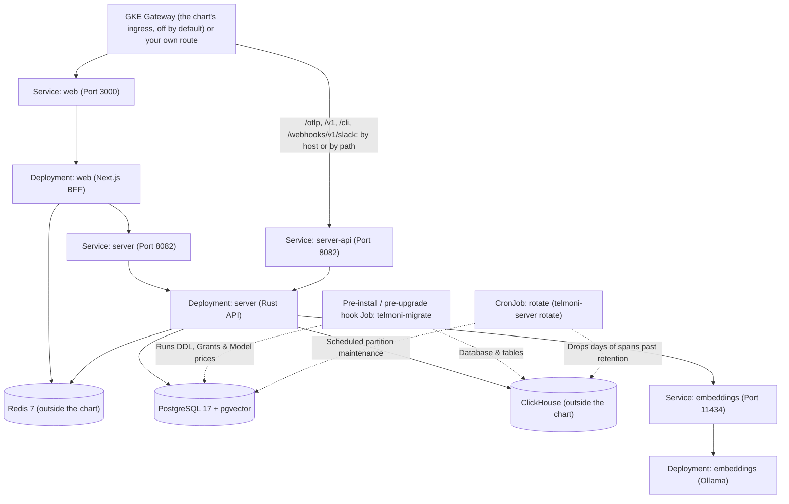

Telmoni provides a Helm chart located in `deploy/charts/telmoni`. It packages the core backend server, the Next.js web console, a migration hook Job, a partition-rotation CronJob, network policies, and an optional in-cluster Ollama vector embeddings deployment.

## Architecture on Kubernetes



---

## Prerequisites

Before deploying the Helm chart, ensure you have:
- A Kubernetes cluster, 1.30 or later (each pod's `preStop` is Kubernetes' own `sleep`): GKE, Amazon EKS, Azure Kubernetes Service, k3s or another. On Google Cloud the keys below can be Cloud KMS keys; on any cluster they can be key files mounted from a Secret
- [Helm](https://helm.sh/docs/intro/install/) 3 (the chart's `apiVersion` is `v2`)
- Nodes that run `linux/amd64`: the published images are built for it alone, each tagged with the full SHA of its commit, which `global.imageTag` names (required)
- A PostgreSQL 17 database instance with the `vector` extension, pgvector 0.8 or later, created by a superuser before the first migration
- The five login roles `auth`, `notifications`, `agent`, `telemetry` and `migrator`, created by you, each with its own password, then hardened with `role_hardening.sql` as the [production guide](/docs/self-host/production) describes; the connection strings below log in as them
- A ClickHouse server outside the chart, one node, reached over its HTTP interface (8123 for `http` and 8443 for `https`, by default), with two users of its own:
  - `migrator`, which the migration and rotation run as, granted `CREATE DATABASE, CREATE TABLE, CREATE VIEW, CREATE ROW POLICY, SELECT, INSERT, ALTER DELETE ON telemetry.*`, the last for dropping partitions past retention and rewriting away the rows a deleted project left. It creates the `telemetry` database, its tables, a row policy that holds every user but itself to the projects each read names, and one that lets it read every row, for the nightly drop; so the server's user must not be the migrator's. Name the rights one by one rather than `ALL ON telemetry.*`: ClickHouse grants `ALL` on the bare name `telemetry` too, which is the server's user's, and with it the rights to alter or drop that user and to act as it.
  - `telemetry`, which the server connects as, granted `SELECT, INSERT, ALTER DELETE ON telemetry.spans` and `SELECT, ALTER DELETE ON telemetry.spans_hourly`, and nothing else in the database. `ALTER DELETE` is what a lightweight delete needs: the server marks a deleted project's rows with one in each table, naming that one project. A grant on all of the database would take in the view that fills the hourly totals, which reads as the migrator, past the row policy, and so answers every project's totals.
- ClickHouse's configuration: `crates/telemetry/clickhouse/low-memory.xml`, the one to give a one-node ClickHouse and the one that keeps a customer's values out of ClickHouse's own log, its logger stopping at warnings, writing no query's error and masking every quoted literal anything else writes. Use it whole. `crates/telemetry/clickhouse/dev-users.xml` shows the two users and their grants as a `users.d` file, but its passwords are the development ones in plain text and it admits every network: write yours with `password_sha256_hex` and `networks` narrowed to your pods' range. The server must keep one default: `custom_settings_prefixes` allowing `SQL_`, or every read is refused
- A way to ClickHouse that a pod accepts: `https` with a certificate from a public CA, or plain `http` to loopback or a Service's name inside the cluster, with its namespace (`clickhouse.<namespace>.svc`, `….svc.cluster.local`): a bare name no Service in the namespace answers falls through the node's DNS search path to whatever outside the cluster does. In a pod, the server and the migrator refuse `http` to any other host, a VM on the same network included, and trust no private CA for ClickHouse. A ClickHouse inside the cluster, like any store there, is admitted by selector (`networkPolicies.stores`, under [Kubernetes security & isolation](#kubernetes-security--isolation))
- A Redis 7 instance outside the chart, reached at a single endpoint (the console does not support Redis Cluster mode)
- A route from outside to the `web` Service on port 3000, and one for the machine lanes — ingest at `/otlp/v1/traces`, where the SDKs send; the read API under `/v1`; the CLI's sign-in under `/cli/v1`; Slack's signed events at `/webhooks/v1/slack` — and the [heartbeat](/docs/self-host/production#the-heartbeat) at `/heartbeat` to the `server-api` Service on port 8082: on a host of their own (`api.telmoni.example.com`, then the SDKs' endpoint) or under their paths on the console's host (then the endpoint), and only those paths, since the rest of the server is the console's to call. The chart's own `ingress` is a GKE Gateway (a Gateway API `Gateway` on a named static address with an HTTPS listener and an HTTP-to-HTTPS redirect, plus GKE's `HealthCheckPolicy` on `/api/health` and a `GCPBackendPolicy` with a 3,600-second timeout for the console's event streams, and an `HTTPRoute` for the lanes with a `HealthCheckPolicy` on `/livez` and a `GCPBackendPolicy` that drains for 30 seconds) and is off by default; on another cluster, bring your own Ingress or Gateway for both
- For the key each project's user ids are hashed under (`TELEMETRY_KEK`), and for connectors (Slack and webhooks alike, `CONNECTOR_KEK`), one of two shapes. Off Google Cloud, a key file: 64 hex characters (`openssl rand -hex 32`) under the keys `telemetry` and `connector` of a Secret named `server-kek` beside the chart, which the server pods mount at `/var/run/secrets/telmoni/kek`, named `file:/var/run/secrets/telmoni/kek/telemetry` (and `…/connector`): a secret to back up beside the database, since a dump restored without it leaves every stored user id matching nothing new and every connector grant unreadable. On Google Cloud, a Cloud KMS key for each, which the server pods may encrypt and decrypt with. They reach it with the token the GKE metadata server gives their Kubernetes service account, `server`, which the chart creates without a Workload Identity annotation, so after installing the chart either grant the key's encrypt and decrypt roles to that account's principal (`principal://iam.googleapis.com/projects/<project number>/locations/global/workloadIdentityPools/<project>.svc.id.goog/subject/ns/telmoni/sa/server`) or bind a Google service account that holds them (`kubectl annotate serviceaccount server -n telmoni iam.gke.io/gcp-service-account=<account>`, then restart the server pods). The server does not try the keys at boot: a missing binding first shows as a `502` `/errors/connectors/key-unavailable` when a connector is set up, and for `TELEMETRY_KEK` as a `503` `/errors/telemetry/store-unavailable` on a project's first export, which exporters retry. A key file that cannot be read stops the server at boot, naming it; a `local:` `CONNECTOR_KEK` or `TELEMETRY_KEK`, whose key would sit in the ConfigMap, is refused in a pod

---

## Deployment steps

<Steps>

<Step>

**Prepare namespace and Kubernetes secrets**

Create a dedicated namespace:

```bash
kubectl create namespace telmoni
```

Generate random 32-byte tokens for the service communication secret and session cookie seal:

```bash
SERVICE_SECRET=$(openssl rand -hex 32)
AUTH_SECRET=$(openssl rand -hex 32)
```

`DATABASE_CA_CERT` (the PEM of the database's CA) belongs in both Secrets that reach the database: `server-secrets`, and `migrator-secrets`, which holds `MIGRATOR_DATABASE_URL`, `MIGRATOR_CLICKHOUSE_URL` and `DATABASE_CA_CERT` (the console's `web-secrets` holds no database settings). In a Kubernetes pod the server and the migrator refuse to start without it.

Create the required Kubernetes secret objects. Each database URL carries the password you gave its role in the [production guide](/docs/self-host/production), and each ClickHouse URL the password of its ClickHouse user, with any character other than a letter, a digit, `-`, `.`, `_` or `~` percent-encoded (`@` as `%40`). The ClickHouse URLs below reach a server outside the cluster over `https`, its certificate a public CA's; one inside it is `http://telemetry:<password>@clickhouse.<namespace>.svc:8123` instead, and the same for `migrator`. The `AGENT_MODEL_API_KEY` line is for a hosted model only; leave it out otherwise.

```bash
# 1. Server secrets
kubectl create secret generic server-secrets \
  --namespace telmoni \
  --from-literal=AUTH_DATABASE_URL="postgres://auth:<auth password>@postgres.internal:5432/telmoni" \
  --from-literal=NOTIFICATIONS_DATABASE_URL="postgres://notifications:<notifications password>@postgres.internal:5432/telmoni" \
  --from-literal=AGENT_DATABASE_URL="postgres://agent:<agent password>@postgres.internal:5432/telmoni" \
  --from-literal=TELEMETRY_DATABASE_URL="postgres://telemetry:<telemetry password>@postgres.internal:5432/telmoni" \
  --from-literal=TELEMETRY_CLICKHOUSE_URL="https://telemetry:<ClickHouse telemetry password>@clickhouse.example.com:8443" \
  --from-literal=REDIS_URL="redis://redis.internal:6379" \
  --from-literal=SERVICE_SECRET="$SERVICE_SECRET" \
  --from-literal=ADMIN_EMAIL="admin@example.com" \
  --from-literal=ADMIN_PASSWORD="<admin password>" \
  --from-literal=AGENT_MODEL_API_KEY="sk-..." \
  --from-file=DATABASE_CA_CERT=/path/to/database-ca.pem

# 2. Web console secrets
kubectl create secret generic web-secrets \
  --namespace telmoni \
  --from-literal=SERVICE_SECRET="$SERVICE_SECRET" \
  --from-literal=AUTH_SECRET="$AUTH_SECRET" \
  --from-literal=REDIS_URL="redis://redis.internal:6379"

# 3. Migrator secrets
kubectl create secret generic migrator-secrets \
  --namespace telmoni \
  --from-literal=MIGRATOR_DATABASE_URL="postgres://migrator:<migrator password>@postgres.internal:5432/telmoni" \
  --from-literal=MIGRATOR_CLICKHOUSE_URL="https://migrator:<ClickHouse migrator password>@clickhouse.example.com:8443" \
  --from-file=DATABASE_CA_CERT=/path/to/database-ca.pem

# 4. Off Google Cloud: the keys the server mounts (config.telemetryKek's file:)
kubectl create secret generic server-kek \
  --namespace telmoni \
  --from-file=telemetry=<(openssl rand -hex 32 | tr -d '\n') \
  --from-file=connector=<(openssl rand -hex 32 | tr -d '\n')
```

Each Secret is handed to its pods whole, as environment. `server-secrets` is therefore also where the server's other secrets go when you use them: `SMTP_URL`, the identity provider's `AUTH_CUSTOM_CLIENT_ID`, `AUTH_CUSTOM_CLIENT_SECRET` and `AUTH_CUSTOM_ISSUER`, the `SLACK_*` credentials, `EMBEDDINGS_API_KEY`, `RERANK_API_KEY` and `TELMONI_API_KEY`. `REDIS_CA_CERT`, for a `rediss://` URL, belongs in `web-secrets`: the console reads it, and the server does not, trusting the certificate authorities its image carries — so a Redis whose certificate a private authority signed is one the server cannot reach: its limits fall back to each replica's own, and ingest claims no export, so a copy an exporter sends again is written again, all of which it logs. Everything else the two read comes from the chart: the values under `config` through the `telmoni-tier` ConfigMap (`APP_URL`, `AUTH_URL`, `LOG_LEVEL`, the sign-in switches and the provider's other `AUTH_CUSTOM_*` settings, `AUTH_REDIRECT_URI` from `config.redirectUri`, which defaults to `http://localhost:3000/auth/callback` and is set to `https://<your host>/auth/callback` with an identity provider, `AUTH_PROVIDER_ORIGINS`, `COMPANY_NAME`, `SUPPORT_EMAIL`, `LEGAL_URL`, `MAIL_FROM`, `CONNECTOR_KEK`, `TELEMETRY_KEK` and the agent settings, with `TRUSTED_PROXY_HOPS` from `web.trustedProxyHops` and `LIVE_REFRESH_HOLD_SECS` from `web.liveRefreshHoldSeconds`), and `PORT` and `SERVER_URL` from the Deployments themselves. Pods read them when they start. A `helm upgrade` that changes the ConfigMap rolls the server and console pods (each carries its checksum), and `helm rollback` restores it with the rest of the release, to any revision that held it as one; a changed Secret restarts no pod, so follow it with `kubectl rollout restart deployment -n telmoni`.

</Step>

<Step>

**Configure Helm values**

Create a custom `values-prod.yaml` file. 

`TELEMETRY_KEK` and `CONNECTOR_KEK` come from the chart values `config.telemetryKek` and `config.connectorKek`, which name a key rather than hold one, and a `local:` key is refused in a pod. `telemetryKek` is required, and the chart refuses to render without it: a Cloud KMS key name like `projects/<p>/locations/<l>/keyRings/<r>/cryptoKeys/<k>`, or `file:/var/run/secrets/telmoni/kek/telemetry` with the `server-kek` Secret above. `connectorKek` takes the same two shapes, `…/kek/connector` for the file, and one KMS key may serve both; left empty, no connector is offered. The server also reads `REDIS_URL` from `server-secrets`, the same Redis as the console's, for ingest's claims and rate limits:

```yaml
config:
  logLevel: "info"
  appUrl: "https://telmoni.example.com"
  authUrl: "https://telmoni.example.com"
  disableSignup: true
  verifyEmail: false
  connectorKek: "projects/my-project/locations/global/keyRings/my-ring/cryptoKeys/connector-kek"
  telemetryKek: "projects/my-project/locations/global/keyRings/my-ring/cryptoKeys/telemetry-kek"

  # Optional AI Agent configuration. Anthropic's, OpenAI's or Google's API
  # needs AGENT_MODEL_API_KEY in server-secrets, or the server refuses to start.
  agent:
    modelProvider: "anthropic" # or "openai"
    model: "claude-sonnet-5"
    # If embeddingsUrl is left empty and embeddings.enabled is true,
    # the chart automatically routes to the in-cluster Ollama service.
    embeddingsUrl: ""
    embeddingsModel: "nomic-embed-text"

# In-cluster Ollama deployment for local embeddings
embeddings:
  enabled: true
  model: "nomic-embed-text"
  resources:
    requests:
      cpu: "500m"
      memory: "2Gi"
    limits:
      memory: "4Gi"

# Core backend server
server:
  enabled: true
  replicas: 2
  resources:
    requests:
      cpu: "250m"
      memory: "256Mi"
    limits:
      memory: "1Gi"

# Web console (Next.js). Its per-address rate limits read X-Forwarded-For
# trustedProxyHops entries back from the end: the GKE Gateway appends the
# client's address and then its own, so 2 is the default; change it only
# behind another appending hop.
web:
  enabled: true
  replicas: 2
  trustedProxyHops: 2
  resources:
    requests:
      cpu: "200m"
      memory: "256Mi"
    limits:
      memory: "512Mi"

# High availability configurations
highAvailability:
  enabled: true
  minReplicas: 2
  maxReplicas: 3
  targetCpuUtilization: 70

# Database migration and partition maintenance
migrator:
  enabled: true
  hook:
    enabled: true # Executes as a pre-install / pre-upgrade Helm hook
  rotateSchedule: "0 2 * * *" # Daily partition rotation
```

The sign-in settings are values under `config` as well, each the `AUTH_*` variable of the same name in the [configuration reference](/docs/self-host/configuration), with its default: `disableSignup` (`true`, so that only an invited address can sign up), `disableUsernamePassword`, `domainsWithSsoEnforcement` and `redirectUri`, and the provider's `customName`, `customScope`, `customChecks`, `customIdTokenSignedResponseAlg`, `customFetchUserinfo` and `customAllowAccountLinking`, whose client id, secret and issuer are the `server-secrets` keys above. Where every new person starts is `defaultOrgId`, `defaultOrgRole`, `defaultProjectId` and `defaultProjectRole`, the `TELMONI_DEFAULT_*` variables of the [default organization](/docs/self-host/configuration#a-default-organization-and-project), all empty unless set.

Enabling `highAvailability.enabled` creates a `HorizontalPodAutoscaler` and a `PodDisruptionBudget` for both `web` and `server` (`deploy/charts/telmoni/templates/high-availability.yaml`), and spreads each Deployment's replicas across nodes where there are several, so losing one node leaves a replica running.

</Step>

<Step>

**Install the Helm chart**

From your repository root, run `helm install` with `global.imageTag` set to the commit your checkout is at, so the chart's templates and both images are the same commit. Every commit CI passed on `main` is published under its full SHA ([server images](https://github.com/telmoni/telmoni/pkgs/container/server)); check out one listed there. The chart refuses to render without the tag.

```bash
helm install telmoni ./deploy/charts/telmoni \
  --namespace telmoni \
  --values values-prod.yaml \
  --set global.imageTag="$(git rev-parse HEAD)"
```

</Step>

<Step>

**Verify the installation**

Check the pods:

```bash
kubectl get pods -n telmoni
```

The `server` and `web` Deployments run between the autoscaler's `minReplicas` and `maxReplicas` (two to three above; with `highAvailability.enabled` off, the `replicas` you set) and `embeddings` one pod, each `Running` and `1/1` once its probes pass: a startup probe gives the server 90 seconds to connect its pools and bind (`/livez`, which is then its liveness probe too), its readiness probe reads every module's tables (`/health`), the console's probes are `/api/health`, and the embeddings pod is ready only once its model has been pulled. The migration Job, `telmoni-migrate`, is a Helm hook deleted as soon as it succeeds, so its pod is listed only while it runs or after it failed, and a failed migration fails `helm install` itself.

</Step>

</Steps>

### Upgrading

The chart runs both images at `global.imageTag`, a commit's full SHA, which it requires. Upgrade by checking out a newer commit and setting the tag to it: `helm upgrade` runs the migration Job first, as a pre-upgrade hook, and a failed migration fails the upgrade.

```bash
helm upgrade telmoni ./deploy/charts/telmoni \
  --namespace telmoni \
  --values values-prod.yaml \
  --set global.imageTag="$(git rev-parse HEAD)"
```

Before Telmoni's first release its migrations are edited in place rather than added to, so an upgrade across such an edit is refused: the migration Job fails naming the schema whose applied migration has changed, or ClickHouse's ledger whose digest differs, and the upgrade stops before any pod rolls, the old release still serving. The way forward is to make both stores again, which deletes every organization, project and span: drop the Postgres schemas and ClickHouse's `telemetry` database with its row policies, as an administrator, then run the upgrade again.

---

## Kubernetes security & isolation

The Telmoni Helm chart sets these defaults:

- **Non-root enforcement**: Every container runs as UID `65532` with `runAsNonRoot: true`, `allowPrivilegeEscalation: false`, the `RuntimeDefault` seccomp profile and `drop: [ALL]`, and no pod mounts a service-account token or receives service-link environment variables. The server, the migrator jobs and the embeddings pod mount a read-only root filesystem (the embeddings pod writes its model to an `emptyDir`), while the console's stays writable for Next's render cache.
- **NetworkPolicies**, unless `networkPolicies.enabled` is `false`, which leaves them to policies of your own: `default-deny-all` refuses every pod's ingress and egress in the namespace, and the rest open only what is used:
  - `allow-kube-dns`: every pod may reach cluster DNS on port 53, and the NodeLocal DNSCache pods that answer in its place where a cluster runs the cache, as GKE does.
  - `allow-web-ingress`: the console accepts port `3000` from anywhere, since the load balancer reaches its pods directly.
  - `allow-web-egress`: the console reaches the `server` pods on `8082` and any address on `6378` or `6379`, for Redis, and nothing else.
  - `allow-server-ingress`: the server accepts `8082` from anywhere, as the console does, since the load balancer reaches its pods directly for the machine lanes; each lane has a gate of its own, the service secret or a project API key.
  - `allow-server-and-jobs-egress`: the server and the migrator jobs may reach any address, for the database, ClickHouse, Redis, the mail and identity vendors, the KMS key and customers' webhooks; the server's own URL guard is what keeps a webhook off private addresses.
  - A store inside the cluster (Postgres, ClickHouse or Redis) is listed under `networkPolicies.stores`, since an address rule is not applied to pods everywhere (GKE Dataplane V2 and other Cilium-based clusters skip it): each entry a `name`, the store's `podSelector` labels, its `namespaceSelector` labels, its `port`, and `web: true` where the console reaches it too (Redis). The server and the migrator jobs, and the console where it says so, may then reach the store's pods on that port; with no `namespaceSelector` the store is in the chart's namespace, and `allow-store-<name>` opens its pods to them there, which `default-deny-all` would close.
  - `allow-server-to-web`: the server may reach the console's pods on `3000`, where it reads the docs the agent answers from (`DOCS_CORPUS_URL`). It names the pods because an address rule like the one above is not applied to traffic between pods everywhere: GKE Dataplane V2 and other Cilium-based clusters skip it.
  - `allow-embeddings-ingress`, `allow-embeddings-egress` and `allow-server-to-embeddings`, with `embeddings.enabled`: the embeddings pod accepts `11434` from the `server` pods alone and may reach any host on port 443 for the model pull at each start, and the server may reach it on `11434`.
- **Rollouts that lose nothing**: each server and console pod keeps serving for 10 seconds after it is told to stop (a `preStop` sleep), while its endpoint leaves the Service and the load balancer, then drains, within a 45-second grace period. With `ingress.enabled`, the machine lanes' backend drains for 30 seconds, as the console's does, so an export in flight on a stopping pod finishes.
- **Pre-upgrade Migration Safety**: Migrations run as a Kubernetes `Job` annotated `"helm.sh/hook": pre-install,pre-upgrade` at weight `-5`, with `backoffLimit: 0` and `activeDeadlineSeconds: 300`; the `migrator` ServiceAccount it needs is a hook too, at weight `-10`, and is kept. It takes `LOG_LEVEL` inline and the rest from `migrator-secrets`, so the `telmoni-tier` ConfigMap is an ordinary object of the release. If a migration fails, the release fails before anything else is updated, the ConfigMap included.
- **Partition Management**: The chart runs partition rotation itself, as a CronJob named `rotate` (`migrator.rotateSchedule`, default `"0 2 * * *"`, in `Etc/UTC`, never two at once), running `telmoni-server rotate` as the migrator role to ensure the current month and the next three months of audit partitions exist ahead of time, and, as the migrator's ClickHouse user, to drop each day of spans once every span in it arrived more than 360 days ago, and each month of hourly totals once it is more than 13 months behind.

## Reaching the console and the machine lanes

`ingress.enabled: true` renders the chart's GKE Gateway: `ingress.gatewayClassName` (default `gke-l7-global-external-managed`), `ingress.staticAddressName` (default `telmoni-web`, a global static address you have reserved) and `ingress.annotations` (default `networking.gke.io/certmap: telmoni-web`, the certificate map holding the console's certificate). Port 80 answers a `301` to HTTPS, and the Gateway's health check reads `/api/health`. That Gateway appends two `X-Forwarded-For` entries, which is what `web.trustedProxyHops: 2` counts.

The machine lanes ride the same Gateway, to the `server-api` Service. `ingress.apiHost` names a host of their own (`api.telmoni.example.com`), whose certificate the map must hold too and which is then what an SDK's `endpoint` names; left empty, the lanes are routed by path on the console's host, which is then the endpoint, and the paths (`/otlp`, `/v1`, `/cli`, `/webhooks`, `/heartbeat`) are reserved slugs no organization can take. On either host only the lanes' paths reach the server: everything else on it is the console's to call, behind the service secret. The lanes' health check is `/livez`, which touches no database, so a database blip does not also refuse an exporter's retries. Their `GCPBackendPolicy` drains a stopping pod for 30 seconds and logs the share of requests `ingress.apiLogSampleRate` names, in millionths (every one by default).

