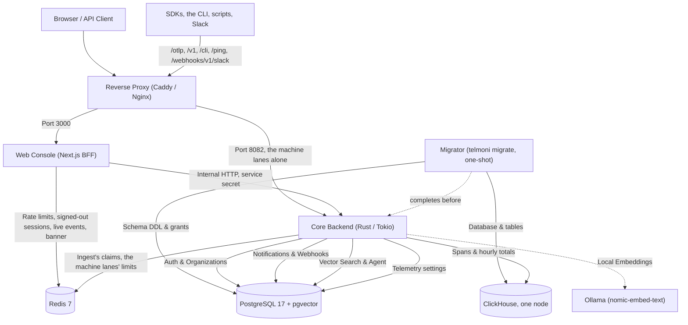

Telmoni open core runs on infrastructure you operate: the server, the console, PostgreSQL, ClickHouse and Redis. On Compose, the keys that seal each project's hashing key (`TELEMETRY_KEK`, required) and connector secrets (`CONNECTOR_KEK`) can be `local:` keys on your host. On Kubernetes, each is a Google Cloud KMS key — `TELEMETRY_KEK` always, and `CONNECTOR_KEK` for connectors, webhooks included — reached with the service account the GKE metadata server gives the server pods (Workload Identity), since a `local:` key is refused in a pod and a mounted key file is not read. Organization management, project scoping, audit logging and the activity feeds need nothing outside your network; mail goes to the SMTP server you configure, a sign-in through an identity provider goes to that provider, and a connector's deliveries go to its Slack or webhook destination. The AI agent reaches out: to the model, embeddings and rerank endpoints you configure, unless they run on your own hosts; and to download its models (on the chart, the embeddings pod pulls its model at every start while `embeddings.enabled` is on; on Compose, you pull Ollama's models once). The documentation it indexes is this deployment's own console's, fetched inside it.

## System architecture

The Telmoni deployment consists of seven components:

### Component breakdown

1. **Core Backend (`telmoni serve`)**: A single-binary Rust service built on Axum and Tokio. On port `8082` it serves the internal service API, only to callers carrying the service secret, so a person's every request enters through the web console; and the machine lanes, the one door machines use, reached through your reverse proxy ([Production → Reverse proxy](/docs/self-host/production#reverse-proxy-configuration)) or the chart's `server-api` Service: ingest at `/otlp/v1/traces`, where the SDKs send, and the read API under `/v1`, each to a caller with a project API key; the CLI's sign-in under `/cli/v1`, by its own device code and bearer; the ping lane at `/ping/v1/{ping_key}/{slug}`, which a crontab's `curl` reaches with the project's ping key in the URL and nothing else; and Slack's signed events at `/webhooks/v1/slack`. Its queries are scoped to one organization, and Row-Level Security (RLS) holds the database to that where its modules connect as the hardened roles (on the Compose quickstart they connect as the database's superuser, which RLS does not bind). It signs webhook payloads, dispatches notifications, and runs automated maintenance loops (retention purges, soft-deletion sagas, and an audit verification walk every 24 hours).
2. **Web Console (`telmoni/web`)**: A Next.js application that serves the dashboard, handles server-side session cookies (sealed with `AUTH_SECRET`), proxies authenticated requests to the backend server, and applies its own rate limits: per address on sign-in, sign-up and password reset, and per session on what a page does. The machine lanes' limits are the server's.
3. **PostgreSQL 17 with `pgvector`**: The primary relational store. Telmoni uses native partitioning for the audit ledger and the `vector` extension for semantic document search. In production, each server module (`auth`, `notifications`, `agent`, `telemetry`) connects as its own role, which `role_hardening.sql` makes `NOSUPERUSER` and `NOBYPASSRLS`; migrations run as a fifth role, `migrator`, which owns the tables and holds `BYPASSRLS`.
4. **ClickHouse**: The store for your agents' spans and their hourly totals: metadata alone, never a prompt or a completion. It is required, on one node, with no replication. Ingest writes a row per finished span, and the console reads them back as traces. Each read names the projects it may see, and a row policy holds the server's ClickHouse user to them; the migrator's user, which creates the tables and drops each day of spans past retention, is not held. Its configuration is `crates/telemetry/clickhouse/low-memory.xml`, which keeps it small enough to share a host.
5. **Redis 7**: An in-memory store used by the web console, for its sliding-window rate limits, its list of signed-out sessions, the channels behind the console's live event stream, and the announcement banner; and by the server, for the claim it holds on each export while writing it and for ingest's rate limits, per project and per address. On the `/v1` and `/cli` routes a rate-limit bucket is keyed by a SHA-256 digest of the bearer token, read as the lanes read it — however the header spells `Bearer` — and on `/ping` by a digest of the key in the path, taken only as it was minted, so neither is ever a Redis key; and an address by itself, or an IPv6 one by its /64. Rate-limit windows expire in milliseconds (`PEXPIRE`), and the Compose file runs Redis without disk snapshots (`--save ""`).
6. **Migrator (`telmoni migrate`)**: A one-shot CLI command packaged within the backend binary. It executes pending database migrations, applies the object grants, then creates ClickHouse's database and tables, before the server boots.
7. **AI Agent & Embeddings (Optional)**: Telmoni includes an embedded context assistant. An optional Ollama service serves `nomic-embed-text` embeddings; on Compose it can also serve a chat model you pull, and with the model and embeddings URLs on the `ollama` service, every endpoint the agent calls is on the Compose network once its models are downloaded. The chart's embeddings pod serves embeddings only. Hosted model providers (Anthropic, or an OpenAI-compatible endpoint such as Google's Gemini API) can be configured via environment variables.

---

## Production recommendations checklist

When moving from a local evaluation or single-node Docker quickstart to a production environment, follow these best practices:

- **Enterprise OIDC Authentication (Recommended)**: While the email and password setup (`ADMIN_EMAIL` / `ADMIN_PASSWORD`) is provided to bootstrap an instance quickly, we strongly recommend connecting an OpenID Connect (OIDC) identity provider: one that publishes its discovery document at `{issuer}/.well-known/openid-configuration` and signs ID tokens with RS256 or the algorithm `AUTH_CUSTOM_ID_TOKEN_SIGNED_RESPONSE_ALG` names. Once OIDC is tested, remove `ADMIN_EMAIL` and `ADMIN_PASSWORD` and disable the password form entirely via `AUTH_DISABLE_USERNAME_PASSWORD=true`, so that every sign-in goes through your provider and its own MFA policy.
- **Database roles & RLS**: Connect each module as its own role, never as a PostgreSQL superuser, and apply `crates/migrator/sql/role_hardening.sql`, which makes the `auth`, `notifications`, `agent` and `telemetry` roles `NOBYPASSRLS`. In ClickHouse, give the server and the migrator a user each, as the [Kubernetes guide](/docs/self-host/kubernetes) describes, so the row policy holds the server's.
- **Reverse Proxy with TLS**: Never expose internal ports `3000` or `8082` directly to the internet. Always terminate TLS using Caddy, Nginx, or a cloud Ingress controller, forwarding the console's host to `3000` and the machine lanes — `/otlp`, `/v1`, `/cli`, `/ping` and `/webhooks/v1/slack`, on a host of their own or on the console's — to `8082`, and nothing else of `8082` ([Reverse proxy configuration](/docs/self-host/production#reverse-proxy-configuration)).
- **Partition Maintenance**: On Compose, schedule `telmoni rotate` daily: it maintains the audit log's 4-month forward partition runway, and drops each day of spans past retention; the Helm chart runs it daily as a CronJob.
- **Encryption Key Retention**: `CONNECTOR_KEK` and `TELEMETRY_KEK` are each either a `local:` key, which is a secret to keep and back up alongside your database dumps, or a Cloud KMS key name, which is not a secret and cannot be dumped: never disable or destroy either key, or connector credentials stop decrypting and the user ids already stored stop matching the ones new spans would hash to.

---

## System requirements

- **Platform**: The published images are built for `linux/amd64` only. Building your own does not change that for the server, whose Dockerfile compiles for x86_64 alone.
- **Database**: PostgreSQL with the `vector` extension at pgvector 0.8 or later; the Compose stack runs `pgvector/pgvector:pg17`.
- **ClickHouse**: One node, reached over its HTTP interface; the Compose stack runs `clickhouse/clickhouse-server:26.8.19.9`. Its server must allow custom settings under the `SQL_` prefix, as it does unless `custom_settings_prefixes` is changed.
- **Redis**: One endpoint, shared by the console and the server; the Compose stack runs `redis:7-alpine`.
- **Sizing**: 4 GB of memory for the Compose stack with the agent off, and 8 GB when Ollama serves the agent's models on the same host. As the quickstart ships, its five containers take about 360 MiB idle and about 550 MiB after the console's first requests, with ClickHouse at about 230 MiB under a steady ingest and capped at 1.5 GiB (`mem_limit`), which it takes as its ceiling; the images take 2.5 GB of disk before any data. The Helm chart's default resource requests and limits for the server, console and embeddings pods are in `deploy/charts/telmoni/values.yaml`; the migration and rotation jobs' are fixed in `templates/migrator.yaml`, at 50m of CPU and 64 MiB requested and 256 MiB at most.

---

## Deployment methods

Choose the deployment workflow that fits your infrastructure:

<Cards>
  <Card title="Docker Compose" href="/docs/self-host/docker-compose">
    The recommended deployment method for single-node installations. Runs PostgreSQL, ClickHouse, Redis, the migration engine, the core server, and the web console with healthcheck dependencies.
  </Card>
  <Card title="Kubernetes & Helm" href="/docs/self-host/kubernetes">
    Deploy with the Helm chart in `deploy/charts/telmoni`; `highAvailability.enabled` adds an autoscaler and a disruption budget for the server and the console.
  </Card>
  <Card title="Self-hosted AI agent" href="/docs/self-host/agent">
    Configure local vector embeddings with Ollama, hybrid search, read-only tools, and documentation corpus indexing.
  </Card>
  <Card title="Production hardening" href="/docs/self-host/production">
    Configure enterprise OIDC, hardened PostgreSQL roles, automated partition rotation, and TLS reverse proxies.
  </Card>
</Cards>
